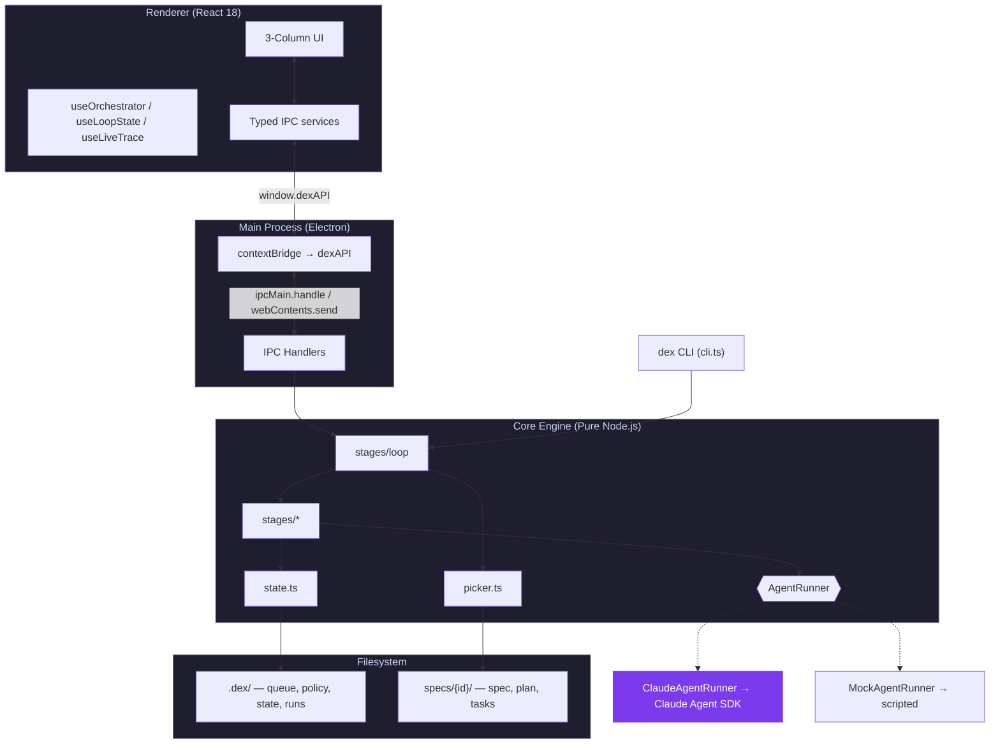

<p align="center">
  <picture>
    <source media="(prefers-color-scheme: dark)" srcset="docs/logo/logo-full-on-dark.png" />
    <source media="(prefers-color-scheme: light)" srcset="docs/logo/logo-full.png" />
    
  </picture>
</p>

<p align="center">
  <strong>Autonomous feature engine — fresh agents per stage, structured planning, full trace visibility.</strong>
</p>

<p align="center">
  
  
  
  
</p>

---

Dex is an Electron desktop app that automates feature implementation using the [Ralph Wiggum loop](https://ghuntley.com/ralph/) philosophy, the [Claude Agent SDK](https://docs.anthropic.com/en/docs/agents-and-tools/claude-agent-sdk), and [spec-kit](https://github.com/github/spec-kit). It spawns a fresh Claude Code agent per **stage** of work — each with clean context to prevent token bloat — while streaming every tool call, subagent spawn, and thinking step to a real-time trace UI.

## Why Dex? The Three-Pillar Synthesis

Each pillar alone has critical gaps. Dex exists because the combination eliminates what each one lacks:

| Used alone            | What breaks                                                                                                                                                                                     |
| --------------------- | ----------------------------------------------------------------------------------------------------------------------------------------------------------------------------------------------- |
| **Ralph Wiggum loop** | No structured specs — the agent picks tasks from a free-form TODO, builds the wrong thing, and burns budget. No UI, no abort, no cost tracking, no failure recovery beyond "kill the terminal." |
| **Spec-kit** | No autonomous loop — specs are great but someone has to manually run each phase, check results, and decide what's next. It's a sequential human-driven workflow. |
| **Claude Code (interactive)** | Single session degrades after ~100K tokens. No persistent memory across sessions. No structured planning. No verification beyond "it compiles." One task at a time, human-driven. |

**Dex fuses all three:**

- **Ralph's loop** provides context isolation and self-improvement — fresh `query()` per stage, learnings persist via filesystem
- **Spec-kit** provides structured planning — specs with acceptance criteria before any code is written, constitution-governed consistency
- **Claude Agent SDK** provides programmatic control — typed hooks, abort, MCP browser verification, session management

The result: describe a project, clarify it into a complete plan, then walk away. Dex autonomously specs, plans, implements, verifies (including browser E2E), and recovers from failures — feature by feature, stage by stage.

## Features

- **Stage-level orchestration** — one fresh agent per stage, so no session ever runs long enough to degrade
- **Structured handoffs** — agent boundaries that matter (manifest extraction) use JSON-schema-constrained output, not regex-parsed prose
- **Real-time agent trace** — streams tool calls, thinking blocks, subagent activity, and results as they happen
- **Spec-kit integration** — discovers specs in `specs/` or `.specify/specs/`, drives the `/speckit-*` skills
- **Queue and picker** — features live in `.dex/queue.json`; the next stage is chosen from the project's files alone, so new and existing projects run the same loop
- **Project-owned policy** — `.dex/policy.json` adds `deny` / `ask` rules, write roots and frozen files on top of the project's own Claude Code settings; an `ask` waits for a human
- **Pause that means pause** — Stop mid-cycle and Resume picks up at the next uncompleted stage, not the start of the cycle
- **Headless runner** — `dex run <projectDir>` runs the same loop from a terminal, with `--once`, `--dry-run` and `--status`
- **Pluggable agent backend** — the real Claude runner or a scripted mock, selected per project
- **Execution history** — every run persists to per-project JSON, readable with `cat` and `jq`
- **Frameless desktop UI** — custom title bar, 3-column layout (sidebar → task board → agent trace), Catppuccin-inspired dark theme

## The Loop

Dex works through a queue of features, `.dex/queue.json`. A new project fills it once, through clarification and manifest extraction; an existing project writes it by hand, or starts from the draft `dex queue init` proposes. Every entry then runs as a sequence of stages, one fresh agent each:

```text
new project only:  prerequisites → clarification → constitution → manifest_extraction
per queue entry:   brief → specify → clarify → plan → tasks → implement → verify
```

The **picker** chooses the next stage from the project's files alone — no AI decision and no remembered position. It takes the first entry that is not `done` or `skipped` and checks, in this order:

| Check                                                                 | Next stage                                        |
| --------------------------------------------------------------------- | ------------------------------------------------- |
| The brief file is missing and the entry has `generate`                | `brief`                                           |
| The spec folder (or its `spec.md`) is missing                         | `specify`                                         |
| `spec.md` has no `## Clarifications` section                          | `clarify`                                         |
| `plan.md` is missing                                                  | `plan`                                            |
| `tasks.md` is missing                                                 | `tasks`                                           |
| An in-scope task is unchecked                                         | `implement`, on the first task phase that has one |
| No verify record for the entry as it is now (`.dex/evidence/`)       | `verify`                                          |
| A passing verify record for the entry as it is now                   | the entry is `done`; go to the next entry         |

Stages listed in an entry's `skip` count as done. `verify` runs in a fresh agent that did not implement the work; when it fails, it appends a `## Phase N: Verify fixes V<k>` section to `tasks.md`, which sends the loop back to `implement`. A stuck entry — two `implement` runs that check no new task, or three failed verify rounds — pauses for the human. Re-planning is a human act: delete `plan.md` and `tasks.md`.

## Git

Dex makes no stage commits. Agents commit as the project's rules say, and Dex reports a stage that leaves the tree dirty instead of committing it.

- **New project** — Dex creates one `dex/<date>-<id>` branch for the run and never switches after that. Its only commit is the initial one, when prerequisites create a GitHub repository at the human's request.
- **Existing project** — Dex creates no branch, makes no commit and does not push on its own. It only switches to the branch an entry needs, right before a stage, and only when the tree is clean; a dirty tree pauses the run with a question.
- **Pull requests** — opt-in for both kinds of project (`openPullRequest` in `.dex/policy.json`), off by default.

`checkpoint/<name>` tags are a fixture convention for the example project, not something the app creates: `scripts/promote-checkpoint.sh` tags any commit, and `scripts/reset-example-to.sh <name>` restores it.

## Architecture



**Data flow:** user action → React UI → typed service → IPC → core orchestrator → `AgentRunner` → hooks capture steps → IPC events → React hooks → UI updates (real-time streaming).

**State never travels through a context window.** Each stage is a separate agent invocation that reads what it needs from disk and writes its results back. The project's files are the authoritative layer: the picker derives the position from them, and `state.json` keeps only what the files cannot say — run id and status, cost, attempt counters, pending questions and the configuration snapshot. Resume runs the picker again; there is no reconcile step.

## On-Disk Layout

Global (machine-wide):

```text
~/.dex/
├── logs/       per-run orchestrator tree, per-phase steps.jsonl
└── dev-logs/   dev-setup.sh captures (vite.log, electron.log)
```

Per-project (inside each opened project):

```text
<projectDir>/.dex/
├── queue.json             tracked — the features to build, one entry each
├── policy.json            tracked — settings sources, deny/ask rules, write roots, frozen files, limits
├── .gitignore             tracked — keeps the runtime files below out of git
├── state.json             runtime — run id, status, cost, counters, pending questions
├── questions.md           runtime — pending questions and approvals as plain text
├── runs/<runId>.json      runtime — one audit record per run
├── state.lock             runtime (PID)
├── ui.json                runtime (per-machine UI prefs)
├── dex-config.json        agent backend (`claude` or `mock`)
└── mock-config.json       mock-runner script
```

A project that still has the old `.dex/feature-manifest.json` is migrated to `queue.json` the first time Dex loads it.

There is no database. `007-sqlite-removal` retired `~/.dex/db/`; any pre-existing directory is removed on first launch.

```sh
jq '.totalCostUsd, (.phases | length)' .dex/runs/<runId>.json
```

## Quick Start

### Prerequisites

- **Node.js** >= 18
- **Claude Code CLI** installed and authenticated
- **GitHub CLI** (`gh`) for PR creation

### Installation

```bash
git clone https://github.com/lukaskellerstein/dex.git
cd dex
npm install
```

### Development

```bash
./dev-setup.sh
```

Starts the Vite dev server (port 5500) and launches Electron with hot reload. Logs go to `~/.dex/dev-logs/`.

### Production Build

```bash
npm run build:start
```

## Usage

1. **Open a project** — pick a directory from the welcome screen
2. **Describe it** — loop mode opens an interactive clarification session and writes the clarified goal
3. **Walk away** — the loop specs, plans, implements and verifies feature by feature
4. **Watch the trace** — tool calls, thinking blocks, and subagent activity stream in real-time
5. **Answer when asked** — a question with no recommended option, or a tool call the project marks `ask`, waits in the questions panel; a question with a recommended option is answered with it and kept for review

Stop is a pause, not a kill. Resume runs the picker again, so the run continues at the stage the files say is next.

Without the app, the same loop runs from a terminal (build with `npx tsc` first):

```bash
node dist/core/cli.js run <projectDir> --dry-run   # each remaining entry's next stage and full prompt; starts no agent
node dist/core/cli.js run <projectDir>             # run until the queue is complete or the run pauses
node dist/core/cli.js queue init <projectDir>      # propose a queue for an existing project
```

## Configuration

`RunConfig` (per run):

| Setting         | Description                                                                 | Default     |
| --------------- | --------------------------------------------------------------------------- | ----------- |
| `mode`          | `loop` (autonomous), `build` (implement existing specs), `plan` (plan only) | —           |
| `model`         | Claude model to use                                                         | `claude-opus-4-6` |
| `maxTurns`      | Max agent turns per stage                                                   | `75`        |
| `maxIterations` | Max iterations within a stage                                               | `50` (loop), `20` (build) |
| `taskPhases`    | `"all"` or specific phase numbers `[1, 3]`                                  | `"all"`     |
| `agent`         | Backend name — `claude` or `mock`                                           | `claude`    |

Budgets, turn limits and retry counts belong to the project: the `limits` field of `.dex/policy.json`. `.dex/dex-config.json` (per project) selects the default agent backend.

## Project Structure

```text
dex/
├── src/
│   ├── main/                    # Electron main process
│   │   ├── index.ts             # App lifecycle, BrowserWindow
│   │   ├── preload.ts           # contextBridge → window.dexAPI
│   │   ├── preload-modules/     # One API surface per domain
│   │   └── ipc/                 # Handler modules
│   ├── core/                    # Orchestration engine (pure Node.js, no Electron imports)
│   │   ├── stages/              # loop, run-stage, cycle-stages, post-stage, clarification, prerequisites, manifest-extraction, build
│   │   ├── agent/               # AgentRunner interface, ClaudeAgentRunner, MockAgentRunner, permissions
│   │   ├── cli.ts, cli/         # The headless `dex` CLI
│   │   ├── picker.ts            # Next stage from the project's files
│   │   ├── queue.ts             # .dex/queue.json + the feature-manifest migration
│   │   ├── policy.ts            # .dex/policy.json + the tool-call decisions
│   │   ├── state.ts             # .dex/state.json (runtime run state)
│   │   ├── parser.ts            # tasks.md → Phase[] with Task[]
│   │   ├── prompts.ts           # Prompt builders per stage
│   │   ├── runs.ts              # Per-run JSON audit records
│   │   └── git.ts               # Branch creation, PR generation
│   └── renderer/                # React 18 UI
│       ├── hooks/               # useOrchestrator, useLoopState, useLiveTrace, useRunSession, …
│       ├── services/            # Typed wrappers over window.dexAPI
│       ├── components/
│       │   ├── layout/          # AppShell, Topbar, WindowControls
│       │   ├── welcome/         # Project picker
│       │   ├── loop/            # Loop dashboard, stage list, question and approval cards
│       │   ├── queue/           # Queue panel
│       │   ├── task-board/      # Phase/task views
│       │   └── agent-trace/     # Step timeline, tool cards, subagent pills
│       └── styles/              # Catppuccin-inspired CSS custom properties
├── specs/                       # Spec-kit specs for Dex itself
├── docs/my-specs/               # Design briefs behind each spec
├── fixtures/                    # Mock-run scripts and the existing-project fixture
├── scripts/                     # check-size, fixture reset, checkpoint promotion, mock harness
├── dev-setup.sh
└── package.json
```

No file in `src/` exceeds 600 LOC. That limit is enforced in CI — see [Testing](#testing).

## Tech Stack

| Layer   | Technology                                                                             |
| ------- | -------------------------------------------------------------------------------------- |
| Desktop | Electron 41 (frameless BrowserWindow)                                                  |
| UI      | React 18, CSS Custom Properties, GSAP, Lucide React                                    |
| Engine  | Pure Node.js orchestrator, Claude Agent SDK `^0.3.318`                                 |
| Data    | Filesystem only — per-project JSON + git refs. No database.                            |
| Build   | Vite 6, TypeScript 5.6 (strict mode)                                                   |
| Test    | `node --test` (core), Vitest + Testing Library + jsdom (renderer)                      |
| Git     | GitHub CLI (`gh`) for automated PRs                                                    |

## Testing

```bash
npm test              # core tests + renderer tests + size guard
npm run test:core     # node --test, --experimental-strip-types
npm run test:renderer # vitest
npm run check:size    # fails above 600 LOC per file
```

Two mechanisms make it affordable to test an autonomous, nondeterministic, LLM-billed system:

- **Mock agent backend** — set `agent: "mock"` in `.dex/dex-config.json` and script the run in `.dex/mock-config.json` (`fixtures/mock/` holds ready-made scripts). A full multi-entry loop finishes in under a minute at zero API cost, producing the same artifacts a real run would; the mock commits each stage as `mock(<stage>): <entry>`, like an agent following the project's rules. `node dist/core/cli.js run <projectDir>` runs it headless.
- **Checkpoint replay** — `scripts/reset-example-to.sh <name>` restores the example project to any `checkpoint/*` tag, so a run boots straight into the stage you are actually changing instead of paying for everything upstream of it. `reset-example-to.sh list` prints the available save points; `scripts/promote-checkpoint.sh` tags any commit as a new one.

## Contributing

1. Fork the repository
2. Create your feature branch (`git checkout -b feature/amazing-feature`)
3. Commit your changes (`git commit -m 'Add amazing feature'`)
4. Push to the branch (`git push origin feature/amazing-feature`)
5. Open a Pull Request
