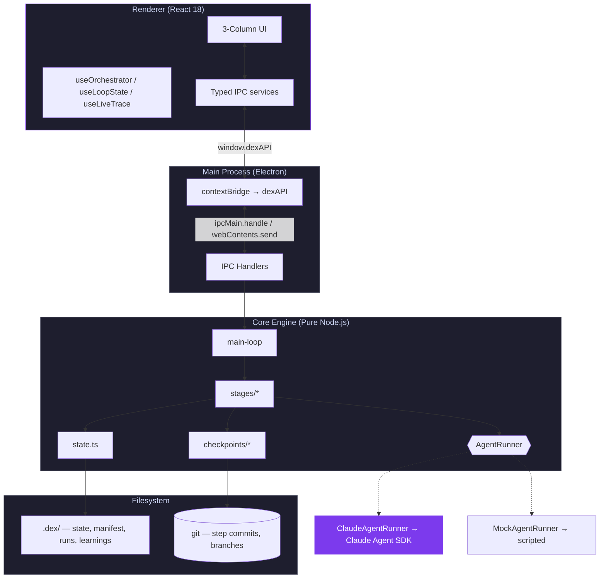

# Dex

<p align="center">
  
</p>

<p align="center">
  <strong>Autonomous feature engine — fresh agents per stage, structured planning, full trace visibility.</strong>
</p>

<p align="center">
  
  
  
  
</p>

---

Dex is an Electron desktop app that automates feature implementation using the [Ralph Wiggum loop](https://ghuntley.com/ralph/) philosophy, the [Claude Agent SDK](https://docs.anthropic.com/en/docs/agents-and-tools/claude-agent-sdk), and [spec-kit](https://github.com/github/spec-kit). It spawns a fresh Claude Code agent per **stage** of work — each with clean context to prevent token bloat — while streaming every tool call, subagent spawn, and thinking step to a real-time trace UI.

## Why Dex? The Three-Pillar Synthesis

Each pillar alone has critical gaps. Dex exists because the combination eliminates what each one lacks:

| Used alone | What breaks |
|---|---|
| **Ralph Wiggum loop** | No structured specs — the agent picks tasks from a free-form TODO, builds the wrong thing, and burns budget. No UI, no abort, no cost tracking, no failure recovery beyond "kill the terminal." |
| **Spec-kit** | No autonomous loop — specs are great but someone has to manually run each phase, check results, and decide what's next. It's a sequential human-driven workflow. |
| **Claude Code (interactive)** | Single session degrades after ~100K tokens. No persistent memory across sessions. No structured planning. No verification beyond "it compiles." One task at a time, human-driven. |

**Dex fuses all three:**

- **Ralph's loop** provides context isolation and self-improvement — fresh `query()` per stage, learnings persist via filesystem
- **Spec-kit** provides structured planning — specs with acceptance criteria before any code is written, constitution-governed consistency
- **Claude Agent SDK** provides programmatic control — typed hooks, abort, MCP browser verification, session management

The result: describe a project, clarify it into a complete plan, then walk away. Dex autonomously specs, plans, implements, verifies (including browser E2E), and recovers from failures — feature by feature, stage by stage.

## Features

- **Stage-level orchestration** — one fresh agent per stage, so no session ever runs long enough to degrade
- **Structured handoffs** — agent boundaries that matter (feature selection, gap analysis) use JSON-schema-constrained output, not regex-parsed prose
- **Real-time agent trace** — streams tool calls, thinking blocks, subagent activity, and results as they happen
- **Spec-kit integration** — discovers specs in `specs/` or `.specify/specs/`, drives the `/speckit-*` skills
- **Interactive timeline** — a branching DAG of every stage commit; click any node to jump there
- **Branch management** — remove a saved version, or promote one to main with merge conflicts resolved by an agent
- **Pause that means pause** — Stop mid-cycle and Resume picks up at the next uncompleted stage, not the start of the cycle
- **Pluggable agent backend** — the real Claude runner or a scripted mock, selected per project
- **Execution history** — every run persists to per-project JSON, readable with `cat` and `jq`
- **Frameless desktop UI** — custom title bar, 3-column layout (sidebar → task board → agent trace), Catppuccin-inspired dark theme

## The Loop

Loop mode runs a project as a sequence of discrete stages. Every completed stage produces a step commit on the run branch, so the whole run is replayable from git alone.

```text
prerequisites → create_branch → clarification → constitution → manifest_extraction
   ↓
   ├─ gap_analysis → specify → plan → tasks → implement → verify → learnings   (per cycle)
   ↓
completion
```

`gap_analysis` is the loop's brain. It emits exactly one decision per cycle:

| Decision | Meaning |
|---|---|
| `NEXT_FEATURE` | Start the next feature from the manifest |
| `RESUME_FEATURE` | Continue an in-flight feature from its spec dir |
| `RESUME_AT_STEP` | Re-enter a partially-completed cycle at a specific stage |
| `REPLAN_FEATURE` | The plan is wrong — regenerate plan + tasks |
| `GAPS_COMPLETE` | Nothing left in the manifest; terminate |

Feature selection itself does **not** call an LLM. `manifest_extraction` runs once and writes `.dex/feature-manifest.json`; every later cycle picks the first pending entry deterministically.

## Timeline

Every completed stage auto-commits with a two-line message — a human subject plus a machine-parseable `[checkpoint:<step>:<cycle>]` body:

```text
dex: plan completed [cycle:2] [feature:product-catalogue]
[checkpoint:plan:2]
```

The Timeline tab renders those commits as a branching DAG — one column per git ref, one node per stage — and a single left-click performs the right git operation: switch branch if the node is a branch tip, fork a `selected-<ts>` branch if it is mid-branch.

Three gestures, no git knowledge required:

- **Jump** — left-click any node to move the working tree there. If the tree is dirty, a confirm dialog offers Save (a normal `dex: pre-jump autosave` commit on the current branch) or Discard.
- **Remove this version** — delete a Dex-owned branch. If it carries steps that exist nowhere else, a confirmation lists them by plain-English label first. `main` and user-created branches have no remove control.
- **Make this the new main** — promote any saved version into the primary line. Content conflicts are handed to a one-shot agent per file, under a Read+Edit-only tool surface with an iteration cap, a cost cap, and the project's verify command as backpressure.

The branch namespace is deliberately small — two families and nothing else:

| Ref | Purpose |
|---|---|
| `dex/<date>-<id>` | One per autonomous loop run |
| `selected-<ts>` | Transient navigation fork from a mid-branch jump (auto-pruned when left empty) |

Named `checkpoint/<name>` tags still exist as a git-level convention, but the running app no longer creates them. They are minted out-of-band by `scripts/promote-checkpoint.sh` for CI fixtures and shared baselines, and travel via `git push --tags` like any other tag.

```sh
git log --oneline --grep='\[checkpoint:'   # every stage commit
git branch --list 'dex/*'                  # every run
```

## Architecture



**Data flow:** user action → React UI → typed service → IPC → core orchestrator → `AgentRunner` → hooks capture steps → IPC events → React hooks → UI updates (real-time streaming).

**State never travels through a context window.** Each stage is a separate agent invocation that reads what it needs from disk and writes its results back. `state.json` is a cache of what git already knows; git refs are the authoritative layer.

## On-Disk Layout

Global (machine-wide):

```text
~/.dex/
├── logs/       per-run orchestrator tree, per-phase steps.jsonl
└── dev-logs/   dev-setup.sh captures (vite.log, electron.log)
```

Per-project (inside each opened project):

```text
<projectDir>/.dex/
├── state.json             tracked — run state, rides git checkout on a jump
├── feature-manifest.json  tracked — extracted once, drives feature selection
├── learnings.md           tracked — accumulates across cycles
├── runs/<runId>.json      tracked — one audit record per run
├── state.lock             gitignored (PID)
├── ui.json                gitignored (per-machine UI prefs)
├── dex-config.json        gitignored (agent backend, conflict-resolver knobs)
└── mock-config.json       gitignored (mock-runner script)
```

There is no database. `007-sqlite-removal` retired `~/.dex/db/`; any pre-existing directory is removed on first launch.

```sh
jq '.totalCostUsd, (.phases | length)' .dex/runs/<runId>.json
```

## Quick Start

### Prerequisites

- **Node.js** >= 18
- **Claude Code CLI** installed and authenticated
- **GitHub CLI** (`gh`) for PR creation

### Installation

```bash
git clone https://github.com/lukaskellerstein/dex.git
cd dex
npm install
```

### Development

```bash
./dev-setup.sh
```

Starts the Vite dev server (port 5500) and launches Electron with hot reload. Logs go to `~/.dex/dev-logs/`.

### Production Build

```bash
npm run build:start
```

## Usage

1. **Open a project** — pick a directory from the welcome screen
2. **Describe it** — loop mode opens an interactive clarification session and writes the clarified goal
3. **Walk away** — the loop specs, plans, implements and verifies feature by feature
4. **Watch the trace** — tool calls, thinking blocks, and subagent activity stream in real-time
5. **Navigate the timeline** — jump back to any stage, remove versions you don't want, promote the one you do

Stop is a pause, not a kill. Resume re-enters at the next uncompleted stage of the same cycle.

## Configuration

`RunConfig` (per run):

| Setting | Description | Default |
|---------|-------------|---------|
| `mode` | `loop` (autonomous), `build` (implement existing specs), `plan` (plan only) | — |
| `model` | Claude model to use | SDK default |
| `maxTurns` | Max agent turns per stage | `200` |
| `maxIterations` | Max iterations within a stage | — |
| `taskPhases` | `"all"` or specific phase numbers `[1, 3]` | `"all"` |
| `maxLoopCycles` | Cycle ceiling for loop mode | — |
| `maxBudgetUsd` | Spend ceiling — loop stops when exhausted | — |
| `stepMode` | Pause after every stage, resume from the dashboard | `false` |
| `agent` | Backend name — `claude` or `mock` | `claude` |

`.dex/dex-config.json` (per project, gitignored) selects the default agent backend and configures the conflict resolver.

## Project Structure

```
dex/
├── src/
│   ├── main/                    # Electron main process
│   │   ├── index.ts             # App lifecycle, BrowserWindow
│   │   ├── preload.ts           # contextBridge → window.dexAPI
│   │   ├── preload-modules/     # One API surface per domain
│   │   └── ipc/                 # Handler modules
│   ├── core/                    # Orchestration engine (pure Node.js, no Electron imports)
│   │   ├── stages/              # main-loop, run-stage, clarification, prerequisites, build, finalize
│   │   ├── checkpoints/         # tags, commit, timeline, jumpTo, branchOps, syncState
│   │   ├── agent/               # AgentRunner interface, ClaudeAgentRunner, MockAgentRunner
│   │   ├── state.ts             # .dex/state.json + reconciliation
│   │   ├── gap-analysis.ts      # Loop decision parsing
│   │   ├── manifest.ts          # Feature manifest
│   │   ├── conflict-resolver.ts # AI merge-conflict resolution (014)
│   │   ├── parser.ts            # tasks.md → Phase[] with Task[]
│   │   ├── prompts.ts           # Prompt builders per stage
│   │   ├── runs.ts              # Per-run JSON audit records
│   │   └── git.ts               # Branch creation, PR generation
│   └── renderer/                # React 18 UI
│       ├── hooks/               # useOrchestrator, useLoopState, useLiveTrace, useRunSession, …
│       ├── services/            # Typed wrappers over window.dexAPI
│       ├── components/
│       │   ├── layout/          # AppShell, Topbar, WindowControls
│       │   ├── welcome/         # Project picker
│       │   ├── loop/            # Loop dashboard, stage list
│       │   ├── checkpoints/     # Timeline canvas, branch ops
│       │   ├── task-board/      # Phase/task views
│       │   └── agent-trace/     # Step timeline, tool cards, subagent pills
│       └── styles/              # Catppuccin-inspired CSS custom properties
├── specs/                       # Spec-kit specs for Dex itself
├── docs/my-specs/               # Design briefs behind each spec
├── scripts/                     # check-size, fixture reset, checkpoint promotion, mock harness
├── dev-setup.sh
└── package.json
```

No file in `src/` exceeds 600 LOC. That limit is enforced in CI — see [Testing](#testing).

## Tech Stack

| Layer | Technology |
|-------|-----------|
| Desktop | Electron 41 (frameless BrowserWindow) |
| UI | React 18, CSS Custom Properties, GSAP, Lucide React, d3-shape / d3-zoom / d3-selection |
| Engine | Pure Node.js orchestrator, Claude Agent SDK `^0.1.45` |
| Data | Filesystem only — per-project JSON + git refs. No database. |
| Build | Vite 6, TypeScript 5.6 (strict mode) |
| Test | `node --test` (core), Vitest + Testing Library + jsdom (renderer) |
| Git | GitHub CLI (`gh`) for automated PRs |

## Testing

```bash
npm test              # core tests + renderer tests + size guard
npm run test:core     # node --test, --experimental-strip-types
npm run test:renderer # vitest
npm run check:size    # fails above 600 LOC per file
```

Two mechanisms make it affordable to test an autonomous, nondeterministic, LLM-billed system:

- **Mock agent backend** — set `agent: "mock"` in `.dex/dex-config.json` and script the run in `.dex/mock-config.json`. A full multi-cycle loop finishes in under a minute at zero API cost, producing the same commits, branches and artifacts a real run would.
- **Checkpoint replay** — `scripts/reset-example-to.sh <name>` restores the example project to any `checkpoint/*` tag, so a run boots straight into the stage you are actually changing instead of paying for everything upstream of it. `reset-example-to.sh list` prints the available save points; `scripts/promote-checkpoint.sh` mints new ones.

## Contributing

1. Fork the repository
2. Create your feature branch (`git checkout -b feature/amazing-feature`)
3. Commit your changes (`git commit -m 'Add amazing feature'`)
4. Push to the branch (`git push origin feature/amazing-feature`)
5. Open a Pull Request
