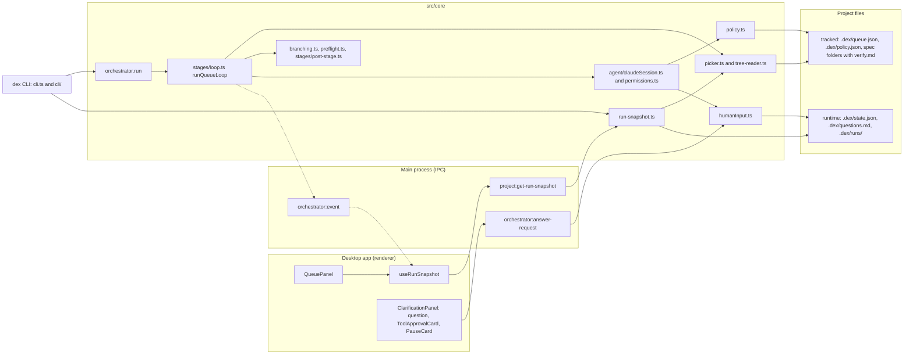
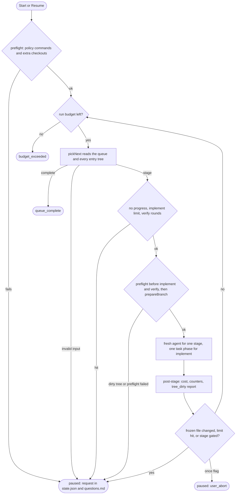
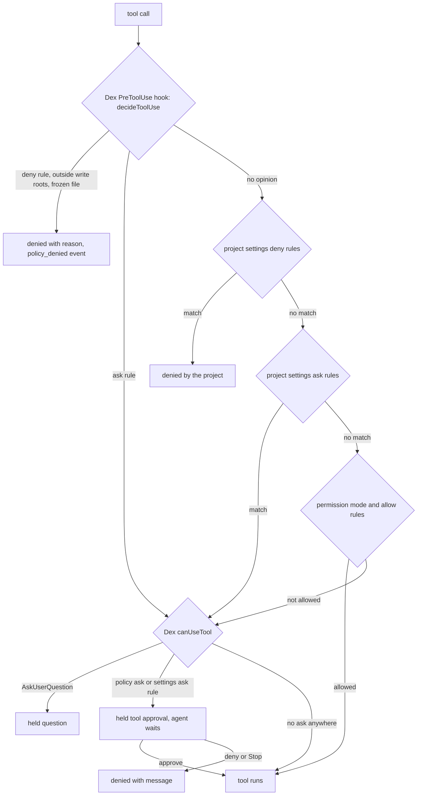

# Feature: Lean Core

> Branch: `015-lean-core` | Base: `main` | Commits: 4

## Overview

Dex shrinks to its loop. A **queue** of features (`.dex/queue.json`) replaces the feature manifest. A **picker** reads only the project's files to choose the next stage, and one fresh agent runs each stage. A **policy** the project owns (`.dex/policy.json`) is enforced on every tool call, on top of the project's own Claude Code settings, which agents now load instead of bypassing. A human is asked through one request queue that covers questions, tool approvals and pauses. The git time machine is deleted: checkpoint commits, timeline, jump-to-version, promote-to-main with the AI conflict resolver, and branch delete. So are agent profiles, the AI gap analysis and the state reconciler. Resume means "run the picker again", with nothing to repair first.

This also makes Dex usable on **existing projects**. You write a queue by hand or with `dex queue init`, and Dex works through it without committing, creating branches or pushing. It only switches to the branch an entry needs, and only when the tree is clean. A headless `dex` CLI runs the same core as the desktop app and can preview a run (`--dry-run`) without spending anything. **The size target was not met:** source went from 28,110 to 22,086 lines (−21.4%), which is 1,086 lines above the 21k goal (SC-007). See [Size and open items](#size-and-open-items).

Source of truth: [`specs/015-lean-core/`](../../../specs/015-lean-core/spec.md). [`research.md`](../../../specs/015-lean-core/research.md) records where the build differs from the plan (the phase gates and § R14).

## Architecture

### Components



`src/core` still imports nothing from Electron. The CLI runs it under plain Node from `dist/core/cli.js`, which shows it works without Electron.

### One pass of the loop



`cycleNumber` is now the entry's 1-based position in the queue, so the log tree (`phase-<cycle>_<step>/`) and `runs.ts` are unchanged.

### How the next stage is chosen (FR-001)

The picker takes the first entry that is not `done` or `skipped` and checks its files in this order. Stages listed in `skip` count as done. A `status` of `done` or `skipped` in `queue.json` is a human override; Dex never writes the queue during a run (research R2).

| Check (first match wins) | Decision |
|---|---|
| `brief` is set, the file is missing, `generate` is set | `brief` |
| `brief` is set, the file is missing, no `generate` | pause `invalid_input` |
| `<specDir>/spec.md` is missing | `specify` |
| `spec.md` has no `## Clarifications` section | `clarify` |
| `plan.md` is missing | `plan` |
| `tasks.md` is missing | `tasks` |
| the `tasks` filter names an id that `tasks.md` lacks | pause `invalid_input` |
| an in-scope task is unchecked | `implement` on the first task phase that has one |
| `verify.md` is missing, unparsable, failed, or carries another `Tasks-SHA256` | `verify` |
| `verify.md` passed for `sha256(tasks.md)` as it is now | entry `done`; next entry |

Which tree is read (research R3): a new project reads its working tree. An existing project reads the entry's branch: the working tree if that branch is checked out, else `git cat-file` on the ref. If the branch does not exist yet, the picker reads the base branch, where only `brief` and `specify` are allowed. The picker never switches branches.

### The permission chain (research R6)



The hook never returns `allow`, so the project's own deny and ask rules always run. The approval wait lives in `canUseTool`, not in the hook, because a hook times out after 600 s. `canUseTool` allows a call that nothing asked about. Without that, an untrusted folder, where the SDK skips the project's allow rules, would send every `ls` to a human (approved option A in `plan.md`).

### What changed from the previous architecture

| Concern | Before 015 | After 015 |
|---|---|---|
| Position in the run | a cursor in `state.json`, kept in step with checkpoint commits, reconciled on resume | derived from files by the picker; Resume runs the picker again |
| What runs next | AI gap analysis (resume, replan, resume-at-step) | the fixed decision table above; re-planning means a human deletes `plan.md` and `tasks.md` |
| Feature list | `.dex/feature-manifest.json` v2 | `.dex/queue.json` v3; a v2 manifest is migrated once |
| Git | a checkpoint commit and tag per stage, timeline, jump, promote with an AI conflict resolver | Dex commits nothing; agents commit as the project's rules say; an existing project only gets a clean-tree `git switch` |
| Permissions | `bypassPermissions`; the user's settings, hooks and ask/deny rules skipped | `settingSources` loaded, `default` mode; the policy's deny, ask, write roots and frozen files on top; bypass refused for an existing project |
| Checking the work | AI feature evaluation, verify-fix and learnings stages | a fresh `verify` agent writes `verify.md`; a failure appends a fix phase; counters pause a stuck entry |
| Questions | `autoClarification` picked the first option | an option labelled `(Recommended)` is taken and listed for review; otherwise the run waits |
| Entry points | the Electron app (and `scripts/run-mock-headless.mjs`) | the app and the `dex` CLI, over the same `run()` |
| UI state | built from events, with next-stage guessing (`NEXT_STAGE_AFTER`) | a snapshot re-read from disk on six stage-boundary events |
| Agent backends | variant profiles, Codex and Copilot runner kinds, worktree overlays | Claude and mock only |

## Changes Summary

The branch touches 207 files: about 15.6k lines added and 21.0k removed. Of the additions, about 1.5k are `package-lock.json` and 2.6k are the spec folder.

### New Files

| File | Purpose |
|---|---|
| `src/core/queue.ts` | Queue v3 types, strict validation, default resolution (`resolveEntries`), v2 manifest migration, atomic save, the scope rule (`isInScope`, `isFixPhase`) |
| `src/core/picker.ts` | `pickNext`, `describeQueue`, `readVerifyRecord`, `tasksHash`, the verify-round count |
| `src/core/tree-reader.ts` | Read-only trees: `workingTree(dir)` and `gitRef(dir, ref)` (`git cat-file -t` / `blob`, byte-exact) |
| `src/core/policy.ts` | Policy types and defaults, `parsePolicy`, `loadPolicy`, the bypass refusal, pure `decideToolUse` |
| `src/core/humanInput.ts` | Replaces `userInput.ts`. One request queue (question, tool approval, pause) with the answer book, the review list and `.dex/questions.md` |
| `src/core/branching.ts` | `dirtyFiles` (Dex's runtime files never count), `isTreeClean`, `prepareBranch` |
| `src/core/preflight.ts` | `policy.preflight` commands (`bash -c`, 60 s timeout) and `policy.repos` clean-checkout checks |
| `src/core/queue-init.ts` | `dex queue init`: a first `kind: "existing"` queue from `specs/*` and `docs/my-specs/*`, plus a default policy and `.dex/.gitignore` |
| `src/core/run-snapshot.ts` | State, queue view with per-entry cost, and validation errors; one read for the app and `dex run --status` |
| `src/core/cli.ts` | The `dex` entry point and exit codes |
| `src/core/cli/args.ts` | Argument parsing |
| `src/core/cli/describe.ts` | `--dry-run` and `--status` output |
| `src/core/cli/run.ts` | Resume-or-start, the event printer, TTY and no-TTY human input |
| `src/core/cli/terminal.ts` | Terminal prompts for questions and tool approvals |
| `src/core/stages/loop.ts` | `runQueueLoop`, replacing `main-loop.ts` |
| `src/core/stages/post-stage.ts` | Replaces `finalize.ts`: `recordStage`, frozen, gate, limit, progress and verify-round checks |
| `src/core/agent/claudeSession.ts` | One SDK `query()` session for `runStep` and `runTaskPhase`; `buildQueryOptions(policy)` |
| `src/core/agent/permissions.ts` | `preToolUseDecision` and `makeCanUseTool`, testable without the SDK |
| `src/renderer/hooks/useRunSnapshot.ts` | Re-reads the snapshot on stage-boundary events; `startActionFor`, `queueProgress` |
| `src/renderer/components/queue/QueuePanel.tsx` | One row per entry (status, next stage, task phase, cost), queue and policy errors, answers given by default |
| `src/renderer/components/loop/ToolApprovalCard.tsx` | Held tool call: tool, subject, input, source, Approve or Deny with an optional reason |
| `src/renderer/components/loop/PauseCard.tsx` | The pause a run ended on; Continue is Resume |
| `scripts/loc-by-area.sh` | Lines of source per area (research R14) |
| `scripts/smoke-stage.mjs` | Runs one real agent stage with no orchestrator (the SDK upgrade check) |
| `fixtures/mock/new-project.json` | Mock script for a whole new-project queue |
| `fixtures/mock/existing-project.json` | Mock script for the existing-project fixture |
| `fixtures/mock/verify-fails-once.json` | Mock script where `verify` fails once, then passes |
| `fixtures/existing-project/` | `queue.json`, `policy.json` and a half-done `specs/900-fixture-a/` |

### Modified Files

| File | Changes |
|---|---|
| `src/core/orchestrator.ts` | Separate paths for new and existing projects; Resume runs the queue loop; no reconcile |
| `src/core/run-lifecycle.ts` | Loads the policy; no run branch for an existing project; a PR only with `openPullRequest` |
| `src/core/state.ts` | State v2: run id, status, cost, counters, pending requests, the config snapshot. 759 → 262 lines; reconcile and drift removed |
| `src/core/prompts.ts` | One builder per stage (R11); one implement prompt that says "commit as this project's rules say"; a verify prompt that carries `Tasks-SHA256`; learnings, gap and evaluation prompts removed |
| `src/core/stages/cycle-stages.ts` | Now `runImplement` and `runVerify` |
| `src/core/stages/prerequisites.ts` | Check-only for an existing project: no `git init`, no `specify init`, no repo creation |
| `src/core/stages/manifest-extraction.ts` | Writes `queue.json` v3 |
| `src/core/stages/run-phase.ts`, `run-stage.ts` | Scope filter and the project's commit rule; build mode uses the loop's implement prompt; no finalize call; `featureSlug` is the entry id |
| `src/core/stages/build.ts` | A queued spec folder keeps its entry's `tasks` scope in build mode |
| `src/core/stages/clarification.ts` | Skipped when the queue already exists (it used to check for existing specs) |
| `src/core/agent/ClaudeAgentRunner.ts` | A thin adapter over `claudeSession.ts` (101 lines); `runOneShot` removed |
| `src/core/agent/MockAgentRunner.ts`, `MockConfig.ts` | Fixtures keyed by entry id; ticks tasks, writes `verify.md` and briefs, commits `mock(<stage>): <entry>`, honours Stop, can ask questions |
| `src/core/agent/AgentRunner.ts`, `steps.ts` | Profiles and `OneShot*` removed; `limitHit` replaces the SDK subtype; the cost table uses current prices and matches the longest prefix first |
| `src/core/git.ts` | `branchExists`, `switchBranch`, `isTrackedAtHead`, `frozenChangesSince` (argument lists, no shell) |
| `src/core/events.ts`, `types.ts` | See [API Changes](#api-changes) |
| `src/core/config.ts` | `once` and `LOOP_DEFAULTS` added; budget, cycle, retry and step-mode fields removed |
| `src/core/dexConfig.ts` | `conflictResolver` removed |
| `src/main/ipc/orchestrator.ts`, `project.ts` | `answer-request` and `get-run-snapshot` |
| `src/main/index.ts`, `preload.ts`, `preload-modules/*` | Handler and API registration |
| `src/renderer/App.tsx`, `AppRouter.tsx`, `layout/AppShell.tsx`, `layout/Topbar.tsx` | Timeline, tabs and branch-ops wiring removed; the run snapshot is passed down to the loop views |
| `src/renderer/components/loop/LoopDashboard.tsx`, `StageList*.ts(x)`, `CycleTimeline.tsx`, `phases/LoopPhase.tsx` | Queue panel added; the cycle count and placeholders come from the queue (`b0f5082`) |
| `src/renderer/components/loop/ClarificationPanel.tsx` | Question, tool-approval and pause cards |
| `src/renderer/hooks/useUserQuestion.ts` | Held approvals, `answer-request`, restore after a reload while the run is live |
| `src/renderer/hooks/useLoopState.ts`, `useOrchestrator.ts`, `buildLoopStateFromRun.ts`, `useProject.ts`, `useRunSession.ts` | No stage guessing, one history rebuild, no `dexStatus` polling |
| `scripts/reset-example-to.sh`, `prune-example-branches.sh`, `trigger-mock-via-cdp.mjs` | `$HOME` instead of a hard-coded `/home/lukas`; the `selected-*` branch family dropped |
| `scripts/check-size.sh` | Allow-list entries for the deleted timeline files removed |
| `package.json` | SDK upgrade, `bin.dex`, `d3-*` removed |
| `README.md`, `docs/SOLUTION.md`, `docs/FINAL_PLAN.md`, `.claude/CLAUDE.md`, `.claude/rules/06-testing.md`, `docs/tests/dex-ecommerce/004-pause-resume-each-step.md` | Rewritten for the queue, the policy and the CLI |

### Removed Files

| File | What it did |
|---|---|
| `src/core/checkpoints/` (10 files), `src/core/checkpoints.ts` | Checkpoint commits and tags, the timeline, jump-to-version, branch ops, state sync |
| `src/core/conflict-resolver.ts` | The AI merge-conflict resolver for promote-to-main |
| `src/core/agent-profile.ts` | Variant agent profiles |
| `src/core/gap-analysis.ts`, `src/core/stages/cycle-gap-analysis.ts` | The AI gap analysis |
| `src/core/stages/main-loop.ts`, `finalize.ts`, `cycle-failure-policy.ts` | The old cycle loop and its finalize step |
| `src/core/manifest.ts` | The v2 feature manifest; the migration now lives in `queue.ts` |
| `src/core/userInput.ts` | Replaced by `humanInput.ts` |
| `src/main/ipc/checkpoints.ts`, `profiles.ts`, `lock-utils.ts`, `logger.ts`; `src/main/preload-modules/checkpoints-api.ts`, `profiles-api.ts` | IPC for the removed features |
| `src/renderer/components/checkpoints/` (19 files), `layout/TopTabBar.tsx`, `services/checkpointService.ts`, `services/profilesService.ts` | Timeline, branch-ops UI and their services |
| `scripts/run-mock-headless.mjs`, `test-014-cdp.mjs`, `validate-mock-config.mjs` | Replaced by `dex run`, or stale |
| `docs/tests/branch-management/` (7 files), `docs/tests/dex-ecommerce/002-delete-branch.md`, `003-fork-branch-and-continue.md`, `docs/my-specs/01X-state-reconciliation/` | Test plans and a brief for the removed features |
| Tests of removed code | `checkpoints`, `jumpTo`, `branchOps`, `conflictResolver`, `timelineLayout`, `agentProfile`, `gap-analysis`, `finalize`, `runOneShot`, `checkpointService` |

The older [Branch Management](../branch-management/README.md) doc describes features this branch removed. It stays as a record and carries a note saying so.

### Configuration Changes

`.dex/policy.json` is new, tracked in the project's git, and owned by the project. A missing file means every default applies. A file that does not parse, or has an unknown field, makes Dex refuse to start.

| Key | Description | Default |
|---|---|---|
| `settingSources` | Which Claude Code settings agents load | `["user", "project", "local"]` |
| `permissionMode` | Agent permission mode; `bypassPermissions` is refused for an existing project | `"default"` |
| `env` | Extra environment for every agent | `{}` |
| `deny` | `{tool, pattern, reason}` rules; a regex on the call's subject (the whole Bash command, the absolute file path, the URL) | `[]` |
| `ask` | Same shape; a match holds the call for a human | `[]` |
| `writeRoots` | The only paths `Edit`, `Write`, `MultiEdit` and `NotebookEdit` may target | `["."]`, plus the OS temp folder |
| `frozen` | Globs of files no agent may change once committed | `[]` |
| `preflight` | Commands that must exit 0 before the run and before each `implement` and `verify` | `[]` |
| `repos` | Globs of extra checkouts that must be clean | `[]` |
| `systemPromptAppend` | A Markdown file appended to the Claude Code preset system prompt | `null` |
| `questions` | `recommended-then-review` or `wait` | `"recommended-then-review"` |
| `openPullRequest` | Push and open a PR when the queue completes | `false` |
| `limits` | `maxBudgetUsdPerStage`, `maxBudgetUsdPerRun`, `maxTurnsPerStage`, `maxImplementRunsWithoutProgress`, `maxVerifyRounds` | `2` and `3` for the last two; the others unset |

Other configuration:

| Key | Description | Default |
|---|---|---|
| `.dex/mock-config.json` | An `entries` map keyed by entry id (with a `"*"` fallback) replaces `dex_loop.cycles[]`. The loader refuses the old shape | — |
| `.dex/dex-config.json` `conflictResolver` | Removed | — |
| `RunConfig` | `once` added; `maxLoopCycles`, `maxBudgetUsd`, `maxVerifyRetries`, `maxLearningsPerCategory` and `stepMode` removed. Limits come from the policy only | — |
| `SPECIFY_FEATURE_DIRECTORY` | Set in the agent's environment for every spec-kit stage, so Dex never writes the tracked `.specify/feature.json` (research R5) | the entry's `specDir` |
| `GIT_BRANCH_NAME` | Set for `specify` in an existing project, so spec-kit creates the branch with the queue's exact name | the entry's `branch` |
| `package.json` `bin.dex` | The CLI entry point | `dist/core/cli.js` |

## API Changes

### CLI

```text
dex run <projectDir> [--once | --dry-run | --status] [--agent mock|claude]
dex queue init <projectDir>
```

| Mode | Behaviour |
|---|---|
| none | Resumes when `.dex/state.json` exists, else starts; runs until the queue completes or the run pauses |
| `--once` | One stage (one task phase for `implement`), then pauses `user_abort` |
| `--dry-run` | For every remaining entry: the decision, the branch move, the env, the SDK options, the system prompt and the full prompt. Starts no agent and writes nothing |
| `--status` | The run snapshot: state, cost, each entry's derived status, and what waits for a human |

With a TTY, questions and tool approvals are asked in the terminal. Without one, a held request is parked in `state.json` and `.dex/questions.md`, and the run pauses. The next `dex run` with a TTY asks the parked requests first and stores the answers in the answer book.

| Exit code | Meaning |
|---|---|
| 0 | Queue complete, or `--once`, `--dry-run` or `--status` finished |
| 1 | The run failed, or any `error` event was emitted |
| 2 | Usage error, or an invalid or refused queue or policy |
| 3 | The run paused and needs a human |

### IPC channels

| Channel | Change | Shape |
|---|---|---|
| `orchestrator:answer-request` | Added; replaces `orchestrator:answer-question` | `(requestId, RequestAnswer) => void` |
| `project:get-run-snapshot` | Added | `(projectDir) => RunSnapshot` (`state`, `queue`, `errors`) |
| `checkpoints:*` (13 channels) | Removed | — |
| `profiles:list`, `profiles:saveDexJson` | Removed | — |

### Orchestrator events

| Change | Events |
|---|---|
| Added | `stage_decision`, `policy_denied`, `tool_approval_request`, `request_resolved`, `tree_dirty` |
| Changed | `paused` now carries a `PauseReason` and a `detail`; `loop_terminated` reasons are `queue_complete`, `user_abort`, `paused`, `budget_exceeded`, `failed` |
| Removed | `step_candidate`, `head_changed`, `loop_reset`, `state_reconciling`, `state_reconciled`, the four `conflict-resolver:*` events, `verify_failed`, `manifest_drift_detected`, `clarification_question` |

The renderer re-reads the snapshot on `run_started`, `step_started`, `step_completed`, `paused`, `run_completed` and `loop_terminated`. The live trace (`agent_step`, `subagent_*`) stays event-driven.

## Data Model Changes

Every entity is a file. "Tracked" files live in the project's git; "runtime" files are listed in `.dex/.gitignore` and never count as a dirty tree.

| File | Tracked | Written by |
|---|---|---|
| `.dex/queue.json` (v3) | yes | the human, `dex queue init`, manifest extraction, the v2 migration; never during a run |
| `.dex/policy.json` | yes | the human (or `dex queue init`, with every default spelled out) |
| `specs/<id>/verify.md` | yes | the `verify` agent |
| `.dex/state.json` (v2) | no | Dex |
| `.dex/questions.md` | no | Dex, regenerated on every request change |
| `.dex/runs/<runId>.json` | no | Dex (`runs.ts`, unchanged) |

- **Queue v3.** `{version: 3, kind: "new" | "existing", entries}`. An entry has `id`, `title` and optionally `description`, `status` (`done` or `skipped`, human-owned), `brief`, `generate` (`{sources, instructions}`), `specDir` (default `specs/<id>`), `branch` (default `<id>`, or the run branch for a new project), `baseBranch` (default: the previous entry's branch, else the current branch), `tasks` (ids and ranges such as `T122-T134`), `skip` and `gates` (default `["brief"]` when `generate` is set). Unknown fields are rejected.
- **Migration.** When `queue.json` is missing and `.dex/feature-manifest.json` exists, `loadQueue` writes a `kind: "new"` queue once and keeps `completed` as `status: "done"`. The manifest file stays. A dry run and the snapshot migrate in memory only.
- **State v2.** It holds only what files cannot say: `runId`, `status`, `pauseReason` and `pauseDetail`, `kind`, `runBranch`, `current`, `cumulativeCostUsd`, per-entry `implementRunsWithoutProgress`, `pendingRequests`, `reviewList`, `answerBook`, and the config snapshot. A file with any other version reads as absent, because position comes from files.
- **Pause reasons.** `user_abort`, `gate`, `question`, `tool_approval`, `dirty_tree`, `frozen_changed`, `preflight_failed`, `limit_reached`, `no_progress`, `invalid_input`.
- **`verify.md`.** Dex parses three header lines: `**Verdict**: passed|failed`, `**Tasks-SHA256**: <64 hex>` and `**Checked**: <ISO-8601>`. Dex computes the hash right before the stage, and the agent copies it verbatim. On failure the agent appends `## Phase <max+1>: Verify fixes V<k>` to `tasks.md`; the phase number stays numeric so the parser and `--phase N` keep working. Verify rounds are counted from those phases, so the count survives a reset.

## Dependencies

| Package | Version | Purpose |
|---|---|---|
| `@anthropic-ai/claude-agent-sdk` | `^0.3.318` (was `^0.1.45`, lockfile 0.1.77) | Upgraded first, before any deletion (FR-047). It brings the hook `ask` → `canUseTool` routing the permission chain needs, `modelUsage` totals, and `TaskCreate`/`TaskUpdate` in place of `TodoWrite` (Dex now re-parses `tasks.md` on write) |
| `zod` `^4`, `@anthropic-ai/sdk`, `@modelcontextprotocol/sdk` | peers of the SDK | Installed by npm with the SDK |
| `d3-selection`, `d3-shape`, `d3-zoom` and their `@types/*` | removed | Used only by the timeline |

The SDK now ships a native per-platform binary (about 320 MB on darwin-arm64) instead of a bundled `cli.js`. That does not affect development, but a packaged Electron build would need it outside the asar.

## Testing

Final run (2026-11-05, after the T106 cycle-count fix): `npm test` gave core 201 pass, renderer 58 pass and `check:size` pass. `npm run typecheck` was clean. `nvim-tools --json --all` added no finding against the Phase 0 baseline.

```bash
npm test                     # core (node --test) + renderer (vitest) + check:size
npm run typecheck            # all three tsconfigs
npm run build                # tsc + vite build; emits dist/core/cli.js for the steps below
bash scripts/loc-by-area.sh  # size per area
grep -rn bypassPermissions src   # only policy.ts (the refusal) and its test
```

New core suites: `picker`, `queue`, `queue-init`, `tree-reader`, `policy`, `humanInput`, `branching`, `preflight`, `loop`, `failure-policy`, `existing-project`, `cli`, `run-snapshot`, `agent/runner-options` and `agent/claudeSession`. New renderer suites: `useRunSnapshot`, `QueuePanel`, `ToolApprovalCard`, `ClarificationPanel` and `buildLoopStateFromRun`.

Key end-to-end scenarios, all under the mock agent at zero cost, on scratch clones of `~/Projects/Github/lukaskellerstein/dex-ecommerce` ([`quickstart.md`](../../../specs/015-lean-core/quickstart.md)):

| Scenario | Quickstart | Expected |
|---|---|---|
| New project, whole queue | § 2 | exit 0, every entry `done`, no `[checkpoint:` or `dex:` commit |
| Stop during `implement`, then Resume | § 3 | the same entry and task phase runs next |
| Reset to a mid-run commit, then Resume | § 4 | continues from the stage the files imply, with no repair step |
| Existing project: entry A from `implement` with a task filter, entry B from `specify` on base A | § 5 | exit 0; the only new branch is spec-kit's `901-fixture-b`; every new commit is `mock(…)`; out-of-scope `T006` stays open |
| Picker, queue and policy tables | § 6 | 73 cases pass |
| Live UI (T106, electron-playwright) | — | queue rows follow every stage; a question card survives a reload; a gate pauses with the pause card and Continue resumes; no Timeline, promote, delete or profile control anywhere |

## Size and open items

**SC-007 is not met.** The target was 21k lines or fewer (at least 25% smaller). The result at the end of the branch is 21,876, which is 22.2% smaller (22,086 at the T110 measurement; a later cut removed `uiPrefs.ts` and 13 exports that nothing called). Counted as non-test `.ts`/`.tsx` under `src/`, after the biome format pass (research § R14):

| Area | Baseline (`7ec23aa`) | After | Change |
|---|---:|---:|---:|
| core | 11,740 | 9,586 | −2,154 (−18%) |
| main | 1,104 | 524 | −580 (−53%) |
| renderer | 15,266 | 11,766 | −3,500 (−23%) |
| **total** | **28,110** | **21,876** | **−6,234 (−22.2%)** |

The additions came out larger than the ~1,900 lines estimated: the CLI is about 610 lines, plus the snapshot path and the approval UI. The brief's open decision 8 applies: decide after the dogfood run whether to cut further. One candidate is the renderer's event-built stage history (`useLoopState` plus `buildLoopStateFromRun`, about 400 lines), which could read the run record through the snapshot instead.

The live checks ran on `claude-haiku-5-5` with a stage budget cap, for about $0.08 in all:

- **T012**: one real `specify` stage on the 0.3 SDK wrote `spec.md` with the preset system prompt, for $0.013 in 36 s (`scripts/smoke-stage.mjs`).
- **T067**: a project-settings `ask` rule for `git push` now reaches the approval card. The first run found that the SDK reports a plain rule-forced ask as `decisionReasonType: "rule"`, not as `matchedAskRule`, so Dex had allowed the push. After the fix the card held the command, nothing reached the remote, and the agent reported the denial.

Known gap: a settings `ask` rule that matches only one part of a compound command (`git add -A && git push`) is still allowed. The SDK reports that call the same way as a compound command that matches no rule. A policy `ask` rule catches it, because its pattern is a regex over the whole command (research § R6).

Still open in `tasks.md`: **T112, T113**, the dogfood run on `onion-demo-01`, first `--dry-run` for owner sign-off (SC-009), then the first real `specify` (SC-010).

Seen but not changed: reloading the renderer returns to the welcome screen while the run goes on, because the open project lives in renderer state. The pending request survives the reload.
