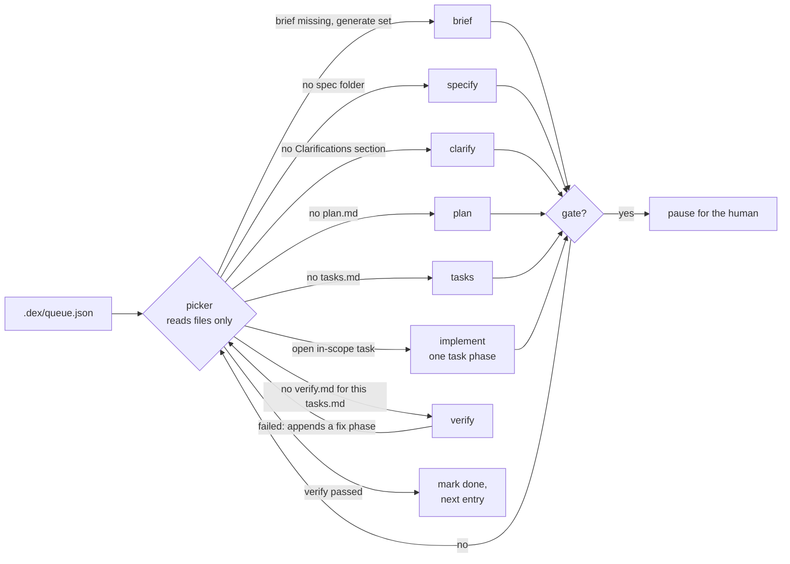

# 015 — Lean core: keep the loop, drop the time machine, run on existing projects

> **Status:** draft v1.0 · 2026-11-04 · the brief for spec-kit. Feature, branch and spec folder: `015-lean-core`.
>
> **Supersedes** `01X-state-reconciliation` (never numbered). Once the next stage is derived from files, there is no second state machine left to reconcile.
>
> **First real user:** `onion-demo-01` ([Appendix A](#appendix-a--first-real-user-onion-demo-01)). This spec is done when Dex runs that project's queue.
>
> **How to start:** commit this brief on `main`, start `claude -w 015-lean-core` in this repo, run `/speckit-specify` with this file as the feature description, then the usual clarify → plan → tasks → implement.

## Why

Dex does one valuable thing: it drives spec-kit through fresh agent sessions, stage by stage, and shows what each agent does. Most of the code does something else.

| Area | Source lines | Specs that built it |
|---|---|---|
| Git time travel: stage checkpoint commits, timeline DAG, jump, `selected-*` forks, promote-to-main with an AI conflict resolver | ~5.9k: core `checkpoints/` 2.0k, `conflict-resolver.ts` 0.3k, `main/ipc/checkpoints.ts` 0.5k, `components/checkpoints/` 3.1k | 002, 008, 009, 010, 012, 013, 014 |
| Keeping `state.json` in step with git: `reconcileState`, `detectStaleState`, `resolveWorkingTreeConflict`, `syncStateFromHead` | most of `state.ts` (759) | 006, 01X |
| Variant agent profiles: Codex/Copilot runner kinds, worktree overlays | `agent-profile.ts` 268, plus the profiles IPC, preload and service | 010 |
| LLM gap analysis deciding RESUME / REPLAN / RESUME_AT_STEP | `gap-analysis.ts` + `stages/cycle-gap-analysis.ts` 373 | 003, 006 |
| **The loop itself:** stages, prompts, task parser, Claude and mock runners | **~5.5k** | 001, 003, 005 |

Today: 28.1k lines of source (core 11.7k, renderer 15.3k, Electron main 1.1k) and 5.0k lines of tests, 2.5k of which test the time machine.

Three problems follow from that.

1. **Every feature pays for time travel.** `state.json` rides git checkouts, so every stage must commit, every jump must re-sync, and every new feature must keep three views agreeing: `state.json`, git, and the renderer's own event log. 01X records all three disagreeing after a single Stop.
2. **Dex can only start new projects.** The entry is a goal file → clarification → constitution → manifest. A project that already has specs, briefs, branch conventions and its own Claude Code setup has no way in. `build` mode implements existing specs, but it has no loop, no verify and no queue.
3. **It runs with no brakes.** `ClaudeAgentRunner` sets `permissionMode: "bypassPermissions"` and `settingSources: ["project"]`. The user's hooks and every `ask`/`deny` rule are skipped, `canUseTool` allows everything, and the PreToolUse hook returns `allow`. That's acceptable on `dex-ecommerce`. It isn't on a project where the agent can deploy to a shared cluster.

## What Dex is after this spec

A queue of features, a picker that reads the project's files to choose the next stage, one fresh agent per stage, a policy the project owns, and a human who is asked only when it matters.

### D-015-1 — The next stage comes from the project's files, never from history

The picker takes the first queue entry that isn't `done` or `skipped` and checks, in this order:

| Check | Next stage |
|---|---|
| The `brief` file is missing and the entry has `generate` | `brief` |
| The spec folder is missing | `specify` |
| `spec.md` has no `## Clarifications` section | `clarify` (it always writes the section, even with no questions) |
| `plan.md` is missing | `plan` |
| `tasks.md` is missing | `tasks` |
| An in-scope task is unchecked | `implement`, on the first task phase that has one |
| `verify.md` is missing, or records a different `tasks.md` hash | `verify` |
| `verify.md` says passed for the current `tasks.md` hash | mark the entry `done` in the queue and move on |

Stages listed in the entry's `skip` are treated as done.

What this buys:

- Stop is a pause, and Resume means running the picker again.
- Resetting the project to any commit, for example with the `reset-example-to.sh` fixtures, resumes correctly with nothing to repair.
- Re-planning is a human act: delete `plan.md` and `tasks.md`, and the picker plans again.

`state.json` stops being tracked in git. It keeps only what files can't say: run id and status, cost, attempt counters, pending questions, the config snapshot.

### D-015-2 — Dex never commits, branches or pushes on its own in an existing project

Agents commit as the project's rules say. Dex drops the `[checkpoint:<step>:<cycle>]` stage commits and `finalizeStageCheckpoint`. In an existing project it also drops the `dex/<date>-<id>` run branch (`createBranch`, called at `run-lifecycle.ts:78` and `orchestrator.ts:338`) and the end-of-run `git push -u` + `gh pr create` (`createPullRequest`, `run-lifecycle.ts:303`).

Dex does only two things with branches:

- before `specify`, it makes sure the project is on the entry's `baseBranch`, switching to it if the tree is clean;
- before any later stage, it switches to the entry's `branch` (spec-kit created it) if the tree is clean.

If a switch is needed and the tree is dirty, the run pauses with a question. After each stage Dex reports a dirty tree in the trace; it doesn't commit it.

A new project keeps its one `dex/<date>-<id>` run branch. Opening a PR becomes opt-in (`openPullRequest`) for both kinds of project.

### D-015-3 — The project owns the policy, and Dex enforces it in code

The policy lives in `.dex/policy.json`, tracked in the project's git.

| Field | Meaning | Default |
|---|---|---|
| `settingSources` | Which Claude Code settings load | `["user", "project", "local"]` |
| `permissionMode` | SDK permission mode | `"default"`; `bypassPermissions` is refused for an existing project |
| `env` | Extra environment for every agent | `{}` |
| `deny` | `{tool, pattern, reason}` regexes, checked in the PreToolUse hook | `[]` |
| `ask` | Same shape; a match holds the tool call for the human | `[]` |
| `writeRoots` | The only paths Edit, Write and NotebookEdit may target | `["."]` plus the OS temp dir |
| `frozen` | Files no agent may change once they're committed | `[]` |
| `preflight` | Shell commands that must exit 0 before a run, and before each `implement` and `verify` | `[]` |
| `repos` | Extra git checkouts (globs) that must be clean; shown in the status panel | `[]` |
| `systemPromptAppend` | A Markdown file appended to every agent's system prompt (Claude Code preset + append) | none |
| `questions` | `"recommended-then-review"` or `"wait"` (D-015-6) | `"recommended-then-review"` |
| `openPullRequest` | Push and open a PR at the end of the run | `false` |
| `limits` | `maxBudgetUsdPerStage`, `maxBudgetUsdPerRun`, `maxTurnsPerStage`, `maxImplementRunsWithoutProgress` (2), `maxVerifyRounds` (3) | as shown |

Enforcement:

- **PreToolUse, all tools.** A `deny` match is denied with its reason and emitted as a `policy_denied` event. Edit, Write and NotebookEdit are checked against `writeRoots` and `frozen`. An `ask` match goes to the approval flow below. With no opinion, the hook returns `{}`. Returning `allow`, as today, would skip the project's own permission rules.
- **canUseTool.** The SDK calls it when the project's settings say `ask`. Today it auto-allows. After this spec it goes to the human: the UI or the CLI shows the tool call, the human approves or denies, and the agent waits. `AskUserQuestion` keeps its current interception.
- **After each stage.** Every `frozen` file is compared with the commit the entry started from; any change pauses the run.

`deny` and `ask` patterns match the whole Bash command string, so chained commands (`cd x && git push -f`) and `bash -c "…"` are covered. This is a guardrail against an agent's mistakes, not a sandbox against a hostile one. The rules engine is a pure module (`policy.ts`) with no SDK import, tested from tables.

### D-015-4 — One queue for both kinds of project

The feature manifest becomes the queue: `.dex/feature-manifest.json` v2 becomes `.dex/queue.json` v3. Dex reads v2 and migrates it. A new project still fills the queue through `manifest_extraction`. An existing project writes it by hand, or with `dex queue init`, which lists `specs/*` and `docs/my-specs/*` and proposes entries for the human to edit.

| Entry field | Meaning |
|---|---|
| `id` | Also the spec folder name and branch name unless overridden, e.g. `021-agent-entry` |
| `title`, `description` | Shown in the queue panel; `description` goes into `specify` |
| `status` | `pending`, `active`, `done` or `skipped` (written by Dex) |
| `brief` | Path to the brief, the source of truth for every stage |
| `generate` | Optional `{sources: [paths], instructions}`: write the brief first |
| `specDir`, `branch` | Optional; default `specs/<id>` and `<id>` |
| `baseBranch` | Optional; default is the previous entry's `branch`, else the current branch |
| `tasks` | Optional scope filter for `implement`, e.g. `["T110", "T122-T134"]` |
| `skip` | Optional stages that are already done or not wanted |
| `gates` | Stages after which the run pauses for approval, e.g. `["brief"]` |

### D-015-5 — Stage prompts that work in an existing project

- **`brief`** writes the entry's brief from `generate.sources`, using the previous entry's brief as the format example. It is gated by default.
- **`specify`** runs `/speckit-specify` with `GIT_BRANCH_NAME=<branch>` and `SPECIFY_FEATURE_DIRECTORY=<specDir>`, so spec-kit's git extension uses the exact names. The prompt says the brief is the source of truth.
- **`clarify`** runs `/speckit-clarify` in autonomous mode. It answers each question from the brief, the repo and its docs, and records the question and answer in the spec. It asks the human only when nothing in the repo answers the question *and* a wrong guess would cost more than a day.
- **`plan`** and **`tasks`** run the spec-kit commands as today. The picker writes `.specify/feature.json` for the entry before these stages.
- **`implement`** works as `run-phase.ts` does today (`/speckit-implement <spec> --phase N`). It adds the in-scope task ids when `tasks` is set, and replaces Dex's own commit line with "commit as this project's rules say".
- **`verify`** runs a fresh agent that didn't do the implementing. It reads the brief's Acceptance/DoD and the spec's success criteria, runs the acceptance commands, and never edits code. It writes `specs/<id>/verify.md`: the verdict, the `tasks.md` hash it checked, and each command with its exit code. On failure it appends `## Phase Vn: verify fixes` to `tasks.md` with concrete tasks.
- **`learnings`** is dropped (open decision 2). The implement prompt already asks the agent to update `CLAUDE.md` with what it learned.

### D-015-6 — Questions have defaults

Agents ask through `AskUserQuestion`, which Dex already intercepts. In `recommended-then-review` mode, a question with a recommended option is answered with it, the run goes on, and the question is listed for the human to review. A question with no recommended option waits for the human. `wait` mode waits on every question. Pending questions persist in `state.json`, as today, and in `.dex/questions.md` for the CLI. `autoClarification` stays as it is for the new-project entry.

### D-015-7 — Failure policy without an LLM

Dex keeps two counters per entry in `state.json`: implement runs that checked no new task, and verify rounds. When either reaches its limit (`maxImplementRunsWithoutProgress`, `maxVerifyRounds`), the run pauses with a question. This replaces the REPLAN decisions and the LLM feature evaluation (`buildFeatureEvaluationPrompt`).

### D-015-8 — A headless runner

`dex run <projectDir> [--once] [--dry-run] [--status]` runs on the same core; `src/core` has no Electron imports already. It builds on `scripts/run-mock-headless.mjs`.

- `--dry-run` prints the picker's decision and the full prompt for every remaining entry without starting an agent.
- Questions and tool approvals prompt on the terminal. Without a terminal, the run pauses and writes `.dex/questions.md`.

### D-015-9 — The UI keeps what you use while a run goes

The UI keeps the project picker, the run controls with a queue panel (entry, stage, task phase, cost), the task board, the agent trace, and the questions panel, which now also handles tool approvals.

It loses the timeline, branch operations, conflict-resolver progress, the Try-N-ways remnants and profiles. The renderer re-reads `state.json` and the queue on every stage event instead of building its own state from events, which closes the class of bug 01X describes.

### D-015-10 — Upgrade the SDK first

Dex pins `@anthropic-ai/claude-agent-sdk` `^0.1.45` (0.1.77 installed); npm's current release is 0.3.318. Upgrade in Phase 0 and fix what breaks before deleting anything, so SDK churn doesn't mix into the later diffs. Read the SDK changelog for changes to `query()` options, hook output types and `canUseTool`.

## Files

### Delete

- **core:** `checkpoints/` (all of it), `checkpoints.ts`, `conflict-resolver.ts`, `agent-profile.ts`, `gap-analysis.ts`, `stages/cycle-gap-analysis.ts`, and `stages/finalize.ts` (replaced by a short post-stage function: update state, emit, check `frozen`, check gates). From `state.ts`: `reconcileState`, `detectStaleState`, `resolveWorkingTreeConflict`, `lastCommit`, `artifacts`.
- **main:** `ipc/checkpoints.ts`, `ipc/profiles.ts`, and their preload modules.
- **renderer:** `components/checkpoints/`, `services/checkpointService.ts`, `services/profilesService.ts`, and the timeline and profile parts of `App.tsx`, `LoopDashboard.tsx` and `StageList.logic.ts`.
- **events:** `step_candidate`, `head_changed`, `state_reconciling`, `state_reconciled`, `loop_reset`. Check each for other consumers first.
- **tests:** `checkpoints`, `jumpTo`, `branchOps`, `conflictResolver`, `timelineLayout`, `agentProfile` and `checkpointService` (2.5k lines). `gap-analysis` and `finalize` tests are replaced by picker and post-stage tests.
- **scripts:** `test-014-cdp.mjs`. Keep `reset-example-to.sh`, `promote-checkpoint.sh` and `prune-example-branches.sh` as fixture tools, trimmed to the branch families that still exist.

### Add

- **core:** `queue.ts` (load, migrate v2 → v3, save), `picker.ts` (D-015-1), `policy.ts` (D-015-3, pure), `stages/brief.ts`, `cli.ts` with a `dex` bin entry in `package.json`.
- **renderer:** `components/queue/QueuePanel.tsx`, and tool approvals in the existing questions panel.

### Change

- `agent/ClaudeAgentRunner.ts`: options come from the policy; the PreToolUse hook stops returning `allow`; `canUseTool` goes to approvals.
- `stages/main-loop.ts`: becomes the picker loop. This also pays off its KNOWN DEBT note (`runMainLoop` over 120 lines).
- `stages/cycle-stages.ts`: writes `verify.md`, appends the fix phase, drops learnings.
- `stages/run-phase.ts`: the task filter, and the project's commit rule instead of Dex's commit line.
- `stages/prerequisites.ts`: in an existing project, check only. Never `git init`, `specify init --force` or repo creation.
- `run-lifecycle.ts`: no run branch or PR in an existing project.
- `prompts.ts`, `state.ts`, `agent/MockAgentRunner.ts` and `agent/MockConfig.ts`: the new stages, so a whole queue runs under the mock at zero cost.
- The `.gitignore` block Dex writes (today `checkpoints/gitignore.ts`): `state.json`, `runs/` and `questions.md` are ignored; `queue.json` and `policy.json` are tracked.

## Implementation order

After every phase, `npm test` and `npm run typecheck` pass and a mock loop on `dex-ecommerce` finishes.

0. **Baseline.** Record lines of source per area and a mock-run trace on `dex-ecommerce`. Upgrade the SDK (D-015-10) and run one real `specify` stage on `dex-ecommerce`.
1. **Delete the time machine** (Files → Delete). Stage commits go and agents commit. Until Phase 2, resume uses `lastCompletedStep`.
2. **Queue and picker** replace the manifest and the gap analysis. Delete the reconcile code; resume is now the picker. Add picker tests over fixture folders: one per row of the D-015-1 table, plus the task filter, `skip`, gates and the v2 → v3 migration.
3. **Policy and permissions** (D-015-3), with table tests. `ClaudeAgentRunner` stops using `bypassPermissions`.
4. **The existing-project entry:**
   - `dex queue init`;
   - branch handling;
   - gates;
   - the brief stage;
   - autonomous clarify;
   - `verify.md` with the fix phase;
   - the failure policy;
   - check-only prerequisites.
5. **Headless CLI** (D-015-8).
6. **UI** (D-015-9): the queue panel, approvals, deleting dead components, and the renderer re-reading state. This can run in parallel with Phase 7.
7. **Dogfood on `onion-demo-01`** (Appendix A). First `dex run --dry-run` over the whole queue, and the owner reviews the printed prompts. Then the first real stage, 021 `specify`, with the owner watching.

## Verification (DoD)

- [ ] `npm test`, `npm run typecheck` and `npm run check:size` pass.
- [ ] A mock loop on `dex-ecommerce` (new-project entry) runs every feature to `done`. Stop and Resume during `implement` continues on the same task phase.
- [ ] After `reset-example-to.sh <checkpoint>`, Resume continues from the files with no repair step.
- [ ] Picker tests pass, one per D-015-1 row, plus the task filter, `skip`, gates and migration.
- [ ] Policy tests pass for `deny`, `ask`, `writeRoots`, `frozen` and the no-opinion `{}`. One live check shows that a project `settings.json` `ask` rule reaches the approval panel instead of running.
- [ ] Existing-project fixture: a copy of `dex-ecommerce` with a hand-written queue runs to `done` under the mock. The queue has one entry starting at `implement` with a task filter, and one at `specify` with a `baseBranch`. The run creates no `dex/*` branch, no Dex commit and no push.
- [ ] `grep -rn bypassPermissions src` finds nothing outside the refusal check.
- [ ] Lines of source after this spec versus the Phase 0 baseline, by area, go in the PR description. Target: 21k or less (−25%), with the rest of the weight left in the renderer.
- [ ] `dex run --dry-run` on `onion-demo-01` prints one decision and one prompt per queue entry, and the owner signs off before any real stage.

## Out of scope

- An Ink TUI. A status board can come later on top of the CLI.
- Parallel features or parallel task phases.
- Codex and Copilot runners.
- Mirroring a feature branch into sibling repos. Projects that need it, like `onion-demo-01`'s rule 05, keep it in their own rules; Dex only checks that `repos` are clean.
- Merging a finished entry into the default branch.

## Open decisions

The proposed default is in bold.

1. **UI:** **keep Electron, slimmed (D-015-9), plus the CLI** | CLI only for now.
2. **Learnings stage:** **drop** | keep as an optional stage.
3. **New-project entry** (clarification → constitution → manifest): **keep, writing the queue** | drop it.
4. **Questions default for an existing project:** **`recommended-then-review`** | `wait`.
5. **What's tracked in the project's git:** **only `queue.json` and `policy.json`** | everything, as today.
6. **Codex/Copilot kinds and variant profiles:** **delete** | keep the type for later.
7. **The 01X brief:** **delete its folder in Phase 1** | keep it with a superseded banner.
8. **If 21k lines still feels heavy:** **decide after the dogfood run**; the next cut would be the loop UI (3.4k).

## Appendix A — first real user: onion-demo-01

`~/Projects/Github/onion-ai-eu/onion-demo-01`. These are the facts that shaped this brief:

- **Seven repos.** A workspace meta-repo plus seven sibling repos under `workload/`, each with its own `.git` and gitignored by the workspace. A feature's branch name is mirrored into each sibling it touches.
- **spec-kit with the git extension.** One branch per feature, overridable with `GIT_BRANCH_NAME`. Briefs live in `docs/my-specs/<id>/README.md`, specs in `specs/<id>/`.
- **Its own Claude setup.** `.claude/` holds rules and hooks. A worktree guard makes the main checkout read-only for agents unless `CLAUDE_NO_WORKTREE` is set. `settings.json` has `ask` rules for `kubectl delete`, `helm uninstall`, `terraform apply` and `git push --force`, among others.
- **The checkout.** Dex runs in the main checkout, because the sibling clones don't exist in a worktree. Nobody else edits that checkout while Dex runs.
- **Owner authorization.** On 2026-11-04 the owner authorized the loop to commit and deploy. Releases are cut by pushing a `platform-v*` tag, which CI turns into an image, so "deploy" includes a non-force push of the feature branch and of release tags.

### Queue: `onion-demo-01/.dex/queue.json`

| id | Starts at | Scope | baseBranch | Gates |
|---|---|---|---|---|
| `020-onion-thin-layer` | `implement` (`skip`: brief to tasks) | `tasks`: T110, T122–T134 (US7 labels on an unmapped warehouse table, plus Trino access rules first cut). US5 except T110, US6 and US8 stay parked; US8 moves to 022 | — (already on it) | — |
| `021-agent-entry` | `specify` | the brief `docs/my-specs/021-agent-entry/README.md` | `020-onion-thin-layer` | — |
| `022-…` Month 2, installable pilot | `brief` (`generate`) | see sources below | `021-agent-entry` | `brief` |
| `023-…` Month 3, production | `brief` (`generate`) | see sources below | `022-…` | `brief` |
| `024-…` Month 4, Chat | `brief` (`generate`) | see sources below; waits on the G4 model decision | `023-…` | `brief` |

The brief sources for 022–024, relative to `onion-demo-01`:

- `../executive-management/product/first-paying-customer/index.html`: the plan, section 3 for the month's features;
- `../executive-management/product/first-paying-customer/demo-coverage.html`: §3 for features by month, §6 for the build order;
- `docs/my-specs/021-agent-entry/README.md`: the format example, and its table "Where the v2.0 phases went";
- `demo/gap-report.md`;
- for 022, also `specs/020-onion-thin-layer/tasks.md` T135–T144 (US8).

### Policy: `onion-demo-01/.dex/policy.json`

- **`settingSources`** `["user", "project", "local"]`; **`permissionMode`** `"default"`; **`env`** `{"CLAUDE_NO_WORKTREE": "1"}`.
- **`deny`**, each with its reason:
  - git: `git push` with `--force`, `-f`, `--force-with-lease`, `--delete`, `--mirror` or `--tags`, or a `+`/`:` refspec; any push to `main`/`master`; `git branch -d/-D/--delete`; `git tag -d`; `git reset --hard`; `git clean -f`; `git merge`; `git rebase`; `git worktree`; `--no-verify`;
  - kubectl: `kubectl delete`; `kubectl apply|create|replace|patch|edit|scale|drain|cordon|taint`, because helm is the only deploy path (exception: `kubectl create job --from=`); `kubectl config use-context|set-context|delete-context`;
  - contexts and namespaces: any `--context`/`--kube-context` not starting with `onion-demo-01`; `helm install|upgrade` with a namespace outside `listovna`, `postara`, `severobanka`, `auth`, `audit`, `redpanda`;
  - helm: `helm uninstall|delete|rollback`;
  - terraform: any subcommand other than `validate|plan|show|output|fmt`;
  - the management cluster: anything naming `mgmt-01` or `rancher.cellarwood.org`;
  - secrets: `sops -d|decrypt|edit|exec-env`; `scripts/secrets.py` (any subcommand); reading `.agent-token` anywhere except inside `$(cat .agent-token)`; `scripts/agent-token.sh` without its stdout redirected;
  - other: `ssh`; `docker system prune`; `gh pr merge|close`; `gh repo delete|edit`; `gh release delete`; `gh secret`; `gh variable`; `rm -r` outside the workspace.
- **Allowed without a rule:**
  - commits on feature branches;
  - a non-force push of the current feature branch and of `platform-v*` and other release tags;
  - `gh workflow run`;
  - `helm upgrade --install` into the namespaces above.
- **`writeRoots`**: `["."]` plus the temp dir. `../executive-management` stays read-only.
- **`frozen`**: `workload/onion-poc-report/thresholds.md`, `workload/onion-poc-report/claim*.md`, and `workload/onion-poc-report/*-thresholds.md` once committed.
- **`preflight`**:
  - `kubectl config current-context` starts with `onion-demo-01`, and `kubectl get ns` answers within 15 s on the LAN or the `-remote` context (rule 01);
  - the workspace and every repo in `repos` are clean.
- **`repos`**: `workload/*`, `workload/sectors/*`, `workload/tenants/*`.
- **`systemPromptAppend`** points to `.dex/loop-rules.md`, which carries:
  - the owner's standing authorization (commit and deploy, 2026-11-04);
  - "the owner is not watching: ask only when the brief, the repo and its docs can't answer, and a wrong guess costs more than a day";
  - a sibling's feature branch starts from the previous entry's branch when that exists, because nothing is merged between entries; this deviates from rule 05 and is logged in `onion-platform/IMPLEMENTATION-LOG.md`;
  - never fill in a login form; a Cloudflare Access login is a human step, so ask.
- **`openPullRequest`**: `false`.
