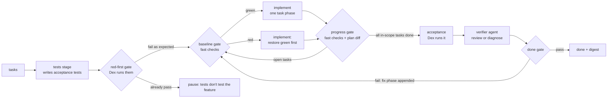

# 016 — Grounded loop: tests and checks decide, not the agent

> **Status:** draft v1.0 · 2026-11-05 · the brief for spec-kit. Feature, branch and spec folder: `016-grounded-loop`.
>
> **Builds on** [`015-lean-core`](../015-lean-core/README.md): the queue, the picker, the policy and the CLI.
>
> **Changes to 015:**
> - amends D-015-1 (adds a `tests` row; the done check becomes a gate);
> - amends D-015-5 (`verify`);
> - replaces D-015-7 (the failure counter).
>
> **First real run:** the first grounded real run, on a scratch clone of `dex-ecommerce`, happens at the end of this spec (Phase 8).
>
> **Followed by** [`017-living-docs`](../017-living-docs/README.md): the project's docs become the loop's lasting memory, and the digest gains a lessons review.

## Why

After 015, Dex counts progress by the boxes an agent ticked in `tasks.md`, and calls an entry done when the verify agent returns `passed: true`. In both cases the agent grades its own work. Three sources say that isn't enough.

- **The progress mirage** ([arXiv 2607.25152](https://arxiv.org/abs/2607.25152), 2026).
  - Over 54 cycles, a frontier agent claimed improvement every time, but 56% of the cycles changed nothing or made things worse.
  - A judge reading the full artifacts and the diff still accepted real regressions 44% of the time, and rejected 38% of real improvements. A stronger judge didn't close the gap.
  - Where success could be checked from outside the agent, the mirage dropped to zero.
- **Anthropic's long-running harness** ([Nov 2025](https://www.anthropic.com/engineering/effective-harnesses-for-long-running-agents)).
  - Agents declared victory early, and marked features done after only unit tests or `curl`.
  - End-to-end testing "as a human user would", in a browser, significantly improved results.
  - The feature list was JSON that agents could only flip to `passes`; removing or editing tests was called "unacceptable".
- **Backpressure** ([Dasith, 2026](https://dasith.me/2026/06/14/backpressure-in-coding-agent-harnesses/)).
  - Sensors measure; gates decide.
  - A check the agent can skip creates no backpressure.
  - Run cheap deterministic sensors first and model judgment later.
  - A flaky gate teaches people to bypass it.

So testing belongs in the loop in two roles:

1. **Tests are written as their own stage**, by an agent that doesn't implement. They're the oracle, written before the code exists.
2. **Tests and checks are run by Dex**, outside the agent, and Dex alone decides whether a gate passed. What an agent says about its own work is input to that decision, never the decision itself.

## Operating model

| Gate | When | Sensors Dex runs | Passes when | On failure |
|---|---|---|---|---|
| **red-first** | after `tests` | the acceptance command | at least one test aimed at this entry fails, by an assertion and not by a crash or collection error | already green → pause: "the tests pass before the feature exists"; crash → run `tests` again |
| **baseline** | before every `implement` and `verify` | fast checks | all green | the stage prompt becomes "restore green first, no new tasks", with the evidence |
| **progress** | after every `implement` run | fast checks, `tasks.md` diff, test-file diff | at least one newly ticked in-scope task, checks green, plan and tests intact | the run doesn't count as progress; the next run gets the evidence |
| **done** | after `verify` | the acceptance command(s), then the verifier agent | acceptance green **and** no blocking finding from the verifier | the verifier appends a fix phase; back to `implement` |

## Decisions

### D-016-1 — Dex runs the sensors; an agent's claim is input, never the verdict

A sensor is a command the project declares: `checks` in the policy, `acceptance` in a queue entry, or the acceptance command the `tests` stage records.

- **Running.** Dex runs sensors in its own process, not through an agent, each with a timeout. It records exit code, duration and the last 200 lines of output in `.dex/evidence/<id>/<stage>-<n>.json`, keyed by HEAD and the `tasks.md` hash.
- **Done.** The picker's done check becomes "the done gate passed at the entry branch's current HEAD". A later commit invalidates it, and the picker verifies again.
- **Gate logic** is a pure module (`gates.ts`): evidence in, decision out. Its tests are table-driven.

### D-016-2 — A `tests` stage writes the oracle before the code

The stage runs after `tasks` and before the first `implement`. Its fresh agent is not the implementer. It writes acceptance tests from the spec's success criteria, the brief's Acceptance/DoD and the plan's contracts. The tests sit at the feature's boundary: a CLI, an HTTP API, the UI through Playwright, or the project's own evidence tool. They don't unit-test code that doesn't exist yet; unit tests stay inside the implement tasks, where spec-kit's test-first ordering already puts them.

The stage returns structured output:

- the test files;
- the acceptance command;
- which success criterion each test covers.

Dex records the command as the entry's acceptance sensor and the files as the entry's frozen test set, then runs the red-first gate.

An entry with nothing to test at a boundary sets `skip: ["tests"]`. It then needs an `acceptance` command in its queue entry. If it has none, it can't pass the done gate, and the picker pauses with a question instead of guessing.

### D-016-3 — Acceptance tests are frozen; only the human or the test author changes them

During `implement` and `verify`, the PreToolUse hook denies any edit, move or delete of the entry's frozen test files. This is 015's `frozen` mechanism with a set per entry.

If the implementer thinks a test is wrong, it asks through `AskUserQuestion` with the reason, and Dex adds the "approve amendment" and "reject" options. An approved amendment re-runs the `tests` stage, scoped to that test, as the test author and not as the implementer. Even in `recommended-then-review` mode, a test amendment is never auto-answered; it waits for the human.

### D-016-4 — Backpressure: fast checks after every implement run, a baseline before every stage

`checks.fast` in the policy is a list of `{name, command, timeoutSec}`, run cheapest first; every check runs, so the evidence is complete.

- **Progress** means at least one newly ticked in-scope task, plus green fast checks, plus an intact plan (D-016-6). Ticked boxes with red checks don't count.
- **Baseline:** before every `implement` and `verify`, Dex runs the fast checks. If they're red, the stage's prompt is "restore green first, no new tasks" and includes the evidence. This is Anthropic's `init.sh`-plus-smoke-test ritual, run by Dex instead of trusted to the agent.

### D-016-5 — Verify is Dex's acceptance run plus an independent verifier

1. Dex runs the acceptance command or commands first.
2. **If acceptance is red,** the verifier runs in *diagnose* mode. It reads the evidence and the diff Dex collected, and appends `## Phase Vn: verify fixes` to `tasks.md` with concrete tasks.
3. **If acceptance is green,** the verifier runs in *review* mode. It checks the work against the spec and the brief, and works the feature end to end "as a user would" when the policy sets `verify.browser` (Playwright MCP). Its findings carry a `blocking` or `minor` severity.
4. **The done gate** is acceptance green **and** no blocking finding. The verifier can block an entry; it can't pass one on its own.

In both modes the verifier may write only `tasks.md`: a write scope for that stage (D-016-6).

### D-016-6 — Each stage gets its own write scope, and Dex checks the plan

The policy's `writeRoots` gains per-stage scopes:

| Stage | May write |
|---|---|
| `tests` | test paths (`testGlobs`) and its own spec folder |
| `implement` | anything in `writeRoots` except the frozen test set |
| `verify` | `tasks.md` only |

After every `implement` run, Dex compares `tasks.md` with its state at the start of the stage. Only checkbox flips are allowed; a removed, reworded or renumbered task pauses the run. Deleting or renaming a file that matches `testGlobs` pauses the run. A new skip or xfail marker in the diff (`@pytest.mark.skip`, `.skip(`, `xit(`, …) is reported in the digest, not blocked.

### D-016-7 — Stall detection on evidence (replaces D-015-7)

Each implement run gets a fingerprint: the names of the failing checks, the first error line of each, and the hash of the run's diff. If a run produces the same fingerprint as the one before, it brought no new information. After two such runs, the run pauses with the evidence. `maxImplementRunsWithoutProgress` and `maxVerifyRounds` stay as upper limits.

### D-016-8 — Flaky sensors are reported, not obeyed

A red check is re-run once (`checks.rerunOnFail`, default 1). If it's green on the re-run, it's recorded as `flaky`, doesn't block, and is listed in the digest. If the same check is flaky three times in one entry, Dex asks the human to fix it or retire it.

### D-016-9 — An attempt log the next session reads

Dex keeps `.dex/evidence/<id>/progress.md` (gitignored), written from each stage's structured output: what was tried, what happened, the failing evidence and the open hypotheses. The latest entries, capped at about 2k tokens, are added to the next stage's prompt. This replaces the old `learnings` stage (dropped in 015) with something narrower: a memory of this entry's attempts, not general insights. The log is working memory, cleared when the entry is done (its archive stays in the evidence). Lasting knowledge goes into the project's docs, through human-approved edits ([017](../017-living-docs/README.md)).

### D-016-10 — A review digest, against comprehension debt

At every gate pause, and when an entry is done, Dex writes a one-page digest to `.dex/digests/<id>.md` and shows it in the UI. `dex run` prints its path. The digest covers:

- the diff stat Dex collected, per repo, including the policy's `repos`;
- the tasks done;
- the check and acceptance results, with any flaky checks;
- the verifier's findings;
- the questions answered with their recommended option;
- the cost.

The digest is what the human reads to understand what the loop made.

### D-016-11 — Test the loop on its unhappy paths

The mock runner gains scenarios, each with a documented outcome:

| Scenario | Expected outcome |
|---|---|
| The agent ticks tasks while fast checks are red | progress gate refuses; the next run is "restore green" |
| The agent rewords a task in `tasks.md` | run pauses |
| The agent edits a frozen acceptance test | the hook denies the edit; `policy_denied` in the trace |
| The `tests` stage writes tests that already pass | red-first gate pauses |
| Two runs with the same fingerprint | run pauses with the evidence |
| A check that fails, then passes on re-run | recorded `flaky`, not blocking |
| The verifier passes while acceptance is red | done gate fails; the verifier diagnoses |
| Acceptance is green and the verifier finds a blocking issue | done gate fails; a fix phase is appended |
| An entry with `skip: ["tests"]` and no `acceptance` | the picker pauses with a question |

The mock needs fake sensors (`sh -c 'exit 1'` and similar, switchable per run) so these scenarios cost nothing.

## Configuration added

**`policy.json`:**

| Field | Meaning | Default |
|---|---|---|
| `checks.fast` | `[{name, command, timeoutSec}]` run by Dex at baseline and after every implement run | `[]` (the progress gate then rests on the plan diff only, and the digest says so) |
| `checks.standing` | Slower checks, such as a full offline suite, run at baseline before `verify` only | `[]` |
| `checks.rerunOnFail` | Re-runs of a red check | `1` |
| `testGlobs` | What counts as a test file | the common Python, TS and Go patterns |
| `verify.browser` | The verifier works the feature in a browser (Playwright MCP) | `false` |

**Queue entry:**

| Field | Meaning |
|---|---|
| `acceptance` | `[{name, command, timeoutSec}]`, merged with the command the `tests` stage records |
| `checks` | Extra fast checks for this entry only |

## Files

- **Add, core:**
  - `sensors.ts`: run a command, capture it, re-run it;
  - `gates.ts`: pure decision logic;
  - `plan-diff.ts`: structural diff of `tasks.md`;
  - `digest.ts`;
  - `stages/tests.ts`;
  - `evidence.ts`, extended from 015 with the stage records, fingerprints and `progress.md`.
- **Add, prompts:** `buildTestsPrompt`; `buildVerifyPrompt` in review and diagnose modes; implement prompts for "restore green" and for including evidence.
- **Change:**
  - `picker.ts`: the `tests` row and the done-gate row;
  - `policy.ts`: per-stage write scopes and per-entry frozen sets;
  - `stages/main-loop.ts` and `stages/cycle-stages.ts`: the gate calls;
  - `agent/MockAgentRunner.ts` and `agent/MockConfig.ts`: scenarios and fake sensors;
  - the renderer: evidence per stage in the trace, and a digest view;
  - `cli.ts`: `dex digest <id>`.

## Implementation order

After every phase, `npm test` and `npm run typecheck` pass.

0. **Confirm 015 as built.** Check that the queue, picker, policy, evidence records and CLI exist and that their tests pass.
1. **Sensors, the evidence store and gates** (pure), unit-tested with fake commands.
2. **Progress and baseline gates in `implement`;** the stall fingerprint; flaky re-runs.
3. **Plan and test protection:** the `tasks.md` diff, `testGlobs`, per-entry frozen sets, per-stage write scopes.
4. **The `tests` stage** with the red-first gate and the amendment flow.
5. **Verify:** Dex's acceptance run, the verifier's two modes, the done gate; the picker's done row from evidence.
6. **The attempt log and the digest,** in the UI and the CLI.
7. **The unhappy-path mock scenarios** (D-016-11), all ending as documented.
8. **First real run on a `dex-ecommerce` scratch clone** (Appendix A):
   - configure the checks and acceptance commands;
   - run `dex run --dry-run`, and the owner signs off;
   - run the first real stage, the next open entry's `tests` stage, with the owner watching;
   - then run the queue.

## Verification (DoD)

- [ ] `npm test`, `npm run typecheck` and `npm run check:size` pass.
- [ ] Gate tests pass, one per row of the gates table, plus flaky, fingerprint and per-stage write scope.
- [ ] Every D-016-11 scenario ends as documented, under the mock.
- [ ] A mock loop on `dex-ecommerce` runs `tests` → red-first → implement → done for every feature.
- [ ] A real (non-mock) entry on `dex-ecommerce`: the `tests` stage writes boundary tests (HTTP or Playwright) that fail before the implementation and pass after it. The evidence records show both runs.
- [ ] A commit after done makes the picker verify again; acceptance re-runs.
- [ ] `grep` shows no code path where an agent's structured output alone marks a gate passed.
- [ ] On the `dex-ecommerce` scratch clone, the dry run lists each entry's fast checks and acceptance commands, and the owner signs off.

## Out of scope

- Coverage thresholds.
- Mutation testing.
- Visual regression.
- Sharding or parallel test runs.
- Running in CI: CI stays the project's own; Dex runs locally beside it.
- An LLM judge as a gate. Inferential sensors (the verifier) can block, never pass.

## Open decisions

The proposed default is in bold.

1. **Who writes acceptance tests:** **a separate `tests` stage, frozen for the implementer** | the implementer, as spec-kit test-first tasks (cheaper, weaker).
2. **Red-first strictness:** **pause when acceptance passes before the implementation** | report only.
3. **Test amendments:** **always wait for the human** | the test author amends on the implementer's request without the human.
4. **Fast checks after every implement run:** **yes** | only before `verify`, for projects with slow suites.
5. **Where evidence and digests live:** **gitignored under `.dex/`** | tracked in the spec folder.
6. **What `implement` may change in `tasks.md`:** **checkbox flips only** | also appending discovered tasks under a fixed heading.

## Appendix A — a dex-ecommerce scratch clone

`dex-ecommerce` is Dex's playground. The real run uses a scratch clone of it: its `origin` points at a scratch bare repo, and its `.dex/dex-config.json` sets `{"agent": "claude"}`. Its features (catalog, cart, accounts, promo codes, checkout) have a boundary a test can reach: HTTP routes, and pages in a browser.

The proposed mapping, with exact commands set in Phase 8, once the clone's code exists:

| Sensor | Proposed command |
|---|---|
| `checks.fast` | the unit tests of the folders the entry touches (for example `src/cart/`); the type check |
| `checks.standing` | the full test suite |
| `acceptance`, an API entry | HTTP tests against the local dev server, for example "add to cart" and "apply a promo code" |
| `acceptance`, a page entry | Playwright tests against the local dev server, for example the checkout flow |
| `verify.browser` | `true`, against the local dev server |

An entry whose spec, tasks and tests already exist adds `tests` to its `skip` list and declares its `acceptance` directly. The next open entry, from `003-promo-codes` on, runs the `tests` stage.
