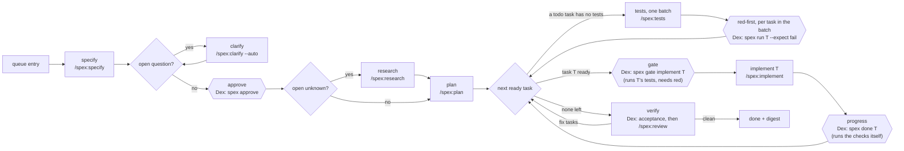

# 017 — Dex runs on spex: small spec files, gates the script checks

> **Status:** draft v1.0 · 2026-11-05 · the first brief for spex, not for spec-kit. Feature, branch and spec folder: `017-dex-runs-on-spex`.
>
> **Builds on** [`015-lean-core`](../015-lean-core/README.md) (queue, picker, policy, CLI), [`016-grounded-loop`](../016-grounded-loop/README.md) (sensors, gates, evidence, the `tests` stage, the digest) and the spex plugin 1.1.0: `~/Projects/Github/lukaskellerstein/claude-my-marketplace/plugins/spex/`, whose `README.md` is the design.
>
> **Changes to 015 and 016:**
>
> - amends D-015-1 (the picker rows read spex files, not spec-kit files);
> - drops the `constitution` step of the clarification flow;
> - amends D-016-2 and D-016-3 (`tests` runs per spex task; the frozen set is spex's `acceptance_dir`);
> - amends D-016-5 (the verifier is `/spex:review`, and its fixes are `kind: fix` tasks);
> - replaces the `tasks.md` plan diff of D-016-6 (no agent writes task status).
>
> **How to start:** commit this brief on `main`, start `claude -w 017-dex-runs-on-spex`, run `/spex:init` once (Dex has no `specs/spex.yaml` yet), then `/spex:specify docs/my-specs/017-dex-runs-on-spex/README.md`. This is the first Dex feature specified with spex, so it is also the first end-to-end use of spex.
>
> **Followed by** [`018-living-docs`](../018-living-docs/README.md): the project's docs become the loop's lasting memory.

## Why

After 016, every entry goes through spec-kit. Three costs come with it.

- **Size.** The 016 brief is 18.6 KB. spec-kit turned it into a 170 KB spec folder: `tasks.md` 44 KB, `spec.md` 42 KB, `research.md` 33 KB. That is 9.1 times the brief, with 98 tasks in 10 phases. Every `/speckit-implement` agent reads the folder before it reads code, and Dex starts one agent per phase. For 015 that was 186 KB, about 47k tokens, sent again on every turn of every run (spex README § Why).
- **Gates on prose.** The picker knows `clarify` is done from a `## Clarifications` heading, and counts progress by the `[X]` an agent writes. 016 had to add `plan-diff.ts` so an agent can't reword `tasks.md`, and `acceptance.json` so Dex knows the test command. The facts Dex decides on sit in prose that agents edit.
- **Tooling.** Each project needs a Python CLI (`uv tool install specify-cli`), a `specify init`, a `.specify/` tree and spec-kit's command files. Dex greps a shell script for `SPECIFY_FEATURE_DIRECTORY` to know whether it can point spec-kit at a folder.

spex removes the three at the source:

- Two YAML files of records with ids: `requirements.yaml` (EARS records with scenarios) and `tasks.yaml` (one task per agent run).
- A bundled Node script, `spex.mjs`, that checks them, decides the gates and is the only writer of task status.
- Eleven skills of 1.2–3.5 KB, none loaded until called. An implement run reads `spex show <task>` (about 1–3 KB) and its `context` files, capped at 24 KB.

## Operating model

The picker still decides from files alone. Its rows for one entry, in order:

| Row | Runs when | The agent runs | Dex runs after |
|---|---|---|---|
| `specify` | `<specDir>/requirements.yaml` is missing | `/spex:specify` | `spex check` |
| `clarify` | a `questions[]` entry has no `answer` | `/spex:clarify` (D-017-4) | `spex check` |
| approve | a record is `draft` and no question is open | — | `spex approve`, or a pause (D-017-4) |
| `research` | an `unknowns[]` entry has no `decision` | `/spex:research` | `spex check` |
| `plan` | `tasks.yaml` is missing, or a live record has no task | `/spex:plan` | `spex check`, exit 0 and not 5 |
| `tests` | a `todo` task has a scenario with no test (`spex show --tests` names the batch) | `/spex:tests` for that batch | `spex coverage`, then one `spex run T --expect fail` per task in the batch |
| `implement` | the next ready task T has every scenario covered, and `spex gate implement T` opens: it runs T's tests itself and they fail | `/spex:implement` for T | progress: `spex done T`, which runs the checks itself |
| `verify` | every task is `done`, and no done record matches the tree | `/spex:review` | the done gate (D-017-6) |
| done | a passed done record matches the tree | — | — |

"The next ready task" is the first `todo` task whose `depends_on` tasks are all `done`, in file order. That is what `spex next` prints. The picker computes it from the file, so it needs no process (D-017-1).

## Decisions

### D-017-1 — spex owns the files and the rules; Dex owns the order and the verdict

- **spex** owns the spec files, every rule (`spex check`), task status (`spex done`, `spex block`) and the stage instructions (the skills).
- **Dex** owns which stage runs next, branches and commits, the sensors and the gates, budgets, pauses and the digest.
- **Dex never re-implements a spex rule.** It reads only plain fields: `status`, `questions[].answer`, `unknowns[].decision`, `tasks[].requirements`, `tasks[].depends_on`. For anything that is a rule, it runs the script with `--json` and reads `ok`, `findings` and the exit code (`0` ok, `4` invalid, `5` coverage gap, `6` gate refused, `7` verify failed).
- **The picker stays pure.** It reads the YAML through the tree reader, as it reads `tasks.md` now, so `dex run --status` and `--dry-run` still work on any branch without starting a process.

### D-017-2 — Dex loads the plugin itself, through the SDK

- Every agent session gets `plugins: [{ type: "local", path: <spex dir> }]`, the SDK's form of `--plugin-dir`. The target project needs no install and no settings change.
- `<spex dir>` is `DEX_SPEX_DIR` when set. Otherwise it is the `installPath` of `spex@claude-my-marketplace` in `~/.claude/plugins/installed_plugins.json`. If neither resolves, the prerequisites fail and say how to install it.
- Dex runs the script as `node <spex dir>/scripts/spex.mjs` with its own runtime (`process.execPath`, with `ELECTRON_RUN_AS_NODE=1` in the app). So Dex's gates don't depend on the agent's `PATH`.
- The SDK's init message lists the session's plugins, and `claudeSession.ts` already logs it. A stage whose session has no `spex` plugin fails at once with that reason. It doesn't send a `/spex:*` prompt that the agent can't resolve.
- Each run record keeps the spex version from `plugin.json`. A version outside the range Dex was tested with fails the prerequisites.

### D-017-3 — Each stage prompt is one skill call plus Dex's own rules

| Stage | Prompt |
|---|---|
| `specify` | `/spex:specify <abs brief path>`, or `/spex:specify <title>: <description>` for an entry without a brief |
| `clarify` | `/spex:clarify <specDir> --auto` in `recommended-then-review`; `/spex:clarify <specDir>` in `wait` |
| `research` | `/spex:research <specDir>` |
| `plan` | `/spex:plan <specDir>` |
| `tests` | `/spex:tests <specDir> <task…>` for the batch the picker named, or `--fix <REQ-id/AC-n>` for an approved amendment |
| `implement` | `/spex:implement <specDir> <task>`, with 016's "restore green first", gate evidence and attempt log sections |
| `verify` | `/spex:review <specDir>`, with Dex's acceptance evidence |

- Dex's rule lines stay: the commit rule, the write scope, the evidence. The `tasks.md` lines go ("mark it `[X]`", "change nothing else in `tasks.md`").
- `SPECIFY_FEATURE`, `SPECIFY_FEATURE_DIRECTORY` and `SPECIFY_FEATURE_NO_PERSIST` go.
- **Dex makes the feature folder.** The queue already resolves `specDir` to `specs/<entry id>` (`queue.ts`), and `spex new` picks its own number, so the two could disagree. Dex creates `specDir` before `specify`, the skill finds it and skips `spex new`, and the queue requires entry ids of the form `NNN-slug` for spex projects.
- **The run report is the stage's result.** Every skill writes `.spex/runs/<feature>/<stage>[-<task>].json` with `status`, `summary`, `concerns`, `questions`, `files_changed` and `pulled`. Dex reads it in place of its own structured output for these stages. `summary` and `concerns` feed 016's attempt log, and `pulled` goes into the run record for the cost test.

### D-017-4 — Clarify and approval follow the question mode

Gate 1 (`spex approve`, draft to approved) is the step where a person says "build this". Dex has two question modes, and the gate follows them:

- **`recommended-then-review`:** `clarify` runs with `--auto`. It takes each recommended option and writes `by: default`. Dex then runs `spex approve` itself. The digest lists the approval and every `by: default` answer, so the human reviews them after the fact, as 015 does for questions.
- **`wait`:** `clarify` asks through Dex's question flow. When no question is open, the picker pauses with "approve the spec". The human's answer makes Dex run `spex approve`.
- `spex approve` refuses while `check` fails or a question is open. A refusal pauses the run with the findings. Dex never edits `status` to get past it.

### D-017-5 — Tests per batch, implement per task

spex gates each task on red *tests*, not on a tests *run*: `spex gate implement` refuses a task whose scenarios have no test, and it runs those tests itself and refuses unless they fail (spex 1.1.0). So one `tests` run covers a batch of tasks — the tasks in plan order that still have no test, up to `limits.tests_scenarios` scenarios (12) — and a feature with N tasks costs N + ⌈N/K⌉ fresh agents, not 2N. For 016's ten phases that is about 13 agents, not 20. *(Rewritten 2026-11-05: the first draft said "one `tests` run per task, as spex's gates need"; that was a gap in spex 1.0.0, closed in 1.1.0.)*

- **Red-first** (D-016-2): after `/spex:tests`, Dex runs `spex run <specDir> <task> --expect fail` for each task in the batch. Exit 0 means red as expected. `RUN-GREEN` (a test passes before the code exists) pauses: "the tests pass before the feature exists". `RUN-NO-TESTS` (a crash, or no test collected) runs `tests` again, as 016 does for a crash. `spex gate implement` runs the same check again when the task starts, so a test that turned green in between pauses there, with the same message.
- **Frozen tests** (D-016-3): the frozen set is every file under `acceptance_dir` plus spex's `protected` paths. `acceptance.json` and its `files` list go away.
- **Amendments** (D-016-3): the `implement` skill never edits a wrong-looking test. It stops with `STATUS: blocked` and a concern of the form `REQ-…/AC-n: <assertion> expects …, the record says …`. Dex turns that concern into 016's amendment question. Approve runs `/spex:tests <specDir> --fix <REQ-…/AC-n>`. Reject runs `implement` again with the human's note. The question waits for the human in both modes, as in 016.

### D-017-6 — Dex runs the gates and `spex done` itself; the agent's own run is input

The `implement` skill ends with its own `spex run` and `spex done`. Dex treats that as a claim (D-016-1), as it treats ticks now. Since spex 1.1.0 a gate and `spex done` run the checks themselves and never read `.spex/evidence/`, so Dex's own call of `spex done` *is* the second run. There is no separate `spex run` for Dex to repeat, and no evidence file whose author matters. *(Rewritten 2026-11-05: the first draft had Dex run `spex run` and `spex done` again because the agent could write the evidence file; spex 1.1.0 reads no such file.)*

- **Progress gate:** after every implement run, Dex runs `spex done <specDir> <task>` in its own process, at the run's final tree. `done` runs `fast_checks`, the task's acceptance tests and the task's `verify` extras, and writes `status: done` only when they pass at that moment. Progress means `done` exits 0.
- **Red after a claimed done:** if Dex's `spex done` exits 7, Dex runs `spex block <specDir> <task> --reason <the failing command>`, and the stall fingerprint (D-016-7) takes the record `done` wrote.
- **Flaky** (D-016-8): an exit 7 is re-run once (`checks.rerunOnFail`). Green on the re-run is recorded as `flaky` in Dex's evidence and doesn't block.
- **Done gate** (replaces the verify half of D-016-5):
  1. Dex runs `spex run <specDir> --all`: the fast checks and every live requirement's acceptance tests, once.
  2. `/spex:review` reads the diff and Dex's acceptance evidence. When acceptance is red, the review routes the failure as a `patch` finding, which appends a `kind: fix` task.
  3. The gate passes when acceptance is green, the review report says `done`, and the review added no task and no question.
- **Rounds:** `maxVerifyRounds` stays Dex's limit. spex's `review_rounds` applies when a person drives spex without Dex.
- **Done record:** keyed by the tree, as in 016 (`tree-stamp.ts`), with the hash of `tasks.yaml` in place of `tasks.md`.

### D-017-7 — Per-stage write scopes come from `tasks.yaml`

016's scopes (D-016-6) get sharper, because a spex task names the files it may write:

| Stage | May write |
|---|---|
| `specify`, `clarify`, `research` | `<specDir>/` except `tasks.yaml` |
| `plan` | `<specDir>/tasks.yaml` and `<specDir>/contracts/` |
| `tests` | `acceptance_dir` |
| `implement` | the task's `paths` |
| `verify` | `<specDir>/tasks.yaml` and `<specDir>/requirements.yaml`, append only |

- The PreToolUse hook enforces the table. A write outside it is `policy_denied` in the trace, as now.
- `.spex/` is the script's, not the agent's. A direct write into `.spex/evidence/` is denied in every stage, so the records can only come from `spex run`. Since spex 1.1.0 no gate reads them as proof anyway; the rule keeps the records honest for the digest.
- **Plan diff:** after `implement`, `tasks.yaml` must be byte-equal to its start-of-stage state, apart from `status` fields that `spex done` or `spex block` changed. Anything else pauses the run, like 016's reworded-task pause. `plan-diff.ts` shrinks to this check.

### D-017-8 — One place for the project's test commands

016 keeps test commands in two places: `checks.fast` in the policy and `acceptance.json` per entry. spex keeps them in `specs/spex.yaml` (`fast_checks`, `acceptance_cmd`), and `spex done` runs those itself and refuses unless they pass.

- **`specs/spex.yaml` wins.** If Dex's policy disagreed with it, `spex done` would refuse a task that Dex's own checks passed.
- `checks.fast` and `acceptance.json` go for spex projects. Dex's baseline gate runs `spex.yaml`'s `fast_checks` through its own sensors (timeout, re-run, evidence). `checks.standing`, `checks.rerunOnFail` and the per-check timeouts stay in the policy.

### D-017-9 — Prerequisites and the new-project flow

- **Checks out:** `specify_cli`, `speckit_init`.
- **Checks in:**
  - `node`: version 20 or newer on `PATH`, because the skills call `node …/spex.mjs` through Bash;
  - `spex_plugin`: D-017-2 resolves, and the version is in range;
  - `spex_config`: `specs/spex.yaml` exists.
- **A new project:** Dex runs `spex init` itself. It is a scan, not an agent. The first entry's `setup` task fills `fast_checks` and `acceptance_cmd` once the stack exists, and that entry's first `tests` run is refused until they're set.
- **An existing project:** check only, as 015 does. The pause names the fix: run `/spex:init`.
- **The clarification flow** loses its constitution step: product, technical, synthesis, then manifest extraction. spex has no constitution. Its job falls to the project's `CLAUDE.md` or `AGENTS.md` (018) and to `specs/spex.yaml`.

### D-017-10 — One spec format: spec-kit support goes

Dex drops spec-kit; it doesn't keep it beside spex.

- Two formats would double the picker rows, the prompts, the parser, the prerequisites and the mock runner.
- The only project Dex runs on is dex-ecommerce, a playground. Its `checkpoint/*` tags were minted on spec-kit trees, so they're minted again from a mock run after 017, as 015 did for its mock config.
- **The task board** reads `tasks.yaml`. A card is a spex task, with its status from the file. The running task shows the agent's own step list (spex skills say "track your steps"), which brings back the TodoWrite feed that the `tasks.md` re-parse replaced.
- **Spec discovery** (`orchestrator.ts`, `ipc/project.ts`) looks for `requirements.yaml` instead of `tasks.md`. The welcome screen's project marker is `specs/spex.yaml` instead of `.specify/integration.json`.

### D-017-11 — Dex's own repo moves to spex

- `.claude/settings.json` enables `spex@claude-my-marketplace`. Done on 2026-11-05, so `/spex:*` works in Dex sessions from now on.
- Workflow step 3 (`.claude/CLAUDE.md`, `rules/04-spec-documentation.md`): `/sync-spec-kit` becomes `/spex:sync`.
- `.specify/` and `.claude/skills/speckit-*` are deleted. So are the spec-kit lines in `rules/01-project-config.md`, `rules/09-code-quality.md` and `.markdownlint-cli2.yaml`.
- Briefs stay in `docs/my-specs/NNN-slug/README.md`. A spex `requirements.yaml` points at the brief with `brief:`.
- `specs/001`–`016` stay as they are, as spec-kit history. Nothing converts them.

### D-017-12 — The mock runner writes spex files and calls the real script

- `MockAgentRunner` writes `requirements.yaml`, `tasks.yaml` and acceptance tests whose names carry the ids. Every gate then runs the real `spex.mjs`, so a mock loop costs nothing and still exercises spex's rules.
- Every D-016-11 scenario is kept, rewritten for `tasks.yaml`.
- New scenarios:

| Scenario | Expected outcome |
|---|---|
| The agent sets `status: done` by hand in `tasks.yaml` | the plan diff pauses the run |
| The implementer writes outside the task's `paths` | the hook denies it; `policy_denied` in the trace |
| The agent writes into `.spex/evidence/` | the hook denies it |
| `/spex:tests` writes a test that already passes | red-first pauses on `RUN-GREEN` |
| The implementer claims done, and Dex's `spex done` exits 7 | Dex runs `spex block`; the next run gets the record |
| The implementer stops `blocked` with a test concern | the amendment question waits for the human |
| `spex approve` refuses (a question is open) | the run pauses with the findings |
| The session's init message has no `spex` plugin | the stage fails before its prompt is sent |

## Configuration

**`policy.json`:**

| Field | Change |
|---|---|
| `checks.fast` | removed for spex projects; the commands come from `specs/spex.yaml` (D-017-8) |
| `checks.standing`, `checks.rerunOnFail` | unchanged |
| `testGlobs` | unchanged; the frozen set adds `acceptance_dir` |

**Queue entry:** `acceptance` is removed for spex projects, because each task's acceptance tests are named by their ids. Entry ids must be `NNN-slug`.

**Environment:** `DEX_SPEX_DIR`, the plugin directory, overrides the installed one (D-017-2).

## Files

- **Add, core:**
  - `spex.ts`: find the plugin, run the script with `--json`, type the envelope;
  - `spex-files.ts`: the plain-field reader for `requirements.yaml` and `tasks.yaml` over a tree reader, replacing `parser.ts`.
- **Change, core:**
  - `picker.ts`: the rows above;
  - `entry-prompts.ts`, `prompts.ts`: the `/spex:*` prompts; the constitution prompt and the `SPECIFY_*` env go;
  - `gates.ts`, `stages/gate-runs.ts`, `stages/tests-stage.ts`, `stages/verify-stage.ts`, `acceptance.ts`: red-first through `spex run --expect fail` and `spex gate implement`, progress through `spex done`, the done gate through `spex run --all`;
  - `scope.ts`: the D-017-7 scopes; `plan-diff.ts`: the status-only check;
  - `evidence.ts`, `digest.ts`: `tasks.yaml` in place of `tasks.md`; the digest lists `by: default` answers and the approval;
  - `agent/claudeSession.ts`: the `plugins` option, the init check, the board feed; `agent/ClaudeAgentRunner.ts`: the skill name;
  - `stages/prerequisites.ts`, `stages/clarification.ts`, `queue.ts`, `queue-init.ts`, `orchestrator.ts`, `cli/describe.ts`, `types.ts`;
  - `agent/MockAgentRunner.ts`, `agent/MockConfig.ts`, `fixtures/mock/*.json`.
- **Change, main and renderer:** `ipc/project.ts`, `PrerequisitesPhase.tsx`, `ClarificationPhase.tsx`, `LoopDashboard.tsx`, `StageList.logic.ts`, `useOrchestrator.ts`, and the task board.
- **Change, this repo:** D-017-11.

## Implementation order

After every phase, `npm test` and `npm run typecheck` pass.

0. **Confirm what Dex relies on in spex 1.1.0,** on a dex-ecommerce scratch clone. Every gap becomes a spex change in the marketplace, with its own test, released before phase 1:
   - a `/spex:*` skill loads through the SDK's `plugins` option, and `${CLAUDE_PLUGIN_ROOT}` resolves in its Bash calls;
   - the argument forms in D-017-3 work;
   - `spex check` accepts a feature folder that Dex made, and ignores spec-kit folders beside it (`specs/001`–`016` here);
   - `spex done` on a task the agent already marked `done`, at the same tree, exits 0;
   - a project that enables `spex@claude-my-marketplace` itself, plus Dex's `plugins` option, loads one copy, not two;
   - the whole-feature acceptance run of D-017-6 is `spex run <dir> --all` (spex 1.1.0);
   - `spex gate implement` on a task whose tests already pass exits 6 with `GATE-RED`, and `spex done` on a red task exits 7 and leaves `status: todo`, both with a forged `.spex/evidence/` record in place (spex's own lifecycle test covers this);
   - `spex init` on an empty repository writes a valid `spex.yaml`.
1. **`spex.ts` and `spex-files.ts`,** unit-tested on spex's own fixtures (`tests/fixtures/csv-export`).
2. **Plugin loading and prerequisites;** the constitution step goes.
3. **Prompts and picker rows** from `specify` to `plan`, with approval (D-017-4).
4. **Tests per batch and implement per task:** red-first, the implement gate, the progress gate, the scopes, amendments.
5. **Verify:** the acceptance run, `/spex:review`, the done gate.
6. **The board, the CLI's `describe`, and the digest.**
7. **The mock runner** on spex files; every D-016-11 and D-017-12 scenario ends as documented.
8. **spec-kit removed,** and this repo moved to spex (D-017-11).
9. **The cost test** (Appendix A).

## Verification (DoD)

- [ ] `npm test`, `npm run typecheck` and `npm run check:size` pass.
- [ ] `grep -rn -i -E 'speckit|spec-kit|\.specify|SPECIFY_' src` finds nothing.
- [ ] A mock loop on a dex-ecommerce clone runs every entry from `specify` to done, and the real `spex.mjs` decides every gate.
- [ ] Every D-016-11 and D-017-12 scenario ends as documented, under the mock.
- [ ] Every agent session's init message lists the `spex` plugin.
- [ ] A real entry on a dex-ecommerce clone (`003-promo-codes`) runs end to end. Its trace shows no read of the spex `README.md`.
- [ ] The cost test's numbers are in Appendix A, and spex is below spec-kit at the same acceptance result.
- [ ] In this repo, workflow step 3 is `/spex:sync`, and `.specify/` is gone.

## Out of scope

- Codex and OpenCode: [019](../019-many-projects-any-agent/README.md).
- `spex archive` run by Dex. Archive follows the merge, which is the human's (gate 2). The digest's last line gives the command.
- `/spex:quick` as a queue entry kind.
- Converting `specs/001`–`016` to spex.
- spex's three-readings ambiguity check (spex v2).

## Open decisions

The proposed default is in bold. The owner accepted all six defaults on 2026-11-05, so they are decisions, not open questions. Defaults 1 and 6 were rewritten the same day, after spex 1.1.0 closed the two gaps they rested on; the owner re-reads those two.

1. **Tests:** **one `tests` run per batch of tasks (`limits.tests_scenarios`, 12 scenarios)** | one per task. spex 1.1.0 gates on red *tests*, which the gate checks itself, so a run per task is not needed: N tasks cost N + ⌈N/K⌉ fresh agents instead of 2N. The cost test measures the batch size.
2. **Test commands:** **`specs/spex.yaml` is the one source** | the policy's `checks.fast` stays, and Dex writes `spex.yaml` from it.
3. **Gate 1 in `recommended-then-review`:** **Dex approves, and the digest lists it** | always wait for the human.
4. **spec-kit:** **removed** | kept as a second format behind a `format` field.
5. **Finding the plugin:** **`installed_plugins.json`, with `DEX_SPEX_DIR` to override** | a copy of spex in Dex, pinned (a second copy to keep up to date).
6. **After a claimed done:** **Dex runs `spex done` itself, once** | Dex trusts the agent's own `spex done`. Since spex 1.1.0 `done` runs the checks itself and reads no evidence file, so the only question left is whose process runs it. Dex's, so the verdict is Dex's (D-017-1).

## Appendix A — the cost test

The test spex's own Definition of Done asks for. It runs once phase 8 is done.

- **Setup:** two scratch clones of dex-ecommerce, each with `origin` pointed at a scratch bare repository. Each clone has `{"agent": "claude"}` in `.dex/dex-config.json`. The entry is `003-promo-codes`, from its brief `docs/my-specs/003-promo-codes/README.md`.
- **Runs:** clone A on 016's spec-kit loop (the commit before 017 merges); clone B on 017's spex loop. Same model, same policy, `recommended-then-review`.
- **Measure, per stage and in total:**
  - input tokens, with cache reads and cache writes counted separately;
  - the number of fresh agents, and turns per agent;
  - the size of the spec folder;
  - `spex check` rounds per stage;
  - `pulled[]` per implement run;
  - the acceptance result.

  The per-run figures come from the run records (`.dex/runs/<runId>.json`), so both loops are measured the same way. Today an agent run there keeps `costUsd`, `inputTokens` and `outputTokens`, but no cache counts. Phase 9 adds `cacheReadTokens` and `cacheCreationTokens`, taken from the same SDK usage that `claudeSession.ts` already reads. Then clone A runs on a build that has them too.
- **Pass:** clone B's acceptance result equals clone A's, and its total input tokens are lower. The numbers go into this appendix, with the run ids.
