# 017 — Dex runs on spex: small spec files, gates the script checks

> **Status:** draft v3.0 · 2026-11-13 · rewritten for spex 3.0.0 (data format 3). v2.0 (2026-11-10) was written for spex 2.2.0, and v1.0 (2026-11-05) for spex 1.4.0. [§ Changes from v2.0](#changes-from-v20) lists what spex changed and where this brief follows. Feature and spec folder: `017-dex-runs-on-spex`. The branch is `spex/<the folder>`, and the script makes it.
>
> **Builds on** [`015-lean-core`](../015-lean-core/README.md) (queue, picker, policy, CLI), [`016-grounded-loop`](../016-grounded-loop/README.md) (sensors, gates, evidence, the digest) and the spex plugin 3.0.0: `~/Projects/Github/lukaskellerstein/claude-my-marketplace/plugins/spex/`. Its `README.md` is the reference, its `README.html` is the design, and its § Use from Dex is the other half of this brief.
>
> **Changes to 015 and 016:**
>
> - amends D-015-1 (the stage of an entry is the command that `spex status` names, D-017-1);
> - amends D-015-2 (the spex script makes the branch and the worktree of a spec and commits on that branch; on the base branch the project's `commit` and `close.cmd` decide, D-017-7);
> - drops the `constitution` step of the clarification flow;
> - replaces D-016-2 (the tests are written and proved red inside `/spex:implement`, not in a stage of Dex) and amends D-016-3 (the frozen set is spex's `protected` set; a wrong test goes to spex's decider, not to 016's amendment question);
> - replaces D-016-5 (the done gate is Dex's own `spex verify` after the last build, plus a spec that spex closed);
> - replaces the `tasks.md` plan diff of D-016-6 (spex stamps the plan and refuses one that was changed by hand);
> - amends D-016-7 (spex counts the rounds; a command that ends with its phase not done pauses the run);
> - amends D-016-9 (the attempt log is no longer part of a prompt; `corrections.md` is what the next run reads).
>
> **The state of the code:** `main` is at `57836b9`, which holds 016's loop for spec-kit. `npm run typecheck` and `npm test` pass there (2026-11-13). v2.0 of this brief was built in part for spex 2.2: 22 of its 41 tasks were done, and the tree was red. The owner took that build off `main` on 2026-11-13. It is kept on the local branch `archive/017-spex-2.2` (one commit, not pushed), as reference only. [§ How to start](#how-to-start) says what comes next.
>
> **Followed by** [`018-living-docs`](../018-living-docs/README.md): the project's docs become the loop's lasting memory.

## How to start

The owner set this order on 2026-11-13 (open decision 16). Steps 1 and 2 are done. The other steps are the owner's.

1. Save the 2.2 build on the local branch `archive/017-spex-2.2`. *(Done 2026-11-13.)*
2. Put `main` back to `57836b9`. This brief and one line of `.spex/config.yaml` are the only changes that stay. *(Done 2026-11-13: `npm run typecheck` and `npm test` pass.)*
3. Update the spex plugin to 3.0.x at project scope, and run `/spex:update`. It moves `.spex/config.yaml` to format 3. The 2.2 spec folder is gone, so the command converts nothing of it.
4. Commit this brief and `.spex/config.yaml` on `main`. A worktree gets only what is committed.
5. `/spex:new docs/my-specs/017-dex-runs-on-spex/README.md`. If it asks about a split, answer "one spec" (open decision 10). Then `/clear`, and `/spex:plan` with the folder it made. The plan checks this brief against the real code, which is 016's.

This is the first Dex feature specified with spex, and the first end-to-end use of spex 3.0.

## Why

After 016, every entry goes through spec-kit. Three costs come with it.

- **Size.** The 016 brief is 18.6 KB. spec-kit turned it into a 170 KB spec folder: `tasks.md` 44 KB, `spec.md` 42 KB, `research.md` 33 KB. That is 9.1 times the brief, with 98 tasks in 10 phases. Every `/speckit-implement` agent reads the folder before it reads code, and Dex starts one agent per phase. For 015 that was 186 KB, about 47k tokens, sent again on every turn of every run (spex README § Why spex).
- **Gates on prose.** The picker knows `clarify` is done from a `## Clarifications` heading, and counts progress by the `[X]` an agent writes. 016 had to add `plan-diff.ts` so an agent can't reword `tasks.md`, and `acceptance.json` so Dex knows the test command. The facts Dex decides on sit in prose that agents edit.
- **Tooling.** Each project needs a Python CLI (`uv tool install specify-cli`), a `specify init`, a `.specify/` tree and spec-kit's command files. Dex greps a shell script for `SPECIFY_FEATURE_DIRECTORY` to know whether it can point spec-kit at a folder.

spex removes the three at the source:

- Records with ids in three YAML files: `requirements.yaml` (EARS records with scenarios: the claim), `tests.yaml` (one test per scenario and per task: the proof plan) and `tasks.yaml` (one task per agent run). `spec.md` is the spec in words, and `source.md` keeps the person's text word for word.
- A bundled Node script, `spex.mjs`, that checks them, starts and ends every phase, keeps the state of a spec in `status.yaml`, decides when a task is done, and is the only writer of every status.
- A wall between a claim and its proof. The agent that writes a record or a task never writes its test: a `test-analyst` subagent writes `tests.yaml`, `test-developer` subagents write the test code from the records alone, and a `developer` never edits a test. 016 had to guard against an implementer that edits its own tests; spex makes that a role no agent holds.
- Four commands carry a spec: `new`, `plan`, `implement` and `review`. Each is one skill of at most 6 KB, and its parts load only when the run gets there. The chat of a command holds ids and results. Ten subagents hold the content: a fresh `developer` builds each task from `spex show <task>` (about 1–3 KB) and its `context` files, capped at 24 KB.

spex 3.0 does inside one command what Dex did with one agent per stage: a fresh agent for each piece of work. So Dex stops cutting an entry into nine stages, and runs four commands (D-017-3).

## What

```mermaid
flowchart LR
  Q[queue entry] --> NW["note<br/>/spex:new brief"]
  NW --> CM{{"the note is committed<br/>spex commit, or a pause"}}
  CM --> SP{{"Dex: spex start plan"}}
  SP --> PL["plan<br/>/spex:plan dir"]
  PL --> AP{{"the approval<br/>by policy, or a pause"}}
  AP --> SI{{"Dex: spex start implement"}}
  SI --> IM["implement<br/>/spex:implement dir"]
  IM --> PG{{"progress gate<br/>Dex: spex verify"}}
  PG --> RV["review<br/>/spex:review dir"]
  RV -- "a fix pick, built in the same run" --> PG
  RV -- "clean: the close" --> DG{{"done gate<br/>Dex: spex list"}}
  DG --> D[done + digest]
```

Every box with an agent can also end with its phase not done: a question, a need, the limit of the fix loop. That is always a pause (D-017-4), and the picture leaves it out.

The picker runs `spex status --json` and takes the row for the command it names in `next` (D-017-1). Its rows for one entry:

| Row | Runs when | The agent runs | Dex runs |
|---|---|---|---|
| note (Dex's own) | the entry has no `specDir`, and no spec is open | `/spex:new <brief>` | before: the project is on the entry's `baseBranch` (D-015-2). After: `spex list --json` for the one new note, which becomes the entry's `specDir`; then `spex commit` (D-017-7) |
| `invalid` | a spex call exits 4 | — | a pause with the findings; Dex never edits a spex file to get past one |
| plan | `next` names `/spex:plan <specDir>`: a note whose turn it is, or `plan, started` | `/spex:plan <specDir>` | before: `spex start plan <specDir>`, where a refusal (exit 6) is a pause with its fix text. After: the phase is `plan, done` |
| the approval | `plan, done`, and no implement run has started | — | `recommended-then-review`: nothing, the next row runs. `wait`: a pause with the digest of the plan (D-017-4) |
| implement | `next` names `/spex:implement <specDir>`: `plan, done`, or `implement, started` | `/spex:implement <specDir>` | before: `spex start implement <specDir>`. After: the progress gate (D-017-6) |
| review | `next` names `/spex:review <specDir>`: `implement, done`, or `review, started` | `/spex:review <specDir>` | before: `spex start review <specDir>`. After a run that built fix picks: the progress gate. After a close: the done gate |
| the close waits | `review, done`, and the spec is still open | — | `close.cmd` is empty: a pause, "merge `spex/<spec>` into `<base>`". After the merge: `spex close <specDir> finish` (D-017-7) |
| comment | the human answered a pause with words that are no answer | `/spex:comment <the words>` | the picker again |
| done | `spex list --json` has the spec as closed, and the entry's done record matches | — | — |

`spex status --json` carries `open` (`dir`, `state.command`, `state.state`, `worktree`, `corrections`), `next` (one command), `closed` and `waiting`. Dex takes the command and the folder from it, and nothing else decides the order.

**`/clear` means a new session.** Every spex reply that finishes a phase ends with a NEXT block: `/clear`, then one command. Dex follows it: it ends the session, and starts a new one with that command as the whole prompt. So no context goes from one command to the next, and the state is in the files. Dex reads the command from `spex status --json`, not from the reply: the same script prints both. A reply that asks a question has no `/clear`, so the answer goes to the same session (D-017-4).

## Decisions

### D-017-1 — spex owns the files, the rules, the state and the branch of one spec; Dex owns the queue and the verdict

- **spex** owns the spec files, every rule (`spex check`), every status (`spex done`, `spex block`, `spex review accept`), the state of a spec (`status.yaml`, written by `spex start`, `spex end` and `spex close`), the branch `spex/<spec>` with its worktree and the commits on it, and the instructions of each phase (the skills and their subagents).
- **Dex** owns which entry runs next, the base branch a run works on (D-015-2), budgets, the sensors and the gates it runs in its own process, the pauses under its question modes, and the digest.
- **Dex never re-implements a spex rule.** For anything that is a rule, it runs the script with `--json` and reads `ok`, `findings` and the exit code (`0` ok, `2` usage, `4` invalid, `5` a gap, `6` refused, `7` failed, `8` a worktree is not removed).
- **The picker asks `spex status`.** `spex status --json` writes nothing, so `dex run --status` and `--dry-run` still change nothing. A spex command that names a spec works in the worktree of that spec from any folder, so the stage of an open spec is known from the main folder. v2.0's limit (no stage for an entry on a branch that is not checked out) goes. *(Changed 2026-11-13: v2.0 asked `spex next`, which spex 3.0 removed. The state is two lines in `status.yaml` now.)*
- **One spec is open at a time, in the order of the numbers.** `spex start plan` refuses a second open spec (`GATE-OPEN`) and a spec whose turn has not come (`GATE-TURN`). So Dex makes the note of an entry only when its turn comes, and the queue's order is the order of the notes (open decision 13).
- Dex reads plain fields only for display: `status`, `questions[].answer` and `by`, `unknowns[].decision`, `tasks[].status`, `requirements` and `depends_on`, `tests[].covers` and `kind`. It reads them in the worktree of the open spec, and on the base branch for a closed one.

### D-017-2 — Dex loads the plugin itself, through the SDK

- Every agent session gets `plugins: [{ type: "local", path: <spex dir> }]`, the SDK's form of `--plugin-dir`. The option wins over a copy that the project's own settings enable, so the session and Dex's own script calls use one copy (research U6). spex is also installed at project scope in each target project, so a person working there has `/spex:*` too (Q2, 2026-11-05).
- The plugin brings its ten subagents (`spex:analyst`, `spex:planner`, `spex:test-analyst`, `spex:test-developer`, `spex:developer`, `spex:tester`, `spex:decider`, `spex:researcher`, `spex:reviewer`, `spex:roadmap-reviewer`) and a Playwright MCP server for the `tester`. Both come with the same option (phase 0).
- **A spex command needs three tools in its session:** `Agent` (every command starts subagents), and `EnterWorktree` and `ExitWorktree` (the skills move the chat into the worktree and out of it). A session that lacks `Agent` fails the stage before its prompt is sent. The two worktree tools are open decision 15.
- `<spex dir>` is `DEX_SPEX_DIR` when set. Otherwise it is the `installPath` of the `spex@claude-my-marketplace` entry in `~/.claude/plugins/installed_plugins.json` whose `projectPath` is the project (Q2). For a new project, Dex runs `claude plugin install spex@claude-my-marketplace --scope project` itself. For an existing project, the prerequisites fail and name that command.
- Dex runs the script as `node <spex dir>/scripts/spex.mjs` with its own runtime (`process.execPath`, with `ELECTRON_RUN_AS_NODE=1` in the app). So Dex's gates don't depend on the agent's `PATH`.
- The SDK's init message lists the session's plugins, and `claudeSession.ts` already logs it. A stage whose session has no `spex` plugin fails at once with that reason. It doesn't send a `/spex:*` prompt that the agent can't resolve.
- Each run record keeps the spex version from `plugin.json`. A version outside the range Dex was tested with (3.0.x) fails the prerequisites.

### D-017-3 — A stage is one spex command, and its prompt is that command alone

| Stage | Prompt | One run does |
|---|---|---|
| note | `/spex:new <brief>` | keeps the brief word for word in `source.md`, and writes the note |
| plan | `/spex:plan <specDir>` | checks the note against the code, settles what is open, writes the full spec, the records, the tasks and the test plan |
| implement | `/spex:implement <specDir>` | writes every script test and proves it red, builds each task with a fresh developer, proves the whole spec |
| review | `/spex:review <specDir>` | reads the diff, takes the answer to its findings, builds the fix picks, and closes the spec when none is left |
| comment | `/spex:comment <words>` | puts the human's words into the spec, the tasks and the test plan; writes no code |

- **Five stages replace nine.** v2.0 had `shaping`, `requirements`, `clarify`, `research`, `tasks`, `tests`, one `develop` per task, `verify` and a fix stage. spex 3.0 has no skill for one of them: each is a part of a command. A fresh agent per task stays, because `/spex:implement` starts one `developer` subagent for each task (open decision 12).
- **The prompt is the command and its arguments.** `auto` follows the folder in the `recommended-then-review` mode (D-017-4). `yes` and the answer to a review are the other two arguments (D-017-4). Nothing else follows the command, because a skill reads every word after it as an argument.
- **Dex's own rule lines move to the system prompt** that Dex appends for the session: the write scope and the evidence line. The commit line goes: no agent commits, and the script commits at the end of each phase. 016's "restore green first" section goes too: a red base pauses before a spec starts (D-017-8).
- `SPECIFY_FEATURE`, `SPECIFY_FEATURE_DIRECTORY` and `SPECIFY_FEATURE_NO_PERSIST` go.
- **Dex starts every phase itself, before the agent.** It runs `spex start plan|implement|review <specDir>` in its own process and starts the session with its working folder set to the `worktree` path of the output. A refusal costs no agent: `GATE-TURN`, `GATE-COMMIT`, `GATE-NEEDS` and `GATE-PLAN-CHANGED` are pauses with the fix text. The skill runs the same `spex start` again, finds the phase started and the chat in the worktree, and goes on (open decision 15).
- **The note comes from `/spex:new`, never from the script alone.** `spex new <slug> --words <file>` writes a note from a template, with every section empty (probe, 2026-11-13). The skill fills it: each detail of the brief becomes one bullet with a link to its line. `<brief>` is the entry's brief. For an entry without one, it is a file Dex writes with the title and the description. *(Changed 2026-11-13: v2.0 made the folder with `spex new --from --shaping --number`. `--from` and `--shaping` are gone, and a number is the next free one.)*
- **`/spex:new` never gets `auto`.** With one spec it does not stop. With more than one it stops with the list before it writes a note, and Dex pauses the entry: split the entry in the queue, one entry for each spec. Roadmaps are 020's.
- **The folder is a field of the entry.** After the note run, `spex list --json` has one note more than before, and Dex writes its `dir` into the entry as `specDir`. An entry whose note a person wrote already carries `specDir` by hand, and has no note run. v2.0's rule that an entry id is `NNN-slug` goes.
- **The run report is the stage's result.** `plan`, `implement` and `review` each end with `spex report`, which writes `.spex/runs/<feature>/<stage>.json` in the worktree: `status` (`done`, `concerns`, `blocked`), `summary`, `concerns`, `questions`, `files_changed` and `pulled`. Dex reads it in place of its own structured output. `summary` and `concerns` go into Dex's attempt log and the digest, and `pulled` goes into the run record for the cost test.
- **`corrections.md` is what the next run reads.** It is in git, in the spec folder, and only the script writes it: what changed after the plan, and why. 016's attempt log stays as Dex's own record, but no prompt carries it any more.

### D-017-4 — A command that ends with its phase not done is a pause

spex 3.0 has no `approve`. The next command is the approval, and each reply ends with a digest of what the agents decided. Dex has two question modes, and both use one rule.

- **The rule:** after a session, Dex runs `spex status --json`. If the phase of the command is `done`, the stage passed. If it is still `started`, the run pauses, and the pause shows the last reply of the session. A spex reply is written for a person: each question is closed, has options and a pick, and `ok` takes every pick. Dex does not parse it.
- **The answer:** the human's answer goes to the same session as its next message, while Dex still holds that session. When the session is gone (the app closed, the run stopped), Dex runs the command again. Two commands take the answer as an argument: `/spex:review <specDir> ok` (or `2=defer 3=fix`) and `/spex:implement <specDir> yes`. `/spex:plan` asks its questions again.
- **Words that are no answer** ("the export must also have the email") go through `/spex:comment <the words>` as a stage of their own. Its reply names the command to run next, and so does `spex status` (open decision 18).
- **`recommended-then-review`:** `plan`, `implement` and `review` get `auto`. A `decider` subagent answers each question with evidence and a confidence, written as `by: agent`. In `review` it picks `fix`, `defer` or `skip` for each finding, and the skill runs `spex review accept … --by agent`. Dex starts `implement` right after `plan, done`: that is the approval, and Dex gave it by policy. The digest lists it, with every `by: agent` and `by: default` answer and every entry of `corrections.md`, so the human reviews them after the fact, as 015 does for questions.
- **`wait`:** no `auto`. The pauses are: the questions of `plan` (at most 3), the approval after `plan, done` ("approve the plan", with its digest), a big change of the spec in `implement`, and the findings of a review round. The human's yes to the plan makes Dex start `implement`.
- **Three stops come in both modes,** because they are not questions:
  - a need only a person can give (a token, a running system): `spex start implement` refuses with `GATE-NEEDS` or `ENV-UP`, and the pause names it;
  - the limit of the fix loop: `/spex:implement` stopped after `verify_rounds` rounds, with each red test and every verdict it got;
  - a write to a real system with no undo: one task is blocked with one yes or no question, and the human's yes makes Dex run `/spex:implement <specDir> yes`.
- A refusal of a gate pauses the run with the findings. Dex never edits a `status` to get past it.

### D-017-5 — The proof plan, then the test code, before any code: inside the commands

spex splits the claim from its proof (spex design rule 11). The `analyst` and the `planner` write the claims in the `plan` run, and a `test-analyst` in the same run writes `tests.yaml`: one test per scenario and one per task, each a script (a test file found by its name, or `driver: shell` steps) or a session (a procedure a `tester` performs). In the `implement` run, `test-developer` subagents write the test code from the records alone, never from the source. *(Rewritten 2026-11-13: v2.0 had a `tests` stage of Dex, and Dex ran `spex run --test --expect fail` for every test. spex 3.0 has no command for the tests alone.)*

- **Red-first** (D-016-2) is spex's own, in two places of the `implement` run. Each test developer proves its test red with `spex run --test --expect fail`. And `spex gate develop` runs the tests of a task again when its developer starts, and refuses with `GATE-RED` when one is green already.
- **Dex does not repeat the red check.** Between the tests and the code there is no moment that is Dex's: both are in one run. Dex's own verdict comes when the run ends (D-017-6). The red records in `.spex/evidence/` are claims, and the digest lists them as that (open decision 6).
- **A test that is green before the code** goes to a `decider` in the run: either the code does what the claim says already, and `spex done` closes the task, or the test asserts nothing, and it is written again.
- **Frozen tests** (D-016-3): the frozen set is spex's `protected` list (`specs/`, `.spex/`, `acceptance_dir`, `.github/`) plus every driver's `dir`. `acceptance.json` and its `files` list go.
- **A red test** (replaces 016's amendments): a `decider` names one of four causes: the test, the code, the tasks or the spec. A test developer rewrites a wrong test, a developer fixes the code, the planner splits a task or gives it one more file. A wrong spec is small (the analyst corrects it, and the digest says so) or big (it touches a line the person gave, the Success, the Not this, or the list of specs). A big change is a question to the human, or to the decider with `auto`. 016's amendment question and `amendments.json` go for spex projects (open decision 8).

### D-017-6 — Dex runs `spex verify` itself after every build; the run's own proof is input

`/spex:implement` ends with `spex end implement`, which checks that every task is done and that the proof is green on this tree. It reads that from `.spex/evidence/<feature>/verify.json`, a record that the run wrote. Dex treats the record as a claim (D-016-1), as it treats ticks now.

- **Progress gate:** after every session that ends at `implement, done`, Dex runs `spex verify <specDir>` in its own process, in the worktree, at the final tree. It runs `env.deploy` and `env.check`, `fast_checks`, every script test and every shell test, and it counts each session's evidence at this tree. Progress means exit 0. A `review` run that built fix picks ends at `implement, done` too, so the same gate follows it.
- **Flaky** (D-016-8): an exit 7 is re-run once (`checks.rerunOnFail`). Green on the re-run is recorded as `flaky` in Dex's evidence and doesn't block.
- **Red after a claimed done:** an exit 7 twice pauses the run with the failures (`spex show <specDir> --verify`). The human goes on with the same command, which sends each red test to the decider, or with `/spex:comment`.
- **The tasks:** `spex done` is the only writer of `status: done`, and it runs the task's tests at that moment. The run calls it for each task. Dex does not call it again: its own `spex verify` runs every task's tests at the final tree. *(Changed 2026-11-13: v2.0 ran `spex done` in Dex's process after each `develop` stage. There is no such stage now.)*
- **Review:** `/spex:review` starts one `reviewer` for each task slice. Every finding comes at once, with a severity (P1 to nit), a fix plan and a pick. The answer (D-017-4) turns each `fix` pick into a fix task, and the same run builds those. A later round checks only the fixes.
- **Done gate:**
  1. Dex's progress gate passed after the last session that ended at `implement, done`.
  2. spex closed the spec: `spex list --json` has it as closed, and the base branch has its `status.yaml` at `review, done`.
  3. Dex's baseline gate (D-016-4) passes on the base branch after the close.
- A session's evidence is a tester's claim, not a run: no program can judge it. spex counts it only at the tree it was recorded on. Dex keeps the `--json` output of its own `spex verify` in `.dex/evidence/<id>/`, because the close removes the worktree with `.spex/evidence/` in it. The digest lists each session with what the tester observed.
- **Rounds:** `.spex/config.yaml`'s `verify_rounds` and `review_rounds` are the limits (D-017-8). The script counts them, and the review's last round picks `fix` only for a P1, so the rounds always end. Dex's own `spex verify` on a green tree is the same round, not a new one.
- **Done record:** keyed by the tree, as in 016 (`tree-stamp.ts`), with the hashes of `tasks.yaml` and `tests.yaml` in place of `tasks.md`.

### D-017-7 — Branches, commits and write scopes

**Branches.** The script makes `spex/<spec>` and the worktree `.claude/worktrees/<spec>` at `spex start plan`, from the branch the main folder is on (`base` in the config, when it is set). It commits on that branch at the end of each phase. Dex makes neither, and never switches to the branch of a spec: its sessions work in the worktree.

- **The base branch is Dex's concern, as in D-015-2.** A new project keeps its one `dex/<date>-<id>` run branch, and that branch is the base of every spec of the run. In an existing project the base is the entry's `baseBranch`. A probe on 2026-11-13 showed that a run branch with no upstream works as the base.
- **The note must be committed on the base branch** before `plan` (`GATE-COMMIT`). `/spex:new` ends with `spex commit`. With `commit: true` in the config, the script commits the note. With `commit: false`, it names the files, and Dex pauses: "commit these files on `<base>`". Dex sets `commit: true` in a new project, and commits nothing itself in an existing one.
- **The close follows the project's `close.cmd`** (open decision 14):

| `close.cmd` | The close | Dex |
|---|---|---|
| `local` | the script merges `spex/<spec>` into the base branch in the main folder, and removes the worktree | sets this in a new project: the loop goes on with no person, and the merge of the run branch into `main` stays the human's |
| empty (spex's default) | the run stops after `review, done`, and waits for a person to merge | pauses: "merge `spex/<spec>` into `<base>`"; after the merge it runs `spex close <specDir> finish` itself |
| a command | the script pushes, opens the request and merges it, as the project says | nothing: the project's rule is the rule |

- The entry's `branch` field is derived: `spex/<the folder name>`. `openPullRequest` has no effect in a spex project: `close.cmd` says how a spec is merged.

**Write scopes.** In spex 3.0 the chat of a command writes nothing: every file has one writer, and each writer is a subagent type. So the scope is per role, and the stage adds little.

| Role | May write |
|---|---|
| the chat of `/spex:new` | `spec.md` of the notes this run made |
| the chat of `/spex:review` | `.spex/review/<feature>-<n>.findings.yaml` |
| the chat of any other command | nothing |
| `spex:analyst` | `<specDir>/spec.md`, `requirements.yaml`, `research.md`, `contracts/`; at the close, `spec.md` of the later notes |
| `spex:planner` | `<specDir>/tasks.yaml`, `contracts/` |
| `spex:test-analyst` | `<specDir>/tests.yaml` |
| `spex:test-developer` | `acceptance_dir` and every driver's `dir` |
| `spex:developer` | the `paths` of its task, as `tasks.yaml` has them at the moment of the write; for a conflict or a failed merge, the files its brief names |
| `spex:researcher`, `spex:decider`, `spex:tester`, `spex:reviewer`, `spex:roadmap-reviewer` | nothing |

- The PreToolUse hook enforces the table. It takes the role from the subagent type in the hook input, and the task from the brief of the `Agent` call that started the developer (`<specDir> T03. Build it; …`) (phase 0). A write outside the table is `policy_denied` in the trace, as now.
- **The write root is the worktree.** A write to the main folder from the session of a spec is denied. Dex's own state (`.dex/state.json`, `.dex/evidence/`, `.dex/runs/`) stays in the main folder, and Dex reads `.dex/policy.json` there.
- **No agent writes these directly, in any stage:** `source.md`, `status.yaml`, `corrections.md`, and everything under `.spex/` but the findings file of the review. They are the script's. `.spex/config.yaml` is the project's file: changed only by a person, or by Dex through `spex init` and `spex update` (D-017-9). The tester's screenshots reach `.spex/artifacts/` through the Playwright MCP server, which is not a tool call the hook sees; spex counts them only as part of a session's claim.
- **The plan diff goes.** `spex end plan` stamps the spec, the records, the tasks and the tests, and `spex start implement` refuses a plan that was changed by hand (`GATE-PLAN-CHANGED`). A change by the process goes through `spex stamp` or `spex paths`, and leaves an entry in `corrections.md`. `plan-diff.ts` is deleted. *(Changed 2026-11-13: v2.0 kept it as a check of the task statuses after each `develop` stage.)*

### D-017-8 — One place for the project's test commands and limits

016 keeps test commands in two places: `checks.fast` in the policy and `acceptance.json` per entry. spex keeps them in `.spex/config.yaml` (`fast_checks`, `acceptance_cmd`, `drivers`), and `spex done` and `spex verify` run those themselves and refuse unless they pass.

- **`.spex/config.yaml` wins.** If Dex's policy disagreed with it, `spex done` would refuse a task that Dex's own checks passed.
- `checks.fast` and `acceptance.json` go for spex projects. Dex's baseline gate runs `config.yaml`'s `fast_checks` through its own sensors (timeout, re-run, evidence), on the base branch: before a spec starts and after it closes. A red base before a spec pauses the run. `checks.standing`, `checks.rerunOnFail` and the per-check timeouts stay in the policy. `limits.verify_minutes` is spex's timeout for one command it runs.
- The same holds for the rounds: `verify_rounds` and `review_rounds` in the config replace the policy's `limits.maxVerifyRounds` for spex projects. Dex's budget still caps the cost of an entry. When the budget stops a session in the middle of a phase, the phase stays `started`, and the same command goes on later: a done task stays done.
- **The worktree needs its packages.** `worktree.setup` in the config runs one time in a new worktree (`npm ci`). `spex verify` and Dex's sensors both run there. spex reports a failed setup as a warning (`WORKTREE-SETUP`), and Dex shows it in the pause of the first red check.
- `env` in the config (`up`, `deploy`, `check`, `down`, `url`) is the project's. spex runs it, and Dex only reports its failures (`ENV-UP`, `ENV-DEPLOY`).

### D-017-9 — Prerequisites and the new-project flow

- **Checks out:** `specify_cli`, `speckit_init`.
- **Checks in:**
  - `node`: version 20 or newer on `PATH`, because the skills call `spex.mjs` through Bash;
  - `spex_plugin`: D-017-2 resolves, and the version is in range;
  - `spex_config`: `.spex/config.yaml` exists, and `spex check --json` reports `format.repo === format.script` (3). A newer repo pauses with the `CONFIG-FORMAT` fix text: update the plugin;
  - `spex_base`: `base` in the config is empty, or it is the branch the run works on. A spec that starts from another branch would not see the run's work.
- **After a spex update:** in a new project, Dex runs `spex update` itself, as it runs `spex init`: a program, not an agent. In an existing project it pauses and names `/spex:update`, because the migration changes tracked files, and Dex commits nothing there (D-015-2). The 2 → 3 migration gives a spec in the middle a `status.yaml` and no branch, so its files must be committed on the base branch before its next command.
- **A new project:** Dex runs `spex init` itself. It is a scan, not an agent. Then it sets `commit: true` and `close: {cmd: local}` (D-017-7). `/spex:init` also proves `acceptance_cmd` with a throwaway test (`REQ_000_000_AC_0_probe`) that must fail and be named; the script does not, so Dex runs the same proof itself once `acceptance_cmd` is set. A command that collects nothing would make every red run `RUN-NO-TESTS`.
- **The first entry of an empty repository** has no stack, so the scan finds no `acceptance_cmd`. Its tests are `driver: shell` tests, which need no command (phase 0). Once that entry is closed, Dex runs `spex init --force` again (a new scan) and sets its two keys again, or the human edits `.spex/config.yaml`. A task may not write it: `.spex/` is in spex's `protected` list.
- **An existing project:** check only, as 015 does. The pause names the fix: run `/spex:init`.
- **The clarification flow** loses its constitution step: product, technical, synthesis, then manifest extraction. spex has no constitution. Its job falls to the project's `CLAUDE.md` or `AGENTS.md` (018) and to `.spex/config.yaml`.

### D-017-10 — One spec format: spec-kit support goes

Dex drops spec-kit; it doesn't keep it beside spex.

- Two formats would double the picker rows, the prompts, the parser, the prerequisites and the mock runner.
- The only project Dex runs on is dex-ecommerce, a playground. Its `checkpoint/*` tags were minted on spec-kit trees, so they're minted again from a mock run after 017, as 015 did for its mock config. A mock run now leaves one commit per phase on `spex/<spec>`, made by the script, and a tag can point at any of them.
- **The task board** reads `tasks.yaml`: in the worktree for the open spec, on the base branch for a closed one. A card is a spex task, with its status from the file and its tests from `tests.yaml`. The running card comes from the start of a `spex:developer` subagent, whose brief names the task. Under it the board shows that subagent's own step list.
- **The stage list** has five stages for an entry (D-017-3). Inside a stage, the trace shows the subagents the command started: the skills say one line before each start (`Develop: T03 + T04 → 2 agents`).
- **Spec discovery** (`orchestrator.ts`, `ipc/project.ts`) reads `spex list --json` instead of a search for `tasks.md`. The welcome screen's project marker is `.spex/config.yaml` instead of `.specify/integration.json`.

### D-017-11 — Dex's own repo moves to spex 3.0

- `.claude/settings.json` enables `spex@claude-my-marketplace` (2026-11-05). The plugin moves to 3.0.x at project scope.
- `.spex/config.yaml`: `/spex:update` moves it from format 2 to 3. `ship` becomes `commit` and `close`, and `approvals` goes. Two values are set by hand: `worktree: {setup: "npm ci"}`, and `close.cmd`. It stays empty at first: the owner merges the request, then types `/spex:review` again.
- `.specify/` and `.claude/skills/speckit-*` are deleted, and so are the spec-kit lines in `rules/09-code-quality.md` and `.markdownlint-cli2.yaml`. Done on `main` on 2026-11-05. Nothing in `src/` read Dex's own `.specify/`: every `.specify` path there is the target project's.
- **Workflow step 3** (`.claude/CLAUDE.md`, `rules/04-spec-documentation.md`) names `/spex:clarify` and `/spex:approve` since 2026-11-10. spex 3.0 has neither. Step 3 becomes: a change to an open spec is `/spex:comment <the change>`, then the command its reply names (open decision 11). The words "skip on `main`" stay true: the work of a spec is on `spex/<spec>`, in its worktree.
- **Worktrees:** `rules/worktree.md` puts a change session in `.worktrees/<name>` (`claude -w <name>`) and forbids `EnterWorktree`. spex 3.0 makes `.claude/worktrees/<spec>` itself, and its skills call `EnterWorktree`. The two rules meet in this repo (open decision 17).
- Left for 017: the lines that describe the product as orchestrating spec-kit projects (`rules/01-project-config.md`, `.claude/CLAUDE.md` § Dex at a glance, `package.json` `description`, `README.md`), and `rules/06-testing.md`, which describes the stages and the checkpoints of 016. They stay true until 017's code ships.
- **Briefs** stay in `docs/my-specs/NNN-slug/README.md` as the input. `/spex:new <the brief>` keeps the text word for word in `specs/NNN-slug/source.md`, and writes the note from it (open decision 9). A brief keeps Why, What, Not this and Success as `##` headings: the note and the full spec have the same sections.
- `specs/001`–`016` stay as they are, as spec-kit history. Nothing converts them.

### D-017-12 — The mock runner plays a whole command and calls the real script

- For one prompt, `MockAgentRunner` does what the command does: it runs the real `spex start` and `spex end`, and between them it writes the files the phase writes. For `plan`: `spec.md`, `requirements.yaml`, `tasks.yaml`, `tests.yaml`. For `implement`: test files whose names carry the ids' tokens (`REQ_007_001_AC_1_…`, `TASK_007_03_…`), a red run for each, the code, `spex done` for each task, a `spex session` for each session test, and `spex verify`. For `review`: the findings file, `spex review accept`, and the steps of the close. So a mock loop costs nothing and still exercises spex's rules.
- A mock scenario names the role that does each write, so the hook sees the same subagent types as in a real run.
- Every D-016-11 scenario is kept, rewritten for spex files. The test-amendment scenario goes with the amendment question (D-017-5).
- New scenarios:

| Scenario | Expected outcome |
|---|---|
| `/spex:new` splits a brief into two specs | the run stops with the list, no note is written, the entry pauses |
| The note is not committed, and `commit` is `false` | `GATE-COMMIT`: the run pauses and names the files, before any agent starts |
| `spex end plan` refuses three times (a line of the brief has no record) | the session ends at `plan, started`; the run pauses with the gap |
| A plan question in `wait` | the run pauses with the reply; the answer goes to the same session, and the plan ends |
| `plan, done` in `wait` | the run pauses with the digest; the human's yes starts `implement` |
| A file of the plan is changed by hand after the stamp | `spex start implement` exits 6 with `GATE-PLAN-CHANGED`; the run pauses, and no agent starts |
| A test's `needs` is not met | `GATE-NEEDS` pauses and names it, before any code is written |
| The developer writes outside the `paths` of its task | the hook denies it; `policy_denied` in the trace |
| A developer writes a test file, or the chat writes `status.yaml` | the hook denies it |
| An agent writes into `.spex/evidence/` | the hook denies it |
| A test is green before the code exists | `GATE-RED` in the run; the mock's decider says "the test asserts nothing"; the test is written again and is red |
| The run ends at `implement, done` with a forged `verify.json`, and one script is red | Dex's `spex verify` exits 7 twice; the run pauses with the failures |
| A script is red once and green on Dex's re-run | recorded as `flaky`; the run goes on |
| The fix loop reaches `verify_rounds` | the session ends at `implement, started`; the run pauses with each red test and its verdicts |
| A task must write to a real system with no undo | the task is blocked with a question; the run pauses; a yes runs `/spex:implement <specDir> yes` |
| A session test fails, and the decider says "the code" | a fix inside the same run; the tester performs the session again; verify goes green |
| A review round with one P1 in `recommended-then-review` | `spex review accept … --by agent`, the fix is built in the same run, the progress gate, a clean second round, the close, done |
| A review round in `wait` | the run pauses with the findings; the answer runs `/spex:review <specDir> <the answer>` |
| The close with an empty `close.cmd` | the run pauses after `review, done`; after the merge, Dex's `spex close … finish` removes the worktree; done |
| The close with `close.cmd: local` | the script merges and removes the worktree; the baseline gate runs on the base branch; done |
| The budget stops the session in the middle of `implement` | the phase stays `started`; Resume runs the command again, and a done task is not built again |
| The human answers a pause with words that are no answer | a `comment` stage; the plan is stamped again; the picker goes on with `implement` |
| The session's init message has no `spex` plugin, or the session has no `Agent` tool | the stage fails before its prompt is sent |

## Configuration

**`policy.json`:**

| Field | Change |
|---|---|
| `checks.fast` | removed for spex projects; the commands come from `.spex/config.yaml` (D-017-8) |
| `limits.maxVerifyRounds` | removed for spex projects; `verify_rounds` and `review_rounds` in `.spex/config.yaml` (D-017-8) |
| `questions` | now also decides `auto` and the pause after `plan, done` (D-017-4) |
| `checks.standing`, `checks.rerunOnFail` | unchanged |
| `testGlobs` | unchanged; the frozen set adds spex's `protected` list and every driver's `dir` |
| `openPullRequest` | no effect in a spex project; `close.cmd` decides (D-017-7) |

**`.spex/config.yaml`,** the keys Dex reads or sets:

| Key | Dex |
|---|---|
| `format` | checks it against the script's (D-017-9) |
| `fast_checks` | runs them in its baseline gate (D-017-8) |
| `commit`, `close.cmd` | sets `true` and `local` in a new project; follows them in an existing one (D-017-7) |
| `base` | checks that it is empty or the branch of the run (D-017-9) |
| `verify_rounds`, `review_rounds`, `auto`, `worktree.setup`, `env` | reads none of them: the script and the skills do. Dex passes `auto` as an argument, so the project's own `auto: true` also works |

**Queue entry:** `acceptance` is removed for spex projects, because each test is named by the id it covers. `specDir` is new: Dex writes it after the note run, or a person writes it for a note that exists. `brief` is the document `/spex:new` reads. `branch` is derived (`spex/<folder>`). An id no longer has to be `NNN-slug`.

**Environment:** `DEX_SPEX_DIR`, the plugin directory, overrides the installed one (D-017-2).

## Files

The lists name 016's modules on `main` by what they are for; `/spex:plan` checks each one against the code. A new module gets its name in the plan. The branch `archive/017-spex-2.2` holds a first version of most new modules, written for spex 2.2. A developer may read it, but copies nothing without a check against spex 3.0.

- **New:**
  - a spex client: find the plugin, run the script with `--json`, type the envelope of `spex status`, `spex list` and `spex start` (archive: `spex.ts`);
  - a reader of the plain fields of `requirements.yaml`, `tests.yaml` and `tasks.yaml` over `tree-reader.ts`, also for a worktree path (archive: `spex-files.ts`). It needs the `yaml` package;
  - the spex picker: the rows above, from `spex status` (archive: `spex-picker.ts`);
  - the spex prompts: five commands, `auto`, `yes` and the review answer (archive: `spex-prompts.ts`);
  - the spex prerequisites and the setup of a new project: the version range, format 3, the tools check, the two keys (archive: `stages/spex-prereqs.ts`, `stages/spex-setup.ts`);
  - the start of a phase: `spex start` before a session, the worktree as the working folder, the note and its commit, the three ways of the close (archive: `stages/spex-actions.ts`);
  - the one pause rule of D-017-4, the answer to a live session, the `comment` stage (archive: `stages/person-gates.ts`);
  - the progress gate, the done gate and the done record of D-017-6 (archive: `stages/progress-gate.ts`, `stages/spex-verify.ts`, `spex-done.ts`);
  - the reader of the three run reports (archive: `stages/run-report.ts`);
  - the mock's spex commands and their fixtures (archive: `agent/mock-spex.ts`, `fixtures/mock/spex/`, `fixtures/spex/`).
- **Change:**
  - `picker.ts`, `stages/loop.ts`, `run-lifecycle.ts`, `branching.ts`, `orchestrator.ts`: the spex rows and the phase start replace 016's stages for spec-kit;
  - `prompts.ts`: Dex's rule lines move to the appended system prompt;
  - `humanInput.ts`: the pause that shows the last reply, and its answer;
  - `gates.ts`: the done gate of D-017-6;
  - `acceptance.ts`: the sensors of an entry stay; the `acceptance.json` record goes;
  - `scope.ts`: the roles of D-017-7, the worktree as the write root;
  - `evidence.ts`, `digest.ts`: the approvals Dex gave by policy, the `by: agent` and `by: default` answers, the entries of `corrections.md`, the sessions and the deferred findings;
  - `stages/prerequisites.ts`, `policy.ts`, `queue.ts`, `queue-init.ts` (`specDir`), `cli/describe.ts`, `types.ts`;
  - `agent/claudeSession.ts` (the working folder, the tools check, the subagent type and brief for the hook and the board), `agent/ClaudeAgentRunner.ts`;
  - `agent/MockAgentRunner.ts`, `agent/MockConfig.ts`.
- **Go:**
  - `plan-diff.ts`, `stages/tests-stage.ts`, `stages/verify-stage.ts`: the plan diff and 016's two stages;
  - `parser.ts`, the `tasks.md` parser, once its last caller reads `tasks.yaml` (12 modules import it on 2026-11-13).
- **Change, main and renderer:** `ipc/project.ts`, `PrerequisitesPhase.tsx`, `ClarificationPhase.tsx`, `LoopDashboard.tsx`, `StageList.logic.ts`, `useOrchestrator.ts`, and the task board.
- **Change, this repo:** D-017-11.

## Implementation order

After every phase, `npm test` and `npm run typecheck` pass.

0. **Confirm what Dex relies on in spex 3.0.0,** on a dex-ecommerce scratch clone. Every gap becomes a spex change in the marketplace, with its own test, released before phase 1:
   - a `/spex:*` skill loads through the SDK's `plugins` option, and `${CLAUDE_PLUGIN_ROOT}` resolves in its Bash calls;
   - the session has the `Agent` tool, the plugin's subagents start by name from a skill, and its Playwright MCP server starts for a `tester` (it needs a browser: `npx playwright install chromium`);
   - `EnterWorktree` and `ExitWorktree` in an SDK session: are they there, and what does a skill do without them;
   - Dex's own `spex start <phase>`, then a session whose working folder is the worktree: the skill's second `spex start` goes on, loses no round count, and the skill skips the move;
   - `spex close <specDir> finish` from Dex's own process in the main folder: after a merge by hand with an empty `close.cmd`, and after a session that could not leave the worktree;
   - the PreToolUse hook input names the subagent type, and the brief of the `Agent` call ties a developer to its task, so D-017-7 can scope by role and by task;
   - the argument forms of D-017-3 and D-017-4 work: a file path for `/spex:new`, `auto`, `yes`, the answer to a review;
   - `/spex:new <brief>` with one spec writes one note and does not stop; with two it stops before it writes; `spex list --json` shows the new note;
   - with spex's default config on a branch with no upstream, `spex start plan` passes once the note is committed, and the base is that branch (probed 2026-11-13: yes); with `close.cmd: local` no gate asks for a remote (`GATE-PUSH`);
   - `spex status --json`, `spex list --json` and `spex check --json` write nothing;
   - spex leaves spec-kit folders beside a spex folder alone (`specs/001`–`016` here), and `/spex:new` gives the number after them;
   - Dex's own `spex verify` on the tree that `spex end implement` proved exits 0 and is the same round; with a forged `verify.json` and one red script it exits 7;
   - where the run report of `review` and the evidence of the sessions are after the close removed the worktree;
   - a session that is stopped in the middle of a phase leaves the worktree usable, and the same command goes on;
   - `spex init` on an empty repository writes a valid `.spex/config.yaml` and the `.spex/.gitignore`; a way to set `commit` and `close.cmd` with no edit by hand (a flag of `spex init`); a first entry with no `acceptance_cmd` gets shell tests and runs to the close.
1. **The spex client and the file reader** on spex 3.0: the types of `status`, `list` and `start`, unit-tested on spex's own fixtures.
2. **Plugin loading and prerequisites:** the version range, format 3, the tools check; the constitution step goes.
3. **The note and the plan:** `/spex:new`, `specDir`, the commit of the note, `spex start plan`, the worktree as the working folder, the pauses of D-017-4.
4. **Implement:** `spex start implement`, the run, the progress gate, the scopes by role.
5. **Review and the close:** the answer, the fix picks, the three ways of the close, the done gate, the `comment` stage.
6. **The board, the CLI's `describe`, and the digest.**
7. **The mock runner** plays the commands; every D-016-11 and D-017-12 scenario ends as documented.
8. **spec-kit removed,** and this repo moved to spex 3.0 (D-017-11).
9. **The cost test** (Appendix A).

## Success

- [ ] `npm test`, `npm run typecheck` and `npm run check:size` pass.
- [ ] `grep -rn -i -E 'speckit|spec-kit|\.specify|SPECIFY_' src` finds nothing.
- [ ] `grep -rn -E '/spex:(requirements|clarify|research|tasks|tests|develop|verify|fix|approve)' src` finds nothing, and no spex call of a mock loop exits 2: spex 3.0 answers a removed command (`spex next`, `spex approve`, `spex ship`) with a usage error.
- [ ] A mock loop on a dex-ecommerce clone runs every entry from its note to a closed spec, and the real `spex.mjs` starts and ends every phase.
- [ ] Every D-016-11 and D-017-12 scenario ends as documented, under the mock.
- [ ] Every agent session's init message lists the `spex` plugin.
- [ ] A real entry on a dex-ecommerce clone runs end to end: a new small entry written for the test (one capability, 2 to 3 spex tasks), with a full cost estimate to done before the first paid stage. Its trace shows no read of the spex `README.md`. *(Changed by Q1, 2026-11-05: the first draft used `003-promo-codes`.)*
- [ ] The cost test's numbers are in Appendix A, and spex is below spec-kit at the same acceptance result.
- [ ] In this repo, workflow step 3 names a command that spex 3.0 has, `.specify/` is gone, and `.spex/config.yaml` is at format 3 and committed.

## Not this

- Codex and OpenCode: [019](../019-many-projects-any-agent/README.md). spex 3.0 moves the chat with two Claude Code tools and starts subagents by name, so a port must give both.
- A push or a request made by Dex. `close.cmd` is the project's: Dex follows it, and adds no way of its own to merge.
- `/spex:new-bug` and `/spex:delete` run by Dex. A person types them in the project. They move the numbers of the notes that wait, and Dex makes a note only when its turn comes, so no `specDir` goes stale.
- spex's list as Dex's queue, and roadmaps: `/spex:new` on a design file, `spex roadmap` and an entry that owns more than one spec are [020](../020-design-roadmap/README.md)'s.
- A feature that writes more than one git repo (`repos` in the config, `repo:` on a task). spex 3.0 makes a worktree in the home repo only.
- Converting `specs/001`–`016` to spex.
- spex's three-readings ambiguity check (spex v2 open question).

## Open decisions

The proposed default is in bold. The owner accepted 1 to 11 for v2.0 on 2026-11-10. spex 3.0 settled two of them (1, 8), three stand as they were (2, 4, 5), and six are rewritten (3, 6, 7, 9, 10, 11). 12 to 18 are new. The owner accepted the rewritten and the new ones on 2026-11-13.

1. **Tests:** settled by spex 3.0. The tests are a part of `/spex:implement`, and no command writes them alone. *(v2.0: one `/spex:tests` run per feature.)*
2. **Test commands and limits:** **`.spex/config.yaml` is the one source, also for `verify_rounds` and `review_rounds`** | the policy's `checks.fast` and `maxVerifyRounds` stay, and Dex writes `config.yaml` from them. *(Stands.)*
3. **The approval and the questions in `recommended-then-review`:** **every command gets `auto`, Dex starts `implement` right after the plan, and the digest lists what the agents decided** | Dex pauses after every plan, in both modes. spex 3.0 has one approval, the plan, and typing `implement` gives it. *(Rewritten 2026-11-13: v2.0 had four `spex approve` gates.)*
4. **spec-kit:** **removed** | kept as a second format behind a `format` field. *(Stands.)*
5. **Finding the plugin:** **`installed_plugins.json`, with `DEX_SPEX_DIR` to override** | a copy of spex in Dex, pinned (a second copy to keep up to date). *(Stands.)*
6. **The verdict:** **Dex runs `spex verify` in its own process after every session that ends at `implement, done`; the red check and the close are spex's own** | Dex also holds two moments inside a run with its hook: it runs `spex gate develop` itself before a developer starts, and `spex verify` before the `merge` step of the close. The hook way keeps Dex's verdict at every gate of 016. It ties Dex to the text of Bash calls and to the order of steps in a skill, which change with spex. *(Rewritten 2026-11-13.)*
7. **The stage of an entry:** **the picker asks `spex status --json` and runs the command it names** | Dex reads `status.yaml` itself. The file is two lines, but the next command also depends on the list, on an open entry of `corrections.md` and on a close that is not finished: those are spex's rules. *(Rewritten 2026-11-13: `spex next` is gone.)*
8. **A wrong test:** settled by spex 3.0. A decider names the cause of every red test, and only a big change of the spec reaches a person. 016's amendment question goes.
9. **Where briefs live:** **in `docs/my-specs/` as the input; `/spex:new <the brief>` keeps it word for word in `source.md` and writes the note** | move the briefs into `specs/` now. *(Rewritten 2026-11-13: v2.0 copied the brief into `spec.md` with `spex new --from`.)*
10. **The size of 017 itself:** **one spec: if `/spex:new` proposes a split, answer "one spec", and accept `FILE-SIZE` warnings** | a list of specs. The change cannot ship in halves: a Dex that reads spex for the plan and spec-kit for the tasks does not work (D-017-10). A split would also take the numbers 018 and on, which collide with briefs 018 to 020. *(Rewritten 2026-11-13: spex 3.0 has no round 0; the split is a question of `/spex:new`.)*
11. **Workflow step 3 in this repo:** **a change to an open spec is `/spex:comment <the change>`, then the command its reply names** | drop step 3, because every spex reply already ends with a NEXT block. *(Rewritten 2026-11-13: `/spex:clarify` and `/spex:approve` are gone.)*
12. **The size of a stage:** **one session per spex command: note, plan, implement, review** | Dex keeps its own loop per task between `spex start implement` and `spex end implement`, with `spex gate develop`, `spex run`, `spex done` and `spex verify`. The own loop keeps a budget check and a pause between two tasks, and a cost per task in the run record. But spex 3.0 has no skill for one task, so Dex would write the orchestration of `/spex:implement` again in TypeScript: the batches of tests, the waves, the decider and its four causes. That copies spex's process, and it breaks with each spex release. The cost of the pick: the budget acts by stopping a session in the middle, which spex allows at any time.
13. **The queue and spex's list:** **`.dex/queue.json` stays the queue; Dex makes the note of an entry with `/spex:new` when its turn comes, and keeps the folder in `specDir`** | spex's list is the queue: manifest extraction becomes one `/spex:new` on the goal, and Dex runs the notes in the order of their numbers. The second way is the natural form of spex 3.0, and it removes a stage of Dex. It also replaces 015's queue, `dex queue init` and the queue view, so it belongs to 020.
14. **The close:** **the project's `close.cmd` decides; Dex sets `local` and `commit: true` in a new project, where the run branch is the base** | Dex always merges `spex/<spec>` itself and keeps `close.cmd` empty | no run branch: each spec is one request into `main`, and the loop waits for a person after every entry. D-015-2 says Dex never commits or merges on its own in an existing project. With the pick, the script does both where the project's config says so, and a person does where it does not.
15. **Who starts a phase:** **Dex runs `spex start` itself and starts the session in the worktree; it also runs `spex close … finish` itself when a session could not** | the skill starts the phase and moves the chat with `EnterWorktree`. With the pick, a refused gate costs no agent, and Dex does not need the two worktree tools in an SDK session. Phase 0 confirms that the skill's second `spex start` is harmless.
16. **The 2.2 build:** **take it off `main`: save it on the local branch `archive/017-spex-2.2`, put `main` back to `57836b9`, and plan again from 016's code** | make it green, commit it on `main`, and plan again on top of it | keep its spec folder: `/spex:update` gives it `implement, started`, and `/spex:comment` puts v3.0 into the plan. `57836b9` is green, and the 2.2 tree was red. spex refuses every task on a red base, so the second way pays to repair code that the plan then rewrites: the build was cut for nine stages, and v3.0 has five. The parts that stand (the plugin loading, the readers, the prerequisites, the mock files) stay readable on the archive branch. The third way leaves 22 done tasks of a plan that no longer says what is built. *(Changed by the owner, 2026-11-13: the first pick of v3.0 was the second way. Done the same day.)*
17. **Worktrees in this repo:** **a spex session starts in the main checkout (`claude --no-worktree`), spex makes `.claude/worktrees/<spec>`, and `rules/worktree.md` names the spex skills as the one caller of `EnterWorktree`** | change spex so that the worktree folder is a config key, and set it to `.worktrees`. `rules/worktree.md` comes from mac-setup, so the change is made there.
18. **The human's words at a pause:** **Dex runs `/spex:comment <the words>` as a stage** | the pause tells the human to type `/spex:comment` in the project, and then to press Resume. The pick is one more prompt and no new rule: `comment` writes no code, and `spex status` names what comes next.

## Changes from v2.0

spex moved from 2.2.0 to 3.0.0 on 2026-11-13, three days after v2.0 of this brief. Each row is a spex change and where this brief follows it. The table of the 1.4 → 2.2 changes was in v2.0 and is in git.

| spex change | In this brief |
|---|---|
| Four commands carry a spec: `new`, `plan`, `implement`, `review`. `requirements`, `clarify`, `research`, `tasks`, `develop-tests`, `develop`, `run-tests` and `fix` are parts of them | the picker rows, D-017-3, open decision 12 |
| No `approve`: the next command is the approval, and `spex end plan` stamps the plan | D-017-4, D-017-7 (the plan diff goes), open decision 3 |
| `status.yaml` holds the state; `spex start` and `spex end` open and close a phase; `spex next` became `spex status` | D-017-1, D-017-3, open decisions 7 and 15 |
| The script makes the branch `spex/<spec>` and a worktree, and commits at the end of each phase | D-017-7, D-017-9 (`spex_base`), open decisions 14 and 17 |
| `new` only writes notes, `spex new --from` and `--shaping` are gone, `source.md` keeps the text | D-017-3 (the note, `specDir`), D-017-11 (briefs), open decisions 9 and 13 |
| One spec is open at a time, in the order of the numbers (`GATE-OPEN`, `GATE-TURN`) | D-017-1 |
| A clean review closes the spec: `spex close` in six steps; `ship` became `commit` and `close` in the config | D-017-6 (the done gate), D-017-7 (the close), Configuration |
| A decider names one of four causes of a red test; a small change of the spec is an agent's, a big one is the person's | D-017-4, D-017-5, open decision 8 |
| `corrections.md` in the spec folder, in git | D-017-3, D-017-4 (the digest) |
| `/spex:comment`: the person's words about the open spec | D-017-4, the picker rows, open decision 18 |
| `new-bug` and `delete` move the numbers of the notes that wait | Not this |
| Ten subagents: `analyst` and `planner` are new, and the chat of a command writes nothing | D-017-2, D-017-7 (scopes per role) |
| Data format 3; `spex update` migrates format 2; `approvals` is gone | D-017-9, D-017-11 |
| `worktree.setup`, `base` and `env` in the config | D-017-8, D-017-9, Configuration |
| `auto` is an argument of `new`, `plan`, `implement` and `review`; three stops still wait for a person | D-017-3, D-017-4 |

## Appendix A — the cost test

The test spex's own open question 8 asks for. It runs once phase 8 is done.

- **Setup:** two scratch clones of dex-ecommerce, each with `origin` pointed at a scratch bare repository. Each clone has `{"agent": "claude"}` in `.dex/dex-config.json`. The entry is the new small entry of the Success list, with its own brief in dex-ecommerce. *(Changed by Q1, 2026-11-05: the first draft used `003-promo-codes`, whose 016 real run reached 15.21 USD at phase 5 of 10.)*
- **Runs:** clone A on 016's spec-kit loop (the commit before 017 merges); clone B on 017's spex 3.0 loop. Same model, same policy, `recommended-then-review`.
- **Measure, per stage and in total:**
  - input tokens, with cache reads and cache writes counted separately;
  - the number of sessions, and of subagents by type; turns per session and per subagent;
  - the size of the spec folder;
  - tries of `spex end plan`, and verify and review rounds;
  - `pulled[]` of the implement run;
  - the acceptance result.

  The per-run figures come from the run records (`.dex/runs/<runId>.json`), so both loops are measured the same way. Today an agent run there keeps `costUsd`, `inputTokens` and `outputTokens`, but no cache counts. Phase 9 adds `cacheReadTokens` and `cacheCreationTokens`, taken from the same SDK usage that `claudeSession.ts` already reads. Then clone A runs on a build that has them too. A subagent's usage counts toward the session that started it. In clone B most of the work is in subagents, so the record also keeps the usage of each subagent with its type.
- **Pass:** clone B's acceptance result equals clone A's, and its total input tokens are lower. The numbers go into this appendix, with the run ids.
