# 017 — Dex runs on spex: small spec files, gates the script checks

> **Status:** draft v2.0 · 2026-11-10 · rewritten for spex 2.2.0 (data format 2). v1.0 (2026-11-05) was written for spex 1.4.0; [§ Changes from v1.0](#changes-from-v10) lists what spex changed and where this brief follows. Feature, branch and spec folder: `017-dex-runs-on-spex`.
>
> **Builds on** [`015-lean-core`](../015-lean-core/README.md) (queue, picker, policy, CLI), [`016-grounded-loop`](../016-grounded-loop/README.md) (sensors, gates, evidence, the `tests` stage, the digest) and the spex plugin 2.2.0: `~/Projects/Github/lukaskellerstein/claude-my-marketplace/plugins/spex/`. Its `README.md` is the design, and its § Use from Dex is the other half of this brief.
>
> **Changes to 015 and 016:**
>
> - amends D-015-1 (an entry's stage is the stage `spex next` names, D-017-1);
> - drops the `constitution` step of the clarification flow;
> - amends D-016-2 and D-016-3 (`tests` is `/spex:tests`, which writes every script test of spex's proof plan and proves each one red; the frozen set is spex's `protected` set; a wrong test goes to spex's decider, not to 016's amendment question);
> - replaces D-016-5 (the done gate is `spex verify` green at this tree plus a clean `/spex:review`; fixes are `kind: fix` tasks);
> - replaces the `tasks.md` plan diff of D-016-6 (spex's approval hash catches a changed task; Dex checks only the statuses).
>
> **How to start:**
>
> 1. On `main`, commit this brief together with `.spex/config.yaml` and `.spex/.gitignore`. `/spex:init` wrote both (format 2), but they are not tracked yet.
> 2. Start `claude -w 017-dex-runs-on-spex`, then `/spex:new docs/my-specs/017-dex-runs-on-spex/README.md`. It makes `specs/017-dex-runs-on-spex/` and sizes the brief in round 0. Answer "one step" (open decision 10).
>
> This brief carries spex's four required sections (Why, What, Not this, Success), so `spex approve` accepts it as it is. It is the first Dex feature specified with spex, and the first end-to-end use of spex 2.x.
>
> **Followed by** [`018-living-docs`](../018-living-docs/README.md): the project's docs become the loop's lasting memory.

## Why

After 016, every entry goes through spec-kit. Three costs come with it.

- **Size.** The 016 brief is 18.6 KB. spec-kit turned it into a 170 KB spec folder: `tasks.md` 44 KB, `spec.md` 42 KB, `research.md` 33 KB. That is 9.1 times the brief, with 98 tasks in 10 phases. Every `/speckit-implement` agent reads the folder before it reads code, and Dex starts one agent per phase. For 015 that was 186 KB, about 47k tokens, sent again on every turn of every run (spex README § Why spex).
- **Gates on prose.** The picker knows `clarify` is done from a `## Clarifications` heading, and counts progress by the `[X]` an agent writes. 016 had to add `plan-diff.ts` so an agent can't reword `tasks.md`, and `acceptance.json` so Dex knows the test command. The facts Dex decides on sit in prose that agents edit.
- **Tooling.** Each project needs a Python CLI (`uv tool install specify-cli`), a `specify init`, a `.specify/` tree and spec-kit's command files. Dex greps a shell script for `SPECIFY_FEATURE_DIRECTORY` to know whether it can point spec-kit at a folder.

spex removes the three at the source:

- Records with ids in three YAML files: `requirements.yaml` (EARS records with scenarios: the claim), `tests.yaml` (one test per scenario and per task: the proof plan) and `tasks.yaml` (one task per agent run). `spec.md` is the spec in words.
- A bundled Node script, `spex.mjs`, that checks them, decides every gate, names the next stage, and is the only writer of every status.
- A wall between a claim and its proof. The agent that writes a record or a task never writes its test: a `test-analyst` subagent writes `tests.yaml`, `test-developer` subagents write the test code from the records alone, and a `developer` never edits a test. 016 had to guard against an implementer that edits its own tests; spex makes that a role no agent holds.
- Fourteen skills of 2.3–6.0 KB and eight subagents, none loaded until called. A develop run reads `spex show <task>` (about 1–3 KB) and its `context` files, capped at 24 KB.

## What

```mermaid
flowchart LR
  Q[queue entry] --> NW{{"Dex: spex new<br/>--from brief --shaping"}}
  NW -- "a section is empty<br/>or a question is open" --> SH["shaping<br/>/spex:new dir auto"]
  NW -- "shaped" --> AS{{"approve spec<br/>Dex: spex approve"}}
  SH --> AS
  AS --> RQ["requirements<br/>/spex:requirements<br/>clarify, research, test analyst"]
  RQ --> G1{{"gate 1<br/>Dex: spex approve"}}
  G1 --> TK["tasks<br/>/spex:tasks<br/>test analyst"]
  TK --> AT{{"approve tasks<br/>Dex: spex approve"}}
  AT --> TS["tests<br/>/spex:tests<br/>test developers, every batch"]
  TS --> RF{{"red check, per test<br/>Dex: spex run --test --expect fail"}}
  RF --> N{"spex next"}
  N -- "task T ready" --> GD{{"Dex: spex gate develop T<br/>(runs T's tests, needs red)"}}
  GD --> DV["develop T<br/>/spex:develop dir T"]
  DV --> DN{{"progress<br/>Dex: spex done T<br/>(runs the checks itself)"}}
  DN --> N
  N -- "every task done" --> VF["verify<br/>/spex:verify<br/>testers, decider"]
  VF -- "a fix task" --> AT
  VF --> RV["review<br/>/spex:review"]
  RV --> RA{{"the answer<br/>Dex: spex review accept"}}
  RA -- "fix picks" --> FX["fix<br/>/spex:fix"] --> RV
  RA -- "clean" --> GS{{"done gate<br/>Dex: spex verify,<br/>spex gate ship"}}
  GS --> D[done + digest]
```

The picker runs `spex next <specDir> --json` and takes the row for the stage it names (D-017-1). Its rows for one entry, in the order `spex next` tests them:

| Row (`spex next` stage) | Runs when | The agent runs | Dex runs |
|---|---|---|---|
| folder (Dex's own) | `<specDir>/` does not exist | — | `spex new <slug> --from <doc> --shaping --number <NNN>` (D-017-3) |
| `invalid` | `spex check` reports an error | — | a pause with the findings; Dex never edits a spex file to get past one |
| `shaping` | a required section of `spec.md` is empty, or an Open question is left | `/spex:new <specDir> auto` | `spex check` |
| `approve-spec` | every required section has words, and nothing is open | — | `spex approve <specDir>` by policy, or a pause (D-017-4) |
| `spec-ready`, `clarify`, `research`, `plan-tests` | no records yet; or a question, an unknown, or a scenario without a test | the command `spex next` names: `/spex:requirements`, then `/spex:clarify` or `/spex:research` when one opens later | `spex check` |
| `approve-requirements` | gate 1: a record is `draft` | — | `spex approve <specDir>` by policy, or a pause |
| `tasks`, `plan-tests` | no `tasks.yaml`; or a task without a test | `/spex:tasks <specDir>` | `spex check`, exit 0 and not 5 |
| `approve-tasks`, `approve-tests` | the file changed since a person approved it (`approvals: [tasks]` is spex's default) | — | after a `tasks` or `verify` run: `spex approve <specDir> tasks` by policy, or a pause; after a `develop` run: a pause (D-017-7) |
| `tests` | a script test in `tests.yaml` has no file | `/spex:tests <specDir>` | `spex coverage`, then `spex run <specDir> --test <TS> --expect fail` per test the run wrote (D-017-5) |
| `develop` | `spex next` names task T | `/spex:develop <specDir> <T>` | before: `spex gate develop <specDir> <T>`; after: progress, `spex done <specDir> <T>` (D-017-6) |
| `blocked` | a task is `blocked` | — | a pause with the reason file, or the `--ask` question (D-017-4) |
| `verify` | every task is `done`, and `spex verify` is not green at this tree | `/spex:verify <specDir>` | `spex check` |
| `review` | verify is green at this tree, and the review report is not clean | `/spex:review <specDir>` | — |
| `review-accept` | a review round waits for its answer | — | `spex review accept <specDir> ok --by agent` by policy, or a pause |
| fix (`spex next` names `/spex:fix`) | accepted review fixes are not built and verified | `/spex:fix <specDir>` | `spex check` |
| `ship` | every task done, verify green, the review report clean | — | the done gate (D-017-6) |
| done | the entry's done record matches the tree | — | — |

`spex next --json` carries `stage`, `command`, `task` (id, title, kind, requirements), `ready`, `waves`, `counts` (todo, done, blocked), `asks` (the `--ask` questions) and `auto`. Dex takes the stage and the task from it, and nothing else decides the order.

## Decisions

### D-017-1 — spex owns the files, the rules and the stage of one entry; Dex owns the queue and the verdict

- **spex** owns the spec files, every rule (`spex check`), every status (`spex approve`, `done`, `block`, `review accept`), the stage of one entry (`spex next`) and the stage instructions (the skills and their subagents).
- **Dex** owns which entry runs next, branches and commits, budgets, the sensors and the gates it runs in its own process, the person gates under its question modes, pauses and the digest.
- **Dex never re-implements a spex rule.** For anything that is a rule, it runs the script with `--json` and reads `ok`, `findings`, `data` and the exit code (`0` ok, `2` usage, `4` invalid, `5` coverage gap, `6` gate refused, `7` verify failed).
- **The picker asks `spex next`.** `spex next <specDir> --json` writes nothing, so `dex run --status` and `--dry-run` still change nothing. They run it on the checked-out tree. For an entry on another branch, `--status` shows the plain fields through the tree reader (task counts from `tasks.yaml`) and says the stage needs that branch checked out. *(Changed 2026-11-10: v1.0 had the picker compute the stage from plain fields, with no process. spex 2.x has about twenty stages, and some depend on the working tree: `verify` is green only at the tree it ran on. Computing them in Dex would copy spex's rules. Open decision 7.)*
- Dex reads plain fields only for display: `status`, `questions[].answer` and `by`, `unknowns[].decision`, `tasks[].status`, `requirements` and `depends_on`, `tests[].covers` and `kind`.

### D-017-2 — Dex loads the plugin itself, through the SDK

- Every agent session gets `plugins: [{ type: "local", path: <spex dir> }]`, the SDK's form of `--plugin-dir`. The option wins over a copy that the project's own settings enable, so the session and Dex's own script calls use one copy (research U6). *(Changed by Q2, 2026-11-05: the first draft said the target project needs no install and no settings change. Now spex is installed at project scope in each target project, so a person working there has `/spex:*` too.)*
- The plugin brings its eight subagents (`spex:test-analyst`, `spex:test-developer`, `spex:developer`, `spex:tester`, `spex:decider`, `spex:researcher`, `spex:reviewer`, `spex:roadmap-reviewer`) and a Playwright MCP server for the `tester`. Both come with the same option (phase 0).
- `<spex dir>` is `DEX_SPEX_DIR` when set. Otherwise it is the `installPath` of the `spex@claude-my-marketplace` entry in `~/.claude/plugins/installed_plugins.json` whose `projectPath` is the project (Q2). For a new project, Dex runs `claude plugin install spex@claude-my-marketplace --scope project` itself. For an existing project, the prerequisites fail and name that command.
- Dex runs the script as `node <spex dir>/scripts/spex.mjs` with its own runtime (`process.execPath`, with `ELECTRON_RUN_AS_NODE=1` in the app). So Dex's gates don't depend on the agent's `PATH`.
- The SDK's init message lists the session's plugins, and `claudeSession.ts` already logs it. A stage whose session has no `spex` plugin fails at once with that reason. It doesn't send a `/spex:*` prompt that the agent can't resolve.
- Each run record keeps the spex version from `plugin.json`. A version outside the range Dex was tested with (2.2.x) fails the prerequisites.

### D-017-3 — Each stage prompt is one skill call plus Dex's own rules

| Stage | Prompt |
|---|---|
| `shaping` | `/spex:new <specDir> auto`: it resumes the folder Dex made, so round 0 (sizing) does not run |
| `requirements` | `/spex:requirements <specDir> auto`; its run also settles the questions, decides the unknowns and has the test analyst write `tests.yaml` |
| `clarify`, `research` | `/spex:clarify <specDir> auto`, `/spex:research <specDir>`, only when one opens after the `requirements` run |
| `tasks` | `/spex:tasks <specDir>`; its run ends with a task test per task in `tests.yaml` |
| `tests` | `/spex:tests <specDir>`: every batch in one run |
| `develop` | `/spex:develop <specDir> <task>`, with 016's "restore green first", gate evidence and attempt log sections |
| `verify` | `/spex:verify <specDir>` |
| `review` | `/spex:review <specDir> auto` |
| fix | `/spex:fix <specDir>` |

- In the `wait` question mode, no prompt carries `auto` (D-017-4).
- Dex's rule lines stay: the commit rule, the write scope, the evidence. The `tasks.md` lines go ("mark it `[X]`", "change nothing else in `tasks.md`").
- `SPECIFY_FEATURE`, `SPECIFY_FEATURE_DIRECTORY` and `SPECIFY_FEATURE_NO_PERSIST` go.
- **Dex makes the feature folder** with `spex new <slug> --from <doc> --shaping --number <NNN>`. `<doc>` is the entry's brief. For an entry without a brief, it is a file Dex writes with the title under `## Why` and the description under `## What`. `--number` keeps the folder at `specs/<entry id>`, where the queue expects it (`queue.ts`). `spex new` refuses a number below its next free one, and the queue's ids go up, so that holds. *(Changed 2026-11-10: v1.0 passed the brief to `/spex:requirements --dir`. spex 2.x removed that form: `spex gate requirements` opens only on a folder under `specs/` whose `spec.md` says `status: ready`.)*
- A copy whose four required sections have words and whose Open questions are empty goes straight to `approve-spec`. Anything else is shaped by `/spex:new` in auto mode first, which drafts every section from the brief and the code.
- If `/spex:new` sizes an entry as more than one step, its run stops with a concern, and Dex pauses the entry. Roadmaps are 020's.
- **The run report is the stage's result.** Every skill writes `.spex/runs/<feature>/<stage>[-<task>].json` with `status` (`done`, `concerns`, `blocked`, `needs-context`, `too-big`), `summary`, `concerns`, `questions`, `files_changed` and `pulled`. Dex reads it in place of its own structured output for these stages. `summary` and `concerns` feed 016's attempt log, and `pulled` goes into the run record for the cost test. The subagents' own statuses never reach Dex except through that file.

### D-017-4 — The person gates follow the question mode

spex has four places where a person says yes: the spec (`approve-spec`), the records (gate 1), `tasks.yaml` (`approve-tasks`) and the answer to a review round (`review-accept`). Dex has two question modes, and the gates follow them:

- **`recommended-then-review`:** every skill that can ask gets `auto`. Each question goes to the `decider` subagent, which answers with evidence and a confidence, written as `by: agent`. Dex then takes each person gate by policy: `spex approve` for the spec, gate 1 and `tasks.yaml`, and `spex review accept <specDir> ok --by agent` for a review round (`/spex:review` runs it itself under `auto`). The digest lists every approval Dex gave and every `by: agent` and `by: default` answer with its evidence and confidence, so the human reviews them after the fact, as 015 does for questions.
- **`wait`:** no `auto`. A skill asks through Dex's question flow. Each person gate pauses: "approve the spec", "approve the records", "approve `tasks.yaml`", "answer the review: ok, or 2=defer 3=fix". The human's answer makes Dex run the matching `spex approve` or `spex review accept`. A spec that still needs shaping pauses as well: shaping without `auto` is a conversation (`/spex:new <specDir>` in the project), not a stage Dex runs.
- `spex approve` refuses while `check` fails or a question is open. A refusal pauses the run with the findings. Dex never edits a `status` to get past it.
- **Pauses that spex names, in both modes:**
  - a `blocked` task: the pause shows its reason file. A block with `--ask` carries one yes/no question, and the human's yes makes Dex run `/spex:develop <specDir> <task>`, which unblocks it first (`spex next`'s `asks[].yes`);
  - `GATE-NEEDS`: a test needs a token in the environment or a running system, and the pause names it;
  - `/spex:verify` stopped past `verify_rounds`: the failures did not converge.

### D-017-5 — The proof plan, then the test code, before any code

spex 2.x splits the claim from its proof (spex design rule 11). `/spex:requirements` and `/spex:tasks` write the claims, and a `test-analyst` subagent in each run writes `tests.yaml`: one test per scenario and one per task, each a script (a test file found by its name, or `driver: shell` steps) or a session (a procedure a `tester` performs at verify). `/spex:tests` then has `test-developer` subagents write the test code from the records alone, never from the source. *(Rewritten 2026-11-10: v1.0's per-batch tests run, its `spex run T --expect fail` per task and its amendment flow came from spex 1.x.)*

- **One `tests` run per feature.** `/spex:tests <specDir>` takes batch after batch (`limits.tests_scenarios`, 12 script tests each) until every script test has its file. Session tests and shell tests have no file.
- **Red-first** (D-016-2): each test developer proves its test red, and the skill runs one red run per test. Dex treats that as a claim, and runs `spex run <specDir> --test <TS> --expect fail` itself for every test the run wrote:
  - `red as expected` passes;
  - `RUN-GREEN` pauses: "the tests pass before the feature exists". One exception: the run report lists that test as already green, with a mutation proof. Then the record is met already, and the `develop` row's `spex done` closes the task;
  - `RUN-NO-TESTS` or `RUN-SKIPPED` runs `tests` again once, as 016 does for a crash. A test that skips is neither red nor green.
- `spex gate develop` runs the task's tests again when the task starts, and refuses with `GATE-RED` when one turned green in between: the same pause. A task with only shell tests has nothing to be red (`RUN-NO-RED`), and the gate opens.
- **Frozen tests** (D-016-3): the frozen set is spex's `protected` list (`specs/`, `.spex/`, `acceptance_dir`, `.github/`) plus every driver's `dir`. `acceptance.json` and its `files` list go.
- **A wrong test** (replaces 016's amendments): the developer never edits a test. It stops with `test-bug`, and the `develop` skill settles that without a person. One `decider` says whether the test, the code or the spec is wrong. A wrong test goes to one `test-developer`, which rewrites it from its record; a wrong spec becomes a question, and the record goes back to `draft`. A second `test-bug` on the same task is a `spex block` with both verdicts, which pauses (D-017-4). 016's amendment question, `amendments.json` and `/spex:tests --fix` go for spex projects (open decision 8).

### D-017-6 — Dex runs the gates and `spex done` itself; the agent's own run is input

The `develop` skill ends with its own `spex run` and `spex done`. Dex treats that as a claim (D-016-1), as it treats ticks now. A gate and `spex done` run the checks themselves and never read `.spex/evidence/` as proof, so Dex's own call of `spex done` *is* the second run. There is no separate `spex run` for Dex to repeat, and no evidence file whose author matters.

- **Progress gate:** after every `develop` run, Dex runs `spex done <specDir> <task>` in its own process, at the run's final tree. `done` runs `fast_checks` and the task's tests from `tests.yaml` (its script tests through their drivers, its shell tests), and writes `status: done` only when they pass at that moment. A skip is a refusal. Progress means `done` exits 0.
- **Red after a claimed done:** if Dex's `spex done` exits 7, Dex runs `spex block <specDir> <task> --reason <the failing command>`, and the stall fingerprint (D-016-7) takes the record `done` wrote.
- **Flaky** (D-016-8): an exit 7 is re-run once (`checks.rerunOnFail`). Green on the re-run is recorded as `flaky` in Dex's evidence and doesn't block.
- **Verify** (replaces the verify half of D-016-5): `/spex:verify` runs `spex verify` rounds. It has a `tester` perform each session test (a browser through the plugin's Playwright MCP server, an API, a CLI) and record it with `spex session`, and it sends each failure to one `decider`: a wrong test is rewritten, a code failure becomes a `kind: fix` task that the same run develops, and a spec gap becomes a question.
- **Review:** `/spex:review` reads the diff for what no test sees. Every finding comes at once, with a severity (P1 to nit), a fix plan and a pick. The answer (D-017-4) turns each `fix` pick into a `kind: fix` task, and `/spex:fix` builds those in one run. A later round checks only the fixes.
- **Done gate:**
  1. Dex runs `spex verify <specDir>` in its own process, at the final tree: `fast_checks`, every script test, every shell test, and every session's evidence at this tree.
  2. Dex runs `spex gate ship <specDir>`: no question open, every task done, verify green at this tree, the review report clean.
  3. The entry is done when both exit 0.
- A session's evidence is a tester's claim, not a run: no program can judge it. spex counts it only at the tree it was recorded on, and the digest lists each session with what the tester observed and its artifacts.
- **Rounds:** `.spex/config.yaml`'s `verify_rounds` and `review_rounds` are the limits (D-017-8). The script counts them, and the review's last round picks `fix` only for a P1, so the rounds always end.
- **Done record:** keyed by the tree, as in 016 (`tree-stamp.ts`), with the hashes of `tasks.yaml` and `tests.yaml` in place of `tasks.md`.

### D-017-7 — Write scopes per stage and per role

016's scopes (D-016-6) get sharper, because a spex task names the files it may write and every subagent has one role:

| Stage | The main agent may write | Its subagents may write |
|---|---|---|
| `shaping` | `<specDir>/spec.md` | nothing (researcher, decider) |
| `requirements`, `clarify`, `research` | `<specDir>/requirements.yaml`, `research.md`, `contracts/` | test analyst: `<specDir>/tests.yaml` |
| `tasks` | `<specDir>/tasks.yaml`, `contracts/` | test analyst: `<specDir>/tests.yaml` |
| `tests` | nothing | test developer: `acceptance_dir` and every driver's `dir`; test analyst: `<specDir>/tests.yaml` |
| `develop` | the task's `paths` | for a wrong test, the test developer and the test analyst, as in `tests` |
| `verify`, fix | `<specDir>/tasks.yaml`, `tests.yaml`, `requirements.yaml`: appends and `covers` only | developer: the fix task's `paths`; test developer and test analyst, as in `tests`; tester: nothing |
| `review` | `.spex/review/<feature>-<n>.findings.yaml` | test developer, as in `tests`; reviewer: nothing |

- The PreToolUse hook enforces the table. It takes the role from the subagent type in the hook input (phase 0). A write outside the table is `policy_denied` in the trace, as now.
- `.spex/` is spex's folder, not the agent's. `config.yaml` is the project's file: committed, changed only by a person, or by Dex through `spex init` and `spex update` (D-017-9). `evidence/`, `runs/` and `review/` are the script's work. A direct write under `.spex/` is denied in every stage, except the findings file of the `review` row. spex's own `protected` list refuses a task that names a path there. The tester's screenshots reach `.spex/artifacts/` through the Playwright MCP server, which is not a tool call the hook sees; spex counts them only as part of a session's claim.
- **Plan diff:** spex's approval hash covers the text of `tasks.yaml` (statuses and `deferred` left out), so a reworded task comes back as `approve-tasks`. After a `develop` run, Dex treats that stage as the reword and pauses, like 016's reworded-task pause. It never approves it by policy. The hash leaves the statuses out, so Dex checks those: after `develop` on T, only T's `status` may differ from its state at the start of the stage. `plan-diff.ts` shrinks to that check.

### D-017-8 — One place for the project's test commands and limits

016 keeps test commands in two places: `checks.fast` in the policy and `acceptance.json` per entry. spex keeps them in `.spex/config.yaml` (`fast_checks`, `acceptance_cmd`, `drivers`), and `spex done` and `spex verify` run those themselves and refuse unless they pass.

- **`.spex/config.yaml` wins.** If Dex's policy disagreed with it, `spex done` would refuse a task that Dex's own checks passed.
- `checks.fast` and `acceptance.json` go for spex projects. Dex's baseline gate runs `config.yaml`'s `fast_checks` through its own sensors (timeout, re-run, evidence). `checks.standing`, `checks.rerunOnFail` and the per-check timeouts stay in the policy. `limits.verify_minutes` is spex's timeout for one command it runs.
- The same holds for the rounds: `verify_rounds` and `review_rounds` in the config replace the policy's `limits.maxVerifyRounds` for spex projects. Dex's budget still caps the cost of an entry.

### D-017-9 — Prerequisites and the new-project flow

- **Checks out:** `specify_cli`, `speckit_init`.
- **Checks in:**
  - `node`: version 20 or newer on `PATH`, because the skills call `node …/spex.mjs` through Bash;
  - `spex_plugin`: D-017-2 resolves, and the version is in range;
  - `spex_config`: `.spex/config.yaml` exists, and `spex check --json` reports `format.repo === format.script` (2). A newer repo pauses with the `CONFIG-FORMAT` fix text: update the plugin.
- **After a spex update:** Dex runs `spex update` itself, as it runs `spex init`: a program, not an agent. It keeps every value in the config, adds the new keys and sets `format`. One exception: a project on format 1 needs the 1 → 2 migration, whose `tests.yaml` files are a start that a test analyst completes. Dex pauses that project and names `/spex:update`.
- **A new project:** Dex runs `spex init` itself. It is a scan, not an agent. `/spex:init` also proves `acceptance_cmd` with a throwaway test (`REQ_000_000_AC_0_probe`) that must fail and be named; the script does not, so Dex runs the same proof itself once `acceptance_cmd` is set. A command that collects nothing would make every red run `RUN-NO-TESTS`.
- Once the first entry's `setup` task has put the stack in place, Dex runs `spex init --force` again (a new scan), or the human edits `.spex/config.yaml`. A task may not write it: `.spex/` is in spex's `protected` list. That entry's first `tests` run is refused until `acceptance_cmd` is set.
- **An existing project:** check only, as 015 does. The pause names the fix: run `/spex:init`.
- **The clarification flow** loses its constitution step: product, technical, synthesis, then manifest extraction. spex has no constitution. Its job falls to the project's `CLAUDE.md` or `AGENTS.md` (018) and to `.spex/config.yaml`.

### D-017-10 — One spec format: spec-kit support goes

Dex drops spec-kit; it doesn't keep it beside spex.

- Two formats would double the picker rows, the prompts, the parser, the prerequisites and the mock runner.
- The only project Dex runs on is dex-ecommerce, a playground. Its `checkpoint/*` tags were minted on spec-kit trees, so they're minted again from a mock run after 017, as 015 did for its mock config.
- **The task board** reads `tasks.yaml`. A card is a spex task, with its status from the file and its tests from `tests.yaml`. The running task shows the agent's own step list (spex skills say "track your steps"), which brings back the TodoWrite feed that the `tasks.md` re-parse replaced.
- **Spec discovery** (`orchestrator.ts`, `ipc/project.ts`) looks for `requirements.yaml`, or a `spec.md` with a spex `status:` line, instead of `tasks.md`. The welcome screen's project marker is `.spex/config.yaml` instead of `.specify/integration.json`.

### D-017-11 — Dex's own repo moves to spex

- `.claude/settings.json` enables `spex@claude-my-marketplace`. Done on 2026-11-05, so `/spex:*` works in Dex sessions.
- `.spex/config.yaml` and `.spex/.gitignore`: `/spex:init` wrote them, and the config is at format 2 (`acceptance_cmd` runs `node --test` over `tests/acceptance/`). They are committed with this brief.
- `.specify/` and `.claude/skills/speckit-*` are deleted, and so are the spec-kit lines in `rules/09-code-quality.md` and `.markdownlint-cli2.yaml`. Done on `main` on 2026-11-05. Nothing in `src/` read Dex's own `.specify/`: every `.specify` path there is the target project's.
- **Workflow step 3** (`.claude/CLAUDE.md`, `rules/04-spec-documentation.md`): `/sync-spec-kit` became `/spex:sync` on 2026-11-05. spex 2.0 removed `sync`, because it edited approved records from the code, so on 2026-11-10 step 3 became `/spex:clarify`, then what `spex next` names (open decision 11). Done on `main`.
- Left for 017: the lines that describe the product as orchestrating spec-kit projects (`rules/01-project-config.md`, `.claude/CLAUDE.md` § Dex at a glance, `package.json` `description`, `README.md`). They stay true until 017's code ships.
- **Briefs** stay in `docs/my-specs/NNN-slug/README.md` as the input. When a feature starts, `/spex:new` (or Dex's `spex new --from`) copies the brief into `specs/NNN-slug/spec.md`, and that copy is the spec from then on (open decision 9). A brief carries spex's four required sections as `##` headings: Why, What, Not this and Success. This one does since v2.0.
- `specs/001`–`016` stay as they are, as spec-kit history. Nothing converts them.

### D-017-12 — The mock runner writes spex files and calls the real script

- `MockAgentRunner` writes `spec.md`, `requirements.yaml`, `tests.yaml`, `tasks.yaml` and test files whose names carry the ids' tokens (`REQ_007_001_AC_1_…`, `TASK_007_03_…`). For a session test it records a `spex session`. Every gate then runs the real `spex.mjs`, so a mock loop costs nothing and still exercises spex's rules.
- Every D-016-11 scenario is kept, rewritten for spex files.
- New scenarios:

| Scenario | Expected outcome |
|---|---|
| The agent sets `status: done` by hand on another task in `tasks.yaml` | the status check pauses the run |
| The developer rewords a task | `approve-tasks` after `develop`; the run pauses |
| The developer writes outside the task's `paths` | the hook denies it; `policy_denied` in the trace |
| An agent writes into `.spex/evidence/` | the hook denies it |
| `/spex:tests` writes a test that already passes | Dex's red check pauses on `RUN-GREEN` |
| A test skips | `RUN-SKIPPED`: `tests` runs again once |
| The developer claims done, and Dex's `spex done` exits 7 | Dex runs `spex block`; the next run gets the record |
| The developer stops with `test-bug` twice on one task | `spex block` with both verdicts; the run pauses |
| A test's `needs` is not met | `GATE-NEEDS` pauses and names it |
| A session fails at verify, and the decider says "the code" | a `kind: fix` task; `approve-tasks` by policy; the fix is developed; verify goes green |
| A review round with one P1 in `recommended-then-review` | `spex review accept … --by agent`, `/spex:fix`, a clean second round, done |
| A review round in `wait` | the run pauses with the findings; the human's answer runs `spex review accept` |
| `spex approve` refuses (a question is open) | the run pauses with the findings |
| The session's init message has no `spex` plugin | the stage fails before its prompt is sent |

## Configuration

**`policy.json`:**

| Field | Change |
|---|---|
| `checks.fast` | removed for spex projects; the commands come from `.spex/config.yaml` (D-017-8) |
| `limits.maxVerifyRounds` | removed for spex projects; `verify_rounds` and `review_rounds` in `.spex/config.yaml` (D-017-8) |
| `questions` | now also decides `auto` and the person gates (D-017-4) |
| `checks.standing`, `checks.rerunOnFail` | unchanged |
| `testGlobs` | unchanged; the frozen set adds spex's `protected` list and every driver's `dir` |

**Queue entry:** `acceptance` is removed for spex projects, because each test is named by the id it covers. Entry ids must be `NNN-slug`. `brief` is the document `spex new --from` copies.

**Environment:** `DEX_SPEX_DIR`, the plugin directory, overrides the installed one (D-017-2).

## Files

- **Add, core:**
  - `spex.ts`: find the plugin, run the script with `--json`, type the envelope and `spex next`'s data;
  - `spex-files.ts`: the plain-field reader for `requirements.yaml`, `tests.yaml` and `tasks.yaml` over a tree reader, replacing `parser.ts`.
- **Change, core:**
  - `picker.ts`: the rows above, from `spex next`;
  - `entry-prompts.ts`, `prompts.ts`: the `/spex:*` prompts and `auto`; the constitution prompt and the `SPECIFY_*` env go;
  - `gates.ts`, `stages/gate-runs.ts`, `stages/tests-stage.ts`, `stages/verify-stage.ts`, `acceptance.ts`: the red check per test, `spex gate develop`, progress through `spex done`, the done gate through `spex verify` and `spex gate ship`;
  - `humanInput.ts`: the person gates of D-017-4; the amendment question goes;
  - `scope.ts`: the D-017-7 scopes per stage and role; `plan-diff.ts`: the status check;
  - `evidence.ts`, `digest.ts`: spex files in place of `tasks.md`; the digest lists the approvals Dex gave, the `by: agent` and `by: default` answers, the sessions and the deferred findings;
  - `policy.ts`: D-017-8;
  - `agent/claudeSession.ts`: the `plugins` option, the init check, the board feed; `agent/ClaudeAgentRunner.ts`: the skill name;
  - `stages/prerequisites.ts`, `stages/clarification.ts`, `queue.ts`, `queue-init.ts`, `orchestrator.ts`, `cli/describe.ts`, `types.ts`;
  - `agent/MockAgentRunner.ts`, `agent/MockConfig.ts`, `fixtures/mock/*.json`.
- **Change, main and renderer:** `ipc/project.ts`, `PrerequisitesPhase.tsx`, `ClarificationPhase.tsx`, `LoopDashboard.tsx`, `StageList.logic.ts`, `useOrchestrator.ts`, and the task board.
- **Change, this repo:** D-017-11.

## Implementation order

After every phase, `npm test` and `npm run typecheck` pass.

0. **Confirm what Dex relies on in spex 2.2.0,** on a dex-ecommerce scratch clone. Every gap becomes a spex change in the marketplace, with its own test, released before phase 1:
   - a `/spex:*` skill loads through the SDK's `plugins` option, and `${CLAUDE_PLUGIN_ROOT}` resolves in its Bash calls;
   - the plugin's subagents start from a skill in that session, and its Playwright MCP server starts for a `tester` (it needs a browser: `npx playwright install chromium`);
   - the PreToolUse hook input names the subagent type, so D-017-7 can scope by role;
   - the argument forms in D-017-3 work, `auto` included;
   - `spex new <slug> --from <brief> --shaping --number <NNN>` makes the folder the queue expects, and `/spex:new <specDir> auto` resumes it without round 0 and ends at `approve-spec`;
   - `spex check` and `spex next` leave spec-kit folders beside a spex folder alone (`specs/001`–`016` here, whose `spec.md` is spec-kit's);
   - `spex next --json` writes nothing;
   - `spex done` on a task the agent already marked `done`, at the same tree, exits 0;
   - a project that enables `spex@claude-my-marketplace` itself, plus Dex's `plugins` option, loads one copy, not two;
   - `spex gate develop` on a task whose tests already pass exits 6 with `GATE-RED`; `spex done` on a red task exits 7 and leaves `status: todo`; a skipping test is refused (`RUN-SKIPPED`), all with a forged `.spex/evidence/` record in place;
   - `spex init` on an empty repository writes a valid `.spex/config.yaml` and the `.spex/.gitignore` that keeps the work folders out of git.
1. **`spex.ts` and `spex-files.ts`,** unit-tested on spex's own fixtures (`tests/fixtures/csv-export`, `tests/fixtures/guest-checkout`).
2. **Plugin loading and prerequisites;** the constitution step goes.
3. **The folder, shaping, requirements and tasks,** with the person gates (D-017-3, D-017-4).
4. **Tests and develop:** the red checks, the develop gate, the progress gate, the scopes, the wrong-test pause.
5. **Verify, review and fix,** and the done gate.
6. **The board, the CLI's `describe`, and the digest.**
7. **The mock runner** on spex files; every D-016-11 and D-017-12 scenario ends as documented.
8. **spec-kit removed,** and this repo moved to spex (D-017-11).
9. **The cost test** (Appendix A).

## Success

- [ ] `npm test`, `npm run typecheck` and `npm run check:size` pass.
- [ ] `grep -rn -i -E 'speckit|spec-kit|\.specify|SPECIFY_' src` finds nothing.
- [ ] A mock loop on a dex-ecommerce clone runs every entry from its folder to an open `spex gate ship`, and the real `spex.mjs` decides every gate.
- [ ] Every D-016-11 and D-017-12 scenario ends as documented, under the mock.
- [ ] Every agent session's init message lists the `spex` plugin.
- [ ] A real entry on a dex-ecommerce clone runs end to end: a new small entry written for the test (one capability, 2 to 3 spex tasks), with a full cost estimate to done before the first paid stage. Its trace shows no read of the spex `README.md`. *(Changed by Q1, 2026-11-05: the first draft used `003-promo-codes`.)*
- [ ] The cost test's numbers are in Appendix A, and spex is below spec-kit at the same acceptance result.
- [ ] In this repo, workflow step 3 names a skill that spex 2.2 has, `.specify/` is gone, and `.spex/config.yaml` is committed.

## Not this

- Codex and OpenCode: [019](../019-many-projects-any-agent/README.md).
- `spex ship` run by Dex. spex folded `archive` into `ship`, which closes the records and merges through `ship.cmd`. The merge is the human's (gate 2), so the digest's last line gives `/spex:ship <specDir>`.
- Roadmaps: `spex new --planned`, `spex roadmap`, `spex drop` and `spex gate new` on a planned step are 020's.
- A feature that writes more than one git repo (`repos` in the config, `repo:` on a task).
- Converting `specs/001`–`016` to spex.
- spex's three-readings ambiguity check (spex v2 open question).

## Open decisions

The proposed default is in bold. The owner accepted defaults 1 to 6 on 2026-11-05. v2.0 of this brief rewrote 1, 2, 3 and 6 for spex 2.2 and added 7 to 11, and the owner accepted all eleven on 2026-11-10. So they are decisions, not open questions.

1. **Tests:** **one `/spex:tests` run per feature, which takes every batch itself** | one Dex stage per batch, so Dex's budget and pauses act between batches. spex 2.x loops the batches inside the skill, each batch through test-developer subagents. *(Rewritten 2026-11-10.)*
2. **Test commands and limits:** **`.spex/config.yaml` is the one source, also for `verify_rounds` and `review_rounds`** | the policy's `checks.fast` and `maxVerifyRounds` stay, and Dex writes `config.yaml` from them. *(Widened 2026-11-10 to the rounds.)*
3. **The person gates in `recommended-then-review`:** **Dex takes all four by policy (spec, records, `tasks.yaml`, the review answer), and the digest lists them** | Dex always waits for the human. *(Widened 2026-11-10: v1.0 had gate 1 and `tasks.yaml` only.)*
4. **spec-kit:** **removed** | kept as a second format behind a `format` field.
5. **Finding the plugin:** **`installed_plugins.json`, with `DEX_SPEX_DIR` to override** | a copy of spex in Dex, pinned (a second copy to keep up to date).
6. **The verdict:** **Dex runs `spex done` after each task and `spex verify` plus `spex gate ship` at the end, in its own process** | Dex trusts the agent's own runs. Dex's process, so the verdict is Dex's (D-017-1). *(Widened 2026-11-10 to the done gate.)*
7. **The stage of an entry:** **the picker asks `spex next --json`** | Dex computes the stage from plain fields, as v1.0 did. With about twenty stages, some tied to the working tree, computing them in Dex copies spex's rules. The cost: `--status` shows no stage for an entry on a branch that is not checked out.
8. **A wrong test:** **spex's decider settles it, and a second one on the same task is a block that pauses** | 016's amendment question waits for the human in both modes. spex's rule is that the process fixes a test the process wrote.
9. **Where briefs live:** **in `docs/my-specs/` as the input; `spex new --from` copies one into `specs/NNN-slug/spec.md` when its feature starts** | move the briefs into `specs/` now | a spex change that lets `spec:` name a document before records exist. spex 2.x's way in is a `spec.md` in the folder; the `spec:` pointer works only once `requirements.yaml` exists.
10. **The size of 017 itself:** **one spec folder: answer "one step" in round 0, and accept `FILE-SIZE` warnings** | a roadmap. A dry run of v1.0 (2026-11-05, spex 1.x, `.spex/runs/017/`) gave 69 records and 24 tasks, with `requirements.yaml` at 53–62 KB, above `limits.file_kb` (40 KB, a warning). But the change cannot ship in halves: a Dex that reads spex for records and spec-kit for tasks does not work (D-017-10). A develop run reads `spex show <task>`, not the whole file, so the size costs the analyst runs only. A roadmap's step folders would also take `017`, `018` and on, which collide with briefs 018 to 020.
11. **Workflow step 3 in this repo:** **on a feature branch, a changed behavior is `/spex:clarify specs/<dir>` (the record goes back to `draft`, then `/spex:approve`), then whatever `spex next` names** | drop step 3, because every spex skill already ends with the NEXT block. `/spex:sync` is gone since spex 2.0.

## Changes from v1.0

spex moved from 1.4.0 to 2.2.0 between v1.0 and v2.0 of this brief. Each row is a spex change and where this brief follows it.

| spex change | In this brief |
|---|---|
| `/spex:new` is the only way in: `spex gate requirements` opens only on `specs/NNN-slug/spec.md` at `status: ready`; the `--dir` and document forms of `/spex:requirements` are gone | D-017-3 (Dex makes the folder with `spex new --from --shaping`), D-017-11 (briefs carry Why, What, Not this, Success) |
| `requirements` runs clarify, research and the test analyst inside its own run | the picker rows, D-017-3 |
| `tests.yaml`, the proof plan, by a `test-analyst`; test code by `test-developer`s from the records alone; design rule 11, the wall | D-017-5, D-017-7 (scopes per role) |
| `implement` is `develop`; `spex gate implement` is `spex gate develop`; the red run is `spex run --test <TS> --expect fail` per test | D-017-3, D-017-5 |
| a wrong test is settled by a decider, never by a person | D-017-5, open decision 8 |
| a new `verify` stage: `spex verify` at the tree that ships, session tests a `tester` performs in a browser | D-017-6 |
| review findings with a severity and a pick, a one-word answer, `spex review accept`, `/spex:fix` | D-017-4, D-017-6 |
| `archive` folded into `ship`, which merges through `ship.cmd` | Not this |
| `quick` and `sync` removed | D-017-11, open decision 11; `/spex:quick` left Not this |
| `spex next` covers about twenty stages, some tied to the working tree | D-017-1, open decision 7 |
| `needs[]`, `live[]`, `people[]`, `RUN-SKIPPED`, `spex block --ask` | D-017-4 (pauses), D-017-5 |
| data format 2; `spex update` migrates format 1 | D-017-9 |
| `verify_rounds`, `review_rounds`, `drivers` in the config | D-017-8 |
| eight subagents and a Playwright MCP server in the plugin | D-017-2, phase 0 |

## Appendix A — the cost test

The test spex's own Definition of Done asks for. It runs once phase 8 is done.

- **Setup:** two scratch clones of dex-ecommerce, each with `origin` pointed at a scratch bare repository. Each clone has `{"agent": "claude"}` in `.dex/dex-config.json`. The entry is the new small entry of the Success list, with its own brief in dex-ecommerce. *(Changed by Q1, 2026-11-05: the first draft used `003-promo-codes`, whose 016 real run reached 15.21 USD at phase 5 of 10.)*
- **Runs:** clone A on 016's spec-kit loop (the commit before 017 merges); clone B on 017's spex loop. Same model, same policy, `recommended-then-review`.
- **Measure, per stage and in total:**
  - input tokens, with cache reads and cache writes counted separately;
  - the number of fresh agents and of subagents, and turns per agent;
  - the size of the spec folder;
  - `spex check` rounds per stage, and verify and review rounds;
  - `pulled[]` per develop run;
  - the acceptance result.

  The per-run figures come from the run records (`.dex/runs/<runId>.json`), so both loops are measured the same way. Today an agent run there keeps `costUsd`, `inputTokens` and `outputTokens`, but no cache counts. Phase 9 adds `cacheReadTokens` and `cacheCreationTokens`, taken from the same SDK usage that `claudeSession.ts` already reads. Then clone A runs on a build that has them too. A subagent's usage counts toward the session that started it.
- **Pass:** clone B's acceptance result equals clone A's, and its total input tokens are lower. The numbers go into this appendix, with the run ids.
