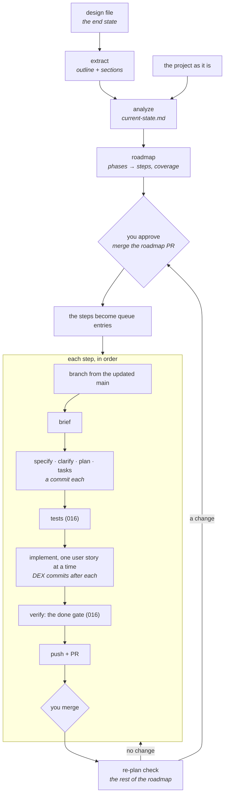

# 019 — Design roadmap: from a finished design to merged steps, one branch and one PR each

> **Status:** draft v1.0 · 2026-11-05 · the brief for spec-kit. Feature, branch and spec folder: `019-design-roadmap`.
>
> **Builds on:**
> - [`015-lean-core`](../015-lean-core/README.md): the queue, the picker, `generate` briefs, `branching.ts`, and `createBranch` / `createPullRequest` in `git.ts`;
> - [`016-grounded-loop`](../016-grounded-loop/README.md): the `tests` stage and the done gate, which is what "testable at the end of a step" means;
> - [`017-living-docs`](../017-living-docs/README.md): the handoff into the `brief` stage (D-017-7), which is how one step's lessons reach the next.
>
> **Independent of** [`018`](../018-many-projects-any-agent/README.md). It works with whatever agent runs the stages.
>
> **First real user:** `nex` (`~/Projects/Github/lukaskellerstein/nex`), with its design `nex-design.html` ([Appendix A](#appendix-a--first-real-user-nex)).
>
> **How to start:** commit this brief on `main`, start `claude -w 019-design-roadmap`, and run `/speckit-specify` with this file as the feature description.

## Why

DEX can turn a goal into features only for a **new** project: `GOAL.md` → clarification → `GOAL_clarified.md` → a feature list (`stages/manifest-extraction.ts`). All the features then go on one run branch, with one optional PR at the end. 015 kept that path and added the queue with `generate` briefs, but in an existing project a human still writes the queue. `onion-demo-01`'s queue was written by hand from its monthly plan.

What's missing:

1. **A finished design as the input**, not a goal paragraph. NEX's design has about 125k tokens of text, 93 diagrams and 161 headings, which is too much for one agent to read next to the code.
2. **An existing project as the starting point.** What's already built must be found, not rebuilt. NEX has 24 hand-written briefs and a working platform.
3. **Phases and steps, each one shippable.** Each step gets one branch, ends testable, and goes up as one PR that is merged before the next step starts.
4. **Commits that mean something:** one per user story, made by DEX, instead of one per run or whatever the agent decides.

## What DEX does after this spec



## Decisions

### D-019-1 — The design is a file the project owns, and DEX reads it in sections

- **Declaring it.** The queue names the design: `"roadmap": {"design": "nex-design.html", "dir": "docs/roadmap"}`.
- **Formats:** HTML, Markdown and PDF.
- **Extraction.** DEX splits the design into sections with no LLM.
  - Headings become section ids (`3.4.1`), and diagrams contribute their text labels.
  - The result is `.dex/design/outline.json` (id, title, token count, hash for each section) plus one `.dex/design/sections/<id>.md` per section. Both are derived and untracked.
- **No agent reads the whole design.** Agents read the outline, plus the sections they're working on.
- **When the design changes,** DEX lists the changed sections and the steps that cite them, and proposes a re-plan (D-019-6). Nothing changes until you approve it.

### D-019-2 — Analyze: what's already there

A new `analyze` stage. A fresh agent reads:

- the design's outline;
- the project's tree;
- its existing specs and briefs (`specs/*`, `docs/my-specs/*`);
- its docs (017);
- a summary of its git log.

It returns one row per design section: `built`, `partly built`, `not built`, or `conflicts with the design`, with evidence (file paths, spec ids) and a note. DEX writes this as `docs/roadmap/current-state.md`.

- **DEX checks the evidence:** every path the agent cites must exist. This is the same broken-reference check as 017's.
- **An empty project** gets a table where every section is `not built`, and the stage still runs, so the roadmap always starts from a table.
- **A design that describes today's code itself** (NEX's §8.12) is read first.

### D-019-3 — Roadmap: phases and steps, and checks DEX runs itself

A new `roadmap` stage. A fresh agent proposes `docs/roadmap/roadmap.md`, with `roadmap.json` as its structured twin.

- **A phase** is a milestone you can demo, for example "one ticket runs end to end". The first phase builds a thin path through the whole product before any part is made deep.
- **A step** is one spec-kit feature, one branch and one PR. It has:
  - `id` (`P1.S2`), title and goal;
  - the design sections it implements;
  - `dependsOn` (earlier steps);
  - `acceptance`: how it's tested at the end. This becomes the queue entry's acceptance command for 016;
  - a size estimate in user stories (default 2–5).

DEX checks the roadmap without an LLM:

- **Coverage.** Every design section is covered by a step, is `built` in the analysis, or sits under `notPlanned` with a reason.
- **Order.** Every dependency is an earlier step, and there are no cycles.
- **Completeness.** Ids are unique, and every step has an acceptance check.

A failed check sends the stage back with the failures. After two failed attempts, the problem goes to you in the inbox.

### D-019-4 — You approve the roadmap, and approving it writes the queue

- **The roadmap goes up as its own PR,** on a `roadmap` branch: `current-state.md`, `roadmap.md`, `roadmap.json`, and the new queue entries. Edit, reorder or cut steps in the PR. **Merging it is the approval.**
- **Each step becomes a queue entry:**
  - `id`: the project's next spec number plus a slug;
  - `step`: the roadmap step's id;
  - `baseBranch`: `main`;
  - `branch`: the entry's id;
  - `generate.sources`: the roadmap step, its design sections and its current-state rows.
- **The loop still never writes the queue** (D-015-4). Entries arrive only inside a PR you merged.
- **A project with no remote** (`git.pullRequest: false`) gets the same files committed on `main` once you approve in the inbox.

### D-019-5 — Git, configured per project

The policy gains a `git` section:

```json
"git": {
  "branches": "per-entry",
  "commits": "per-task-phase",
  "pullRequest": "per-entry",
  "merge": "human",
  "mergeMethod": "merge",
  "mainBranch": "main",
  "remote": "origin"
}
```

| Field | Values | 015's behaviour |
|---|---|---|
| `branches` | `none` · `per-run` · `per-entry` | `none` for an existing project, `per-run` for a new one |
| `commits` | `agent` · `per-stage` · `per-task-phase` | `agent` |
| `pullRequest` | `false` · `per-run` · `per-entry` | `false`. 015's `openPullRequest: true` is read as `per-run` |
| `merge` | `human` · `auto` | n/a |
| `mergeMethod` | `merge` · `squash` | n/a |

A project without a `git` section keeps 015's behaviour exactly. A roadmap project defaults to the JSON above.

- **Branch per entry.** Before an entry's `brief`, DEX brings `mainBranch` up to date (fetch, then fast-forward only) and creates the entry's branch from it. If `main` can't fast-forward, the run pauses. Milestone 0 finds how spec-kit's `specify` reuses a branch DEX made; letting spec-kit make the branch stays the fallback.
- **Commit per task phase.** spec-kit's `tasks.md` is grouped by user story, and the picker already implements one task phase at a time.
  - After a phase passes 016's progress gate (newly ticked tasks, green fast checks), DEX commits: `<entry id>: <phase name> (T014–T022)`, with `Dex-Stage` and `Dex-Evidence` trailers.
  - Setup, Foundational and Polish phases get a commit each too. Each spec-kit stage commits its own documents, and the brief is the branch's first commit.
  - In this mode the policy denies the agent's own `git commit`, so a commit means what the setting says.
- **DEX's own Git actions** (commit, push to the entry's branch, opening the PR, merging) are permitted by this section, not by the agent rules. Force-push and pushes to `main` are never among them.
- **End of a step.** DEX pushes and opens a PR only when the done gate (016) passes. The PR body is the step's digest (016 D-016-10), the roadmap step, the design sections it covers, and the verify verdict.
- **`merge: "human"`.** DEX files a "PR ready" item in the inbox and watches the PR with `gh pr view --json state,mergedAt`.
  - On merge it fetches, switches to `main`, fast-forwards, and moves on.
  - A PR closed without merging goes to the inbox: retry the step, or re-plan.
  - Waiting holds no slot (018).
- **`merge: "auto"`** merges with `gh pr merge` once the repository's required checks are green. It's opt-in.
- **`mergeMethod: "merge"`** keeps the per-story commits on `main`. A squash would fold them into one.

### D-019-6 — After each merge, DEX re-checks the rest of the plan

A short `replan` stage runs after every merged step. A fresh agent reads:

- the roadmap and its remaining steps;
- the merged step's digest;
- the docs and decision log (017's handoff);
- the current-state rows for the sections the step touched.

It returns either "no change" or a list of changes (split, merge, reorder, drop or add a step), each with its reason.

- **"No change"** with DEX's checks still passing means the next step starts without you.
- **A change** goes up as a roadmap PR (or to the inbox without a remote). It touches only steps that haven't started; a started step is never rewritten.
- **A changed design file** (D-019-1) also starts a `replan`.

### D-019-7 — Briefs come from the roadmap

015's `generate` is the mechanism. The brief stage gets:

- the step's goal, acceptance and dependencies;
- the text of its design sections;
- its current-state rows;
- the previous step's digest, and the docs (D-017-7).

It writes the brief in the project's own style: NEX keeps flat `docs/my-specs/NN-name.md` files, and DEX keeps folders with a `README.md`. Then spec-kit takes over, as for any entry.

### D-019-8 — One step at a time

Steps run in order on one checkout. Each next step branches from the `main` its predecessor was merged into. Running independent steps in parallel, in worktrees, is out of scope. The roadmap records dependencies so that it can come later.

### D-019-9 — The picker, CLI and UI

**Picker rows** come before 015's per-entry rows, in a project whose queue names a design:

| Condition | Stage |
|---|---|
| No `current-state.md` for the design's current hash | `analyze` |
| No `roadmap.json` | `roadmap` (always gated) |
| The roadmap PR is open, or the queue has no roadmap entries yet | wait for your approval |
| The current entry's PR is open | wait for the merge |
| A merged step with no `replan` record | `replan` |

**CLI commands:**
- `dex roadmap init --design <file>`;
- `dex roadmap status` (phases and steps with their branch, PR and stage, plus design coverage);
- `dex roadmap approve` (for a project without a remote).

**UI:** a Roadmap view. It shows phases → steps, each step's state (planned, in progress at a stage, PR open, merged), the share of design sections covered, and links to the PRs.

## Configuration

- **`.dex/queue.json`:** `roadmap: {design, dir}`, and `step` on each entry.
- **`.dex/policy.json`:** the `git` section (D-019-5).
- **Entries from a roadmap** carry 016's `acceptance`, taken from the step.

## Files

### Add

- `core/design/extract.ts`: HTML, Markdown and PDF → sections.
- `core/design/outline.ts`.
- `core/roadmap.ts`: the schema, plus the coverage and order checks; pure, with table tests.
- `stages/analyze.ts`, `stages/roadmap.ts`, `stages/replan.ts`.
- `core/git-policy.ts`: what to do with branches, commits, PRs and merges under the `git` section. The decisions are pure; it calls `git.ts` for the actions.
- `core/pr-watch.ts`.
- The `dex roadmap` CLI commands, and `renderer/components/roadmap/`.

### Change

- `picker.ts`: the rows above.
- `branching.ts`: per-entry branches.
- `git.ts`: commit, fetch with fast-forward only, a PR per entry, merge.
- `run-lifecycle.ts`: a PR per entry instead of per run.
- `queue.ts`: the `roadmap` section and `step`.
- `policy.ts`: the `git` section, with `openPullRequest` read as `per-run`.
- `prompts.ts`: in `per-task-phase` mode, tell the agent DEX commits.
- **Mock:** a local bare remote and a fake `gh` on `PATH` (PR open, merged, closed), so a whole roadmap runs at $0.

## Implementation order

0. **Measure:**
   - how spec-kit's `specify` uses a branch DEX already made;
   - what extraction gets from `nex-design.html` (sections, token counts, diagram labels);
   - which `gh pr view` fields tell merged from closed.
1. **Git policy** (D-019-5) on a hand-written queue, with no roadmap yet. Branch per entry, commit per task phase, PR per entry, wait for the merge. Useful on its own.
2. **Design extraction** (D-019-1).
3. **Analyze, roadmap, checks and approval** (D-019-2, -3, -4).
4. **Re-plan** (D-019-6) and briefs from the roadmap (D-019-7).
5. **CLI and UI** (D-019-9).
6. **NEX** (Appendix A):
   - analyze and roadmap only: you review the roadmap PR;
   - then the first step, run to a merged PR.

## Verification (DoD)

- [ ] Mock: a three-section design becomes a two-step roadmap, two branches, a commit per task phase, two PRs (fake `gh`) merged in order, and a `main` that holds both. All at $0.
- [ ] The coverage check catches a design section that no step covers. A dependency on a later step is refused.
- [ ] `git log` on a step branch shows the brief, one commit per spec-kit stage and one per task phase, and no commit made by the agent.
- [ ] With `merge: "human"` DEX waits. A closed PR produces an inbox item, never a silent next step.
- [ ] A changed design file lists its changed sections and proposes a re-plan, and nothing in the queue changes until you approve it.
- [ ] A project with no `git` section behaves exactly as under 015: no DEX commit, branch or push (015's own checks still pass).
- [ ] `main` only ever moves by fast-forward or by a merged PR. DEX never force-pushes and never pushes to `main`.
- [ ] On NEX, the roadmap PR covers every design section, or lists it as built or not planned, and the owner signs it off.

## Out of scope

- Steps in parallel.
- Writing or editing the design itself.
- Release branches and environments, such as NEX's own develop / release / main.
- Rebasing a step branch when someone else moved `main` under it. DEX pauses and asks.
- Cost estimates per step.

## Open decisions

The proposed default is in bold.

1. **Approval:** **the roadmap as a PR you merge** | approval in the inbox.
2. **Who commits:** **DEX, once per task phase, with the agent's own `git commit` denied** | the agent, told when to commit.
3. **Merge:** **you merge** | DEX merges once checks are green.
4. **Merge method:** **merge commit, keeping the per-story commits** | squash.
5. **Re-plan:** **after every merge, and "no change" passes without you** | only when you ask.
6. **Where the roadmap files live:** **`docs/roadmap/`, tracked** | `.dex/`, untracked.
7. **Step size:** **2–5 user stories** | another range.

## Appendix A — first real user: `nex`

- **The design:** `nex-design.html`.
  - 1.13 MB: about 125k tokens of text, 93 SVG diagrams, 161 headings.
  - Chapters: Overview; the four cycles (implementation, testing, environment, improvement); extension; configuration; the platform; security and cost; Decisions; Open for you.
- **Where analyze starts:** §8.12, "What the current code keeps, and what is new". The design calls it "the one place in the design that speaks of today", and it points to `docs/architecture/flow.md` (ADR-072) for today's code.
- **Today's state:**
  - `platform/` (Python 3.12, Temporal, Kubernetes Jobs);
  - 37 ADRs in `docs/architecture/adr/`;
  - 24 hand-written briefs in `docs/my-specs/` (`01-…` to `25-…`, plus `XX-projects-and-goals.md`);
  - remote `origin` on GitHub, so PR mode.
- **"Open for you"** holds design decisions that are still open. Sections that depend on them go under `notPlanned: waiting on a decision`, and each open decision becomes an inbox question. They're never guessed.
- **Owner steps before the first run:**
  - spec-kit isn't installed in NEX (no `.specify/`), and DEX never runs `specify init` in an existing project (015), so you install it;
  - you write `.dex/policy.json` from NEX's own `.claude/` rules;
  - you delete or keep the stray local branches `abcd`, `balbal` and `xyz`.
- **Numbering:** steps continue at `26-…`, in NEX's flat brief style.
