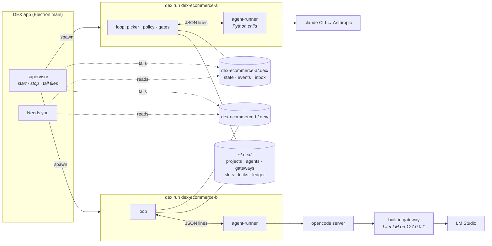

# 019 — Many projects, any agent: several projects at once, on Claude Code, Codex or OpenCode, through a gateway you choose

> **Status:** draft v1.0 · 2026-11-05 · a brief for spex, written before 017: where the body names a spec-kit file or command, 017 replaces it with its spex form. Feature, branch and spec folder: `019-many-projects-any-agent`.
>
> **Builds on** [`015-lean-core`](../015-lean-core/README.md) (queue, picker, policy, headless `dex run`), [`016-grounded-loop`](../016-grounded-loop/README.md) (stages, write scopes, gates DEX runs itself) and [`018-living-docs`](../018-living-docs/README.md) (the project's docs as the loop's memory).
>
> **Takes from REX** (`~/Projects/Github/lukaskellerstein/rex`): its agent library `agent-runner/` (REX specs 42, 44, 47) and its built-in gateway `local-gateway/` (REX spec 46). DEX **uses** both instead of porting them. [Appendix B](#appendix-b--what-changes-in-rexs-library) lists the changes REX's library needs before a second app can use it. Those changes also remove the places where the library still names REX.
>
> **Timing:** after 018. It doesn't block the first real `dex-ecommerce` queue, which runs on Claude through 015–018. 015 built `policy.ts` over Claude's tool names; this spec converts it (D-019-4).
>
> **How to start:** milestone 0 comes first, in the REX repo: the measurements in [Implementation order](#implementation-order) and the library changes in Appendix B, released as a REX tag. Then commit this brief on DEX `main`, start `claude -w 019-many-projects-any-agent`, and run `/spex:specify docs/my-specs/019-many-projects-any-agent/README.md`.

## Why

Two limits remain after 018.

1. **One project at a time.** `orchestrator.ts` keeps one module-level `runtimeState.currentContext`. The `orchestrator:start` IPC takes one `RunConfig`, and `stopRun()` stops "the" run. While one project runs overnight, no other project runs.
2. **One agent.** `agent/index.ts` knows `claude` and `mock`. `ClaudeAgentRunner.ts` (873 lines) imports the Claude Agent SDK, and the stages lean on Claude-only behaviour:
   - `/speckit-*` skill dispatch;
   - `AskUserQuestion` interception;
   - `TodoWrite` for the task board;
   - `output_format` for verdicts.

   `agent-profile.ts` names `codex` and `copilot` kinds with no runner behind them (015 deletes it).

What more agents buy:

- **A checker from another vendor.** 016's verifier can run on a different model family from the implementer, so maker and checker don't share blind spots.
- **Another account when one hits its limit.**
- **Local open-source models**, for work that can stay on the machine. They're judged by the same gates DEX runs (016): a weak model fails a gate, it can't declare itself done.
REX has already built the agent half:

| REX piece | What it does | Size |
|---|---|---|
| `agent-runner/` | Claude Agent SDK, Codex, OpenCode and Deep Agents behind one interface. It's a Python child on a JSON-lines pipe, its TypeScript types are generated from its models, and the host decides every tool call | 8.7k lines of Python (6.2k in adapters), 29 test files |
| `local-gateway/` | LiteLLM on `127.0.0.1`: LM Studio, Ollama, Unsloth, OpenAI, OpenRouter, Anthropic. One model alias serves every agent | 1.5k lines |

It also comes with findings that DEX would otherwise have to measure again:

- **Codex:**
  - It always makes its working directory writable, whatever the sandbox says.
  - Its SDK gives no usable veto before a tool runs.
  - It starts the plugins in `~/.codex` unless `CODEX_HOME` is isolated.
- **OpenCode** needs its own server per run, because per-run headers can't share one.- **The SDKs count tokens differently** (REX spec 61).
- **Claude, in a headless run, gets stuck on permission prompts** that a hook's "allow" doesn't suppress (REX spec 52).
- **An `ANTHROPIC_API_KEY` exported in the shell overrides `claude login`**, so a "subscription" run is billed to an API account.

## What DEX is after this spec

- **Many projects.** Every running project is one `dex run` process with its own agent-library child. The app supervises those processes, and a run started from a terminal is the same kind of process.
- **One "Needs you" inbox** for questions, tool approvals and lessons from every project.
- **Agent profiles:** agent (`claude-agent`, `codex`, `opencode` or `mock`) + gateway + model + effort. The project's policy picks a profile per stage. DEX refuses to start a stage on an agent that can't enforce that stage's rules.
- **Three gateway kinds:**
  - **Original:** each CLI on its own login.
  - **Built-in:** DEX's own LiteLLM, for local and API-key models.
  - **LiteLLM:** one you run yourself.
- **DEX imports no agent SDK.** `grep -rn "claude-agent-sdk" src/ package.json` finds nothing.



## Decisions

### D-019-1 — DEX uses REX's agent library; it doesn't port it

DEX starts `agent-runner` as a child process (`python -m agent_runner`) and speaks its pipe protocol. DEX's TypeScript types are generated from the library's Pydantic models (`python -m agent_runner.protocol --typescript > src/core/agent/protocol.ts`), and a test regenerates them and fails on drift.

- **A pinned REX tag.** `dex/agent-host/pyproject.toml` depends on `agent-runner @ git+https://github.com/lukaskellerstein/rex@<tag>#subdirectory=agent-runner`, and on `local-gateway` the same way. `npm run setup:agents` runs `uv sync`, and DEX runs that venv's Python directly.
- **Version check.** The library's first message, `ready`, carries its protocol version. On a mismatch DEX refuses to start a run and names both versions.
- **The mock stays in TypeScript.** `MockBackend` implements the same interface, so mock runs and unit tests need no Python.
- **One method.** `AgentRunner`'s three methods become one: `run(request, onEvent, askPolicy, signal) → result`.
  - `runOneShot` loses its last caller in 015 (the conflict resolver).
  - `runTaskPhase` differs from `runStep` only by `TodoWrite`, which goes (D-019-5).
- **Delete the old runner.** `ClaudeAgentRunner.ts` and the SDK dependency go once Claude, run through the library, matches it on `dex-ecommerce`.

**Why not a TypeScript port?** All three agents have TypeScript SDKs, so a port is possible. It would mean writing 6.2k lines of adapters a second time, measuring every finding above again, and fixing every later bug in two places. What reuse costs instead: Python and `uv` for real runs, and a pin across two repos.

### D-019-2 — One process per running project

`dex run <dir>` (D-015-8) is the unit. The app's supervisor starts one per project you start, each in its own process group. A run started from a terminal is the same thing.

- **Isolation.** Each run process has its own agent-library child, environment and working directory.
  - An SDK crash takes down only that project.
  - Stopping a run kills its process group, so no `claude`, `codex` or `opencode` process is left behind.
  - 015's file-derived picker (D-015-1) means a crashed stage simply runs again.
- **Everything a viewer needs is in the project's files:**
  - `.dex/state.json` (015);
  - `.dex/runs/<runId>/events.jsonl`, append-only;
  - `.dex/inbox/` (D-019-3).

  The supervisor tails these files and keeps no state of its own. When the app restarts, it reattaches to every run whose lock names a live process.
- **Quitting the app with runs active** asks whether to stop them or keep them running in the background.
- **The singleton can stay.** The module-level `currentContext` is harmless with one project per process.

### D-019-3 — Questions, approvals and lessons are files, in one inbox

- **Asking.** A run that needs a human writes `.dex/inbox/<id>.json` (`kind`: question, approval, lessons or amendment, plus entry, stage, payload and time) and waits for `<id>.answer.json`.
- **Answering.** The app, `dex answer <id>` and the terminal prompt of a CLI run all write that same answer file, written to a temp file and then renamed. The first answer wins; a later one is ignored and is told so.
- **The app's inbox** lists every pending item across projects, oldest first, with the project's name. A macOS notification fires when an item arrives and the window isn't focused. `dex inbox` gives the same list in a terminal.
- **`.dex/questions.md`** (015) becomes a view of the inbox.
- **Waiting for a human holds no slot** (D-019-10).

### D-019-4 — The policy judges tool calls in a common vocabulary

015 built `policy.ts` over Claude's tool names: its `ToolCall` is `{toolName, input}`, and `WRITE_TOOLS` lists Edit, Write, MultiEdit and NotebookEdit. This spec converts it to REX's `ToolCall` shape, `{name, common, input}`, so one policy judges every agent.

- **`common`** is one of `read`, `list`, `search`, `fetch`, `write`, `edit`, `shell`, `mcp` or `task` (REX spec 42 §8), or null when a tool maps to none of them.
- **The library does the mapping** (Bash → `shell`, Edit → `edit`, Write and NotebookEdit → `write`, and so on). `policy.ts` decides on `common` and never sees an SDK's own tool names.
- **Rule forms.** `deny` and `ask` keep 015's regex over the whole shell command, and gain a `{binary, args}` form.
  - The new form is matched against each simple command. 015 already splits compound commands for settings `ask` rules (`agent/settingsRules.ts`: `&&`, `||`, `;`, `|` and new lines), and the new form reuses that splitter.
  - REX learned that agents write `git -C /path push`, which a prefix regex misses.
  - A command hidden in `$(…)` or `bash -c` isn't split, so it's matched by the regex only.
- **Unmapped tools** are allowed unless a rule names them. The exception is "ask the user" tools (Claude's `AskUserQuestion`, OpenCode's question tool), which are refused with: "put the question in your result's `questions` field" (D-019-5).
- **It's still a guardrail** against an agent's mistakes, not a sandbox against a hostile one (015).

### D-019-5 — Stages stop depending on Claude-only features

| Today (Claude only) | After this spec |
|---|---|
| `/speckit-specify …` dispatches the skill | DEX reads the command file the project installed (for example `.claude/skills/speckit-specify/SKILL.md`) and substitutes `$ARGUMENTS`. It says where the skill's own files are and sends the result as the prompt. Every agent gets the same prompt, and `--dry-run` shows it in full |
| `AskUserQuestion`, intercepted mid-run (D-015-6, D-016-3) | Questions are part of the stage's result, as `questions: [{text, options, recommended?}]`. In `recommended-then-review` mode the agent carries on with the recommended option, and DEX files the question for review. A question with no recommendation, or a test amendment (016), ends the stage: DEX files it in the inbox, and the stage runs again, fresh, with the answer in its prompt |
| The task board is fed by `TodoWrite` | DEX reads `tasks.md` whenever the run reports a write to it (`wrote` and `diff` events) and after each stage. `tasks.md` is the truth (015, 016) |
| `output_format` (Claude) | `RunRequest.output_schema` → `RunResult.output` (Appendix B3). An agent with native support uses it. Otherwise the library asks for one JSON object as the final message, validates it, and on failure resumes once with the validation error. DEX validates again |
| Agent instructions load because Claude reads `.claude/` | D-019-6 |

Every stage result shares one small schema: `summary`, `questions`, `lessons` (018) and `amendments` (016), plus that stage's own fields.

### D-019-6 — Every agent gets the project's instructions

Claude Code loads `CLAUDE.md` and `.claude/rules/*.md` itself. Codex and OpenCode read `AGENTS.md`, and milestone 0 checks what OpenCode does with `CLAUDE.md`. A `dex-ecommerce` clone has its spec-kit skills under `.claude/skills/` and no `AGENTS.md`, so a Codex run there wouldn't see any of them.

- **What counts.** The project's agent instructions are 018's docs with `audience: agent` and `read: always`. Without a docs list, DEX uses `CLAUDE.md`, `.claude/CLAUDE.md`, `.claude/rules/*.md` and `AGENTS.md`.
- **Inlining.** For an agent that doesn't load a file itself, DEX appends it to the system prompt under its path.
- **The dry run shows it.** For each stage and agent, `--dry-run` prints what loads natively, what DEX inlined, and a token count.
- **Context check.** A stage doesn't start (D-019-7) when its model's known context window is smaller than the inlined instructions, plus the stage prompt, plus `limits.minHeadroomTokens` (default 32k). REX measured LM Studio loading models with 8,192 tokens of context.

### D-019-7 — DEX refuses a stage on an agent that can't hold its rules

The agents keep their safety in different places, as REX measured:

| | Claude Agent SDK | OpenCode | Codex |
|---|---|---|---|
| Refuse a shell command before it runs | yes: the PreToolUse hook | yes: a permission `ask` that DEX answers | **no**: the policy sees a command only after the sandbox has run it (REX spec 44 §9.1). Milestone 0 measures Codex's command rules |
| Hold a call for a human | yes: the hook waits | yes: the permission waits | no |
| Confine writes | the hook, against `writeRoots` | the permission, plus a macOS seatbelt around the server | sandbox `writable_roots`, but the working directory is always writable |
| Switch the network off | no | no | the sandbox's switch |

The library reports these facts per route (Appendix B2). Before each stage, DEX works out what the stage needs from the policy:

- **`deny` rules on shell commands** need a shell veto before the command runs.
- **`ask` rules** need a veto that can wait for a human.
- **Write scopes and frozen files** (015, 016) need nothing from the agent. DEX checks them again from git after every stage, for every agent, and a veto before the write is an extra layer where the agent has one.
- **The context window** must fit (D-019-6).

A stage that needs something its agent lacks doesn't start, and the refusal names the rule and the agent. For example: "implement for 003-promo-codes can't run on codex: policy deny[0] (`git push --force`) needs a veto before the command runs, and Codex reports commands only after its sandbox has run them."

`dex run --dry-run` prints this table for the whole queue. The library checks again when the run starts. In REX's words: "a capability flag and a run-time check that could disagree are two ways to be wrong".

### D-019-8 — Agent profiles, chosen per stage

**Profiles** live on the machine, in `~/.dex/agents.json`:

```json
{
  "default": "claude",
  "profiles": {
    "claude":      { "agent": "claude-agent", "gateway": "original", "model": "claude-opus-5-5", "effort": "high" },
    "claude-fast": { "agent": "claude-agent", "gateway": "original", "model": "claude-sonnet-5-5" },
    "codex":       { "agent": "codex",        "gateway": "original" },
    "local":       { "agent": "opencode",     "gateway": "builtin",  "model": "qwen3-coder" }
  }
}
```

- A missing `model` means the agent's own default.
- Models and effort levels come from the library's capabilities probe (REX specs 58 and 60), not from typing.
- `local` above is an example: its model is whatever alias the built-in gateway serves.
- The library also describes `deep-agents`. DEX doesn't offer it, and refuses a profile that names it (see Out of scope).

**The project's choice** goes in its tracked policy:

```json
"agents": { "default": "claude", "stages": { "verify": "codex", "docs": "claude-fast" } }
```

- **Precedence:** `dex run --agent <profile>` or `--stage-agent verify=<profile>`, then the machine's entry for the project in `~/.dex/projects.json`, then the policy, then the machine default.
- **No fallback.** A profile name the machine doesn't have is refused by name.
- **Records.** Evidence records (016) and digests note the agent, gateway and model of each stage, so every gate result can be read against who did the work.
- **Budgets.** 015's limits in USD apply where the agent reports a cost. `limits.maxTokensPerStage` and `limits.maxTokensPerRun` always apply, because the library reports tokens the same way for every SDK. The library stops a run at the cap (Appendix B5).

### D-019-9 — Gateways: Original, Built-in, LiteLLM

These are REX's three kinds. Their forms are drawn from the library's descriptor, so DEX's UI hard-codes no gateway (REX spec 42 §10).

| Kind | What it is | Credentials |
|---|---|---|
| **Original** | each CLI on its own login: `claude login`, `codex login`, OpenCode's own config | the CLI's own store |
| **Built-in** | DEX's LiteLLM (`local-gateway`) on `127.0.0.1`. Local providers: LM Studio, Ollama, Unsloth. Key providers: OpenAI, OpenRouter, Anthropic | provider keys and the master key, in the macOS Keychain |
| **LiteLLM** | one you run yourself | its master key, in the Keychain |

Gateways are stored machine-wide in `~/.dex/gateways.json`, which holds no secrets, and never in a project. One model alias reaches every agent: LiteLLM serves `/v1/messages`, `/v1/responses` and `/v1/chat/completions` from the same name (REX spec 46 §4.5). So Claude Code, Codex and OpenCode can all use the same local model.

Where DEX differs from REX, because several DEX processes share one gateway:

- **Lifecycle.** The first run that needs the gateway starts it, detached. Its pid and port go in `~/.dex/gateway/state.json`, and `dex gateway status|stop` controls it. It stops itself after 30 minutes with no stage using it.
- **The master key** is random on each start and kept in the Keychain. REX keeps it in one process's environment; DEX has several processes to hand it to.
- **Port.** The default is 24335, because REX uses 24334. If the port is taken it moves, as REX's does.
- **Keychain access** goes through `/usr/bin/security`, so it works from the CLI without Electron. Reads use `find-generic-password -w`. Writes go through `security -i` on stdin, so a key never shows in a process list.
- **Labels.** Every request carries `project`, `entry`, `stage` and `run` labels (Appendix B1), so the gateway's own logs can group spend by project.
- **Model warnings** follow REX: a model the provider says can't call tools is marked before you pick it (REX spec 46 §5.5), and the context window is checked as in D-019-6.

### D-019-10 — Limits across projects

`~/.dex/config.json`:

| Field | Meaning | Default |
|---|---|---|
| `maxConcurrentStages` | agent stages running at once, across all projects | 3 |
| `gateways.<id>.maxConcurrent` | stages using one gateway at once | 1 for a built-in gateway with only local providers; otherwise no limit |
| `maxBudgetUsdPerDay` | reported spend across all projects | none |
| `maxTokensPerDay` | tokens across all projects | none |

- **Slots** are lock files in `~/.dex/slots/`, created exclusively and holding a pid. A dead pid frees its slot.
  - A stage takes a slot before it starts and gives it back when it ends. Waiting for a human holds none.
  - A stage that is waiting says what for, for example: "waiting for gateway builtin (1/1 in use: dex-ecommerce-a implement)".
- **Spend** is appended to `~/.dex/ledger/<date>.jsonl` after each stage, and DEX adds up today's lines before each stage. Over a cap, no new stage starts in any project. Running stages finish, and an inbox item says why.

### D-019-11 — Two runs never share a tree or a declared resource

- **Tree locks.** A run locks its project (`.dex/run.lock`, with its pid). Machine-wide, it also locks the git top level of the project and of each `repos` entry (015), as `~/.dex/locks/<hash of real path>`.
  - A project whose locks overlap a running one waits, naming the other run. With `--no-wait` it exits instead.
  - Two worktrees of one repository are different trees, so they run in parallel.
- **Resources.** `resources` in the policy names things outside the tree that two runs mustn't touch at once, such as a staging database that two `dex-ecommerce` clones both seed. A run holds its resource locks while a stage runs.

### D-019-12 — The app shows the projects, then a project

- **Sidebar:** every registered project, one line each: running (entry · stage · agent · today's cost), needs you (n), blocked (a gate or a stall, 016), idle or done.
- **Inbox** at the top (D-019-3).
- **A project's page** is 015's slimmed UI, plus the agent and model on each stage.
- **Settings:** Gateways, Agent profiles, Limits.
- **CLI commands:**
  - `dex projects add|list|remove`;
  - `dex status` (every project, read from files and locks);
  - `dex inbox` and `dex answer <id>`;
  - `dex gateways list|add|test|remove` and `dex gateway start|stop|status`;
  - `dex agents list|probe`;
  - `dex doctor`, which checks the Python environment, the three CLIs, their logins and the Keychain items.

## Configuration

**Project** (`.dex/policy.json`, tracked), new fields:

- `agents` (D-019-8);
- `resources` (D-019-11);
- `limits.maxTokensPerStage`, `limits.maxTokensPerRun`, `limits.minHeadroomTokens`;
- `agentConfig`: `"user"` or `"project"` (Appendix B6). The default is `"user"`, matching 015's `settingSources`.

**Machine** (`~/.dex/`): `projects.json`, `agents.json`, `gateways.json`, `config.json`, plus the `slots/`, `locks/`, `ledger/` and `gateway/` folders. Secrets live only in the Keychain, under service `dex`.

## Files

### REX (milestone 0)

[Appendix B](#appendix-b--what-changes-in-rexs-library), as a REX spec of its own.

### DEX — add

- `agent-host/pyproject.toml` and `uv.lock`: the pin (D-019-1).
- `src/core/agent/`:
  - `protocol.ts` (generated);
  - `backend.ts` (the interface);
  - `library.ts` (start the child, `ready`, version check, many runs on one pipe, stop);
  - `mock.ts` (from `MockAgentRunner.ts`);
  - `request.ts` (stage → `RunRequest`; pure);
  - `eligibility.ts` (D-019-7; pure, table tests);
  - `instructions.ts` (D-019-6);
  - `commands.ts` (spec-kit commands, D-019-5).
- `src/core/machine/`: `registry.ts`, `profiles.ts`, `gateways.ts`, `keychain.ts`, `slots.ts`, `locks.ts`, `ledger.ts`, `gateway-lifecycle.ts`.
- `src/core/inbox.ts`.
- `src/main/supervisor.ts`: start, tail, stop, reattach.
- Renderer: the projects sidebar, the inbox, the three settings pages.

### DEX — change

- `policy.ts` (015): the common vocabulary and the `{binary, args}` rule form (D-019-4).
- Stages:
  - prompts come from `commands.ts`;
  - the shared result schema;
  - questions go to the inbox;
  - the task board reads `tasks.md`.
- `cli.ts`: the new commands.
- `MockConfig.ts`: scenarios per agent, so the unhappy paths run at zero cost:
  - a refusal for eligibility;
  - no cost reported;
  - no native schema;
  - a slot wait;
  - an answer arriving from the CLI.

### DEX — delete

- `agent/ClaudeAgentRunner.ts` and the `@anthropic-ai/claude-agent-sdk` dependency.
- The `TodoWrite` and `AskUserQuestion` interception, and `userInput.ts`'s pending map (the inbox replaces it).

## Implementation order

0. **Measure, then change the library (REX repo).** Run the measurements below, then build Appendix B behind protocol version 2 and release it as a REX tag. REX's own test suites must pass.
1. **The seam** (D-019-1):
   - the `agent-host` pin, the generated types, `LibraryBackend` and `MockBackend`, and one `run()`;
   - Claude through the library must match the current runner on `dex-ecommerce`: first the mock queue, then one real entry;
   - then delete `ClaudeAgentRunner.ts`.
2. **Agent-neutral stages** (D-019-4, -5, -6). A dry run on a `dex-ecommerce` clone shows the same prompts for every agent, apart from the inlined instructions.
3. **Profiles and eligibility** (D-019-7, -8).
4. **Gateways** (D-019-9).
   - Claude, Codex and OpenCode each run one `dex-ecommerce` entry on Original.
   - Claude and OpenCode each run a stage through the built-in gateway to a local model.
5. **Many projects** (D-019-2, -3, -10, -11): the supervisor, inbox, slots, locks, ledger and CLI.
6. **UI** (D-019-12).
7. **Dogfood.** On one machine, overnight, two scratch clones: `dex-ecommerce-a` on Claude, and `dex-ecommerce-b` on OpenCode with a local model.

**Milestone 0 measurements.** Following REX's practice, any finding that contradicts this brief is written into it.

1. Does a spec-kit command, expanded as text (D-019-5), produce `spec.md` under Codex and under OpenCode, in a scratch clone of `dex-ecommerce`?
2. **Codex command rules.** Does a `forbidden` rule in the run's own `CODEX_HOME` stop `git push --force` before it runs, through the SDK? If it does, Codex gets a shell veto for `deny` rules, but not for `ask` rules, which need a wait.
3. **OpenCode approvals.** Does a bash permission held for 15 minutes still run, or get refused cleanly, once DEX answers?
4. **Structured output.** Which agents take a schema natively?
5. **Local model.** Run one `specify` stage, end to end, on Claude Code through the built-in gateway to an LM Studio model. Record the context window and any tool-call failures.
6. What does OpenCode load from `CLAUDE.md` and `.claude/rules/`?
7. Does the owner's auto memory reach a Claude run through the library (Appendix B10)?
## Verification (DoD)

- [ ] `grep -rn "claude-agent-sdk" src/ package.json` finds nothing.
- [ ] The mock queue on `dex-ecommerce` runs to done at $0, on a machine with no Python environment.
- [ ] The same `dex-ecommerce` entry reaches a verify record under Claude, Codex and OpenCode on Original, and each record names its agent and model.
- [ ] Claude and OpenCode, through the built-in gateway to a local model, each run a stage. DEX's gates decide the result: a failure is a named gate failure, never a crash or a silent "done".
- [ ] `dex run --dry-run` on a `dex-ecommerce` clone prints the eligibility table. Codex is refused for every stage while the policy has shell rules, with the rule named, unless milestone 0 found a veto.
- [ ] Two projects run at once. Their events, inbox items and evidence never mix. Stopping one leaves none of its `claude`, `codex` or `opencode` processes behind (`pgrep`), and the other keeps going.
- [ ] Two registered projects on the same git top level can't run together; two worktrees of one repository can.
- [ ] Two projects that declare the same resource never run stages at the same time, as event timestamps show.
- [ ] On a one-slot gateway, two projects' stages run one after the other, and the waiting one says why.
- [ ] The daily budget stops new stages in every project and files an inbox item.
- [ ] An answer from the CLI reaches a run started from the app, and the other way round. A second answer is ignored and says so.
- [ ] No key or token appears in any file under `~/.dex/` or in the project (grep for the test keys), nor in `ps` output during `dex gateways add`.
- [ ] After a restart, the app reattaches to a run it left in the background.
- [ ] The protocol drift test passes, and a library with a different protocol version is refused by name.
- [ ] REX's own test suites pass at the tag DEX pins.

## Out of scope

- Copilot and Gemini CLI.
- **Deep Agents.** REX's library has an adapter, but it has no shell, and every DEX stage needs one: the agent commits, and most stages run spec-kit's scripts. Adding a shell would be new library work and a new safety surface, for an agent nobody plans to use in DEX. If that changes, it's a small follow-up: the policy middleware REX already has would sit in front of the shell.
- Agents on another machine, in containers or in the cloud.
- A traffic view like REX's (specs 45 and 51). The labels reach the gateway; reading them back comes later.
- One project waiting for another project's entry.
- Choosing an agent automatically, for example the cheapest.
- Different agents for different tasks inside one `implement`.
- Windows and Linux. The Keychain is macOS; REX is macOS-only too.

## Open decisions

The proposed default is in bold.

1. **Agent code:** **REX's `agent-runner` as a child process** | a port to the TypeScript SDKs.
2. **Where the library lives:** **in REX, pinned by tag**; move it to its own repository when a third app (VEX) wants it | its own repository now.
3. **Process model:** **one process per running project** | one process for all projects.
4. **Questions:** **part of the stage's result** | a DEX MCP tool that every agent can call mid-run.
5. **Spec-kit commands:** **DEX expands them, for every agent** | each agent's own command dispatch, where it has one.
6. **Codex in a project with shell rules:** **refused until milestone 0 finds a veto** | allowed with the network off.
7. **Quitting with runs active:** **ask** | always stop them | always keep them.
8. **Concurrency:** **3 stages; 1 per local-only gateway** | other numbers.
9. **Built-in gateway master key:** **Keychain, new on each start** | a file readable only by the owner (mode 0600).

## Appendix A — two `dex-ecommerce` scratch clones

- **Projects:** `dex-ecommerce-a` and `dex-ecommerce-b`, each a scratch clone with `origin` on its own scratch bare repo.
- **Profile:** `claude` for every stage of `dex-ecommerce-a`. The queue doesn't change.
- **Policy additions:**

  ```json
  "agents": { "default": "claude" },
  "resources": ["shop-staging-db"]
  ```

- **The expected dry run:**
  - **Claude:** eligible for every stage.
  - **OpenCode:** eligible once milestone 0 item 3 holds. DEX inlines the clone's agent instructions, and the dry run prints their token count.
  - **Codex:** refused for every stage, because the policy's `deny` rules cover force-push.
- **A checker from another vendor** is OpenCode with an OpenAI model through the built-in gateway, set as `"stages": {"verify": "<that profile>"}`. Only after milestone 0, and not the default.
- **The resource lock** means the two clones never seed the staging database at the same time.

## Appendix B — what changes in REX's library

These need a REX spec of their own. Each one keeps REX's behaviour the same: REX passes the values it uses today.

- **B1. Names that still say REX.**
  - What still names REX:
    - `RunRequest.thread_id` and `profile` (documented as "which REX comment thread is spending this");
    - the `x-rex-*` headers;
    - state under `~/.rex/` (`codex-home`, `opencode`, `work/ask`);
    - the `REX_*` variables.
  - The change: replace them with `labels: dict[str, str]`, sent as `x-<prefix>-<key>` headers with the prefix chosen by the host, and one state directory from `AGENT_RUNNER_HOME`.
  - REX passes `{thread, profile}`, the prefix `rex` and `~/.rex`. The old `REX_*` variables are still read for one release.
- **B2. Capabilities that name REX's modes.** `supports_ask` and `supports_act` become enforcement facts:
  - `vetoes`: the common tools whose calls the host can refuse before they run;
  - `vetoes_wait`: whether a veto can wait for a human;
  - `confines_writes`: an OS-level boundary on `writable`;
  - `network_switch`.

  REX works out ASK and ACT from these; DEX works out eligibility (D-019-7).
- **B3.** `output_schema` → `RunResult.output`, with D-019-5's fallback built once, in the library.- **B4.** `env`: extra, non-secret environment for the agent process. Variables that carry the route's credentials are refused, so the route stays the only way a credential arrives.
- **B5.** `max_budget_usd`, `max_tokens`, and a running `usage` event, so a host can stop a run at a cap even where the SDK has none. The Claude SDK has `max_budget_usd`.
- **B6.** `config_scope`:
  - `project` is what REX does today: the repository's own agent files, with Codex and OpenCode in isolated homes.
  - `user` adds the machine owner's own configuration. For Codex that means the plugins in `~/.codex` start (REX spec 44 §7), so DEX's dry run lists the MCP servers and plugins each agent will start.
- **B7.** `mcp_servers`: one common shape, `{name, command, args, env}`, which each adapter installs its own way. 016's browser verify (Playwright MCP) needs it on every agent.
- **B8. Codex command rules** (milestone 0 item 2). If a `forbidden` rule holds, Codex gets a real veto for deny rules. REX gains too: on Codex, REX's policy today only makes an attempt visible (REX spec 56 §3.4).
- **B9. Split shell commands once** *(optional).* `ToolCall.shell` becomes `list[list[str]] | None`, None when a command can't be split. REX's `gate.ts` already has `splitStages()`. Moving it into the library gives REX's gate and DEX's policy one tested splitter.
- **B10. Auto memory.** Nothing in REX sets `CLAUDE_CODE_DISABLE_AUTO_MEMORY`. If milestone 0 shows that the reviewer's auto memory for a repository reaches a REX run, and that its writes show up as denials at REX's gate, REX should pass the variable through B4.
- **B11. Releases.** `PROTOCOL_VERSION` becomes `"2"`, and each library release gets a tag (for example `agent-runner-v2.0.0`) for DEX to pin.