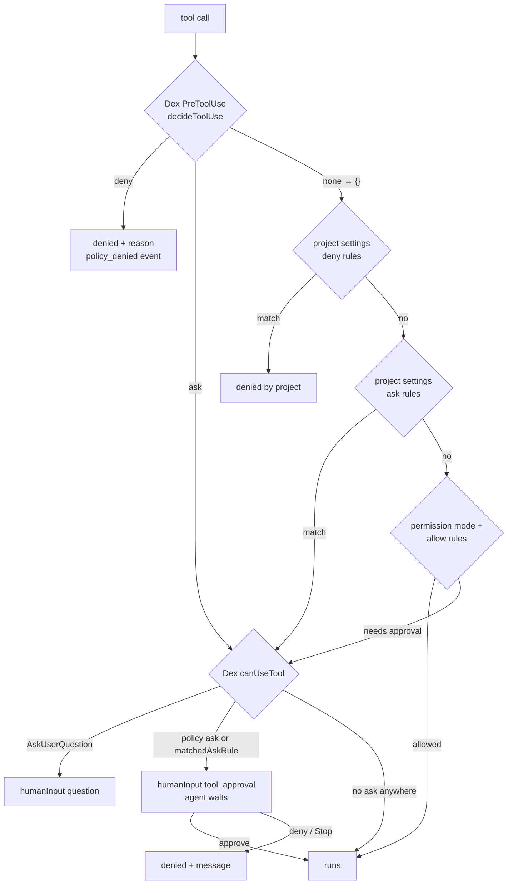

# Contract: `.dex/policy.json` and the permission chain

Tracked in the project's git, owned by the project. Types, defaults and
validation: [`../data-model.md`](../data-model.md) § Policy. Why the chain
looks like this: [`../research.md`](../research.md) R6.

## Example (shape of `onion-demo-01`'s policy, abridged)

```json
{
  "settingSources": ["user", "project", "local"],
  "permissionMode": "default",
  "env": { "CLAUDE_NO_WORKTREE": "1" },
  "deny": [
    { "tool": "Bash", "pattern": "\\bgit\\s+push\\b[^\\n]*(\\s--force\\b|\\s-f\\b|--force-with-lease|--delete\\b|--mirror\\b|--tags\\b)", "reason": "no force, delete, mirror or tag-all pushes" },
    { "tool": "Bash", "pattern": "\\bgit\\s+push\\b[^\\n]*\\s(origin\\s+)?(main|master)\\b", "reason": "never push to main/master" },
    { "tool": "Bash", "pattern": "\\bgit\\s+(reset\\s+--hard|clean\\s+-[a-z]*f|merge|rebase|worktree)\\b", "reason": "history-rewriting git commands are the owner's" },
    { "tool": "Bash", "pattern": "\\bkubectl\\s+(delete|apply|create(?!\\s+job\\s+--from=)|replace|patch|edit|scale|drain|cordon|taint)\\b", "reason": "helm is the only deploy path" },
    { "tool": "Bash", "pattern": "\\bhelm\\s+(uninstall|delete|rollback)\\b", "reason": "destructive helm commands are the owner's" },
    { "tool": "Bash", "pattern": "\\bsops\\s+(-d|--decrypt|decrypt|edit|exec-env)\\b", "reason": "secrets are never decrypted by an agent" },
    { "tool": "*", "pattern": "mgmt-01|rancher\\.cellarwood\\.org", "reason": "the management cluster is off limits" }
  ],
  "ask": [],
  "writeRoots": ["."],
  "frozen": ["workload/onion-poc-report/thresholds.md", "workload/onion-poc-report/claim*.md", "workload/onion-poc-report/*-thresholds.md"],
  "preflight": ["kubectl config current-context | grep -q '^onion-demo-01'", "timeout 15 kubectl get ns >/dev/null"],
  "repos": ["workload/*", "workload/sectors/*", "workload/tenants/*"],
  "systemPromptAppend": ".dex/loop-rules.md",
  "questions": "recommended-then-review",
  "openPullRequest": false,
  "limits": { "maxBudgetUsdPerStage": 15, "maxBudgetUsdPerRun": 120, "maxImplementRunsWithoutProgress": 2, "maxVerifyRounds": 3 }
}
```

The owner writes the real file in that repo. The table tests in this repo carry
the rules above as fixtures, one passing and one blocked command each.

## `decideToolUse(policy, call, env)` — pure

```ts
type ToolCall = { toolName: string; input: Record<string, unknown> };
type PolicyEnv = { projectDir: string; tmpDir: string; isTrackedAtHead: (absPath: string) => boolean };
type PolicyDecision =
  | { kind: "deny"; rule: "deny" | "writeRoots" | "frozen"; reason: string }
  | { kind: "ask"; reason: string }
  | { kind: "none" };
```

Order, first match wins:

1. `deny` rules whose `tool` is the call's tool or `"*"`, `pattern` tested on the subject.
2. Write tools (`Edit`, `Write`, `NotebookEdit`) only:
   - the resolved target outside every `writeRoots` entry and outside `tmpDir`
     → `deny` (`writeRoots`);
   - the target matching a `frozen` glob and tracked at HEAD → `deny` (`frozen`).
3. `ask` rules, same matching as `deny`.
4. `none`.

`isTrackedAtHead` is injected, so the function stays pure and table-testable.
The runner passes a `git ls-files --error-unmatch` probe.

## The chain at runtime



## What the refusal looks like

`permissionMode: "bypassPermissions"` in an `existing` project → `run()` emits
`error` with:

> `.dex/policy.json: permissionMode "bypassPermissions" is refused for an existing project — the project's own permission rules would be skipped.`

and the CLI exits 2. This check, in `policy.ts`, is the only place the string
`bypassPermissions` appears in `src/` (SC-006).
