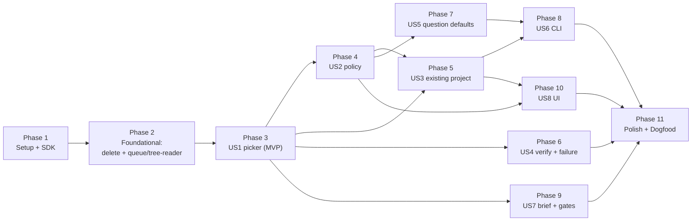

# Tasks: Lean Core — Keep the Loop, Drop the Time Machine, Run on Existing Projects

**Input**: Design documents from `specs/015-lean-core/` — [plan.md](plan.md), [spec.md](spec.md), [research.md](research.md) (R1–R18), [data-model.md](data-model.md), [contracts/](contracts/), [quickstart.md](quickstart.md)
**Prerequisites**: plan approved 2026-11-05 (R2, R5, R6 option A)

**Tests**: requested. The spec's success criteria require picker tests per D-015-1 row (SC-001), policy table tests (SC-005), and mock end-to-end runs (SC-002 to SC-004). Inside each story, the test tasks come first and must fail before the implementation lands.

**Organization**: Setup is the brief's Phase 0 (baseline + SDK). Foundational is the brief's Phase 1 (delete the time machine), plus the two pure modules every story reads. Then one phase per user story in priority order, and a final Polish & Dogfood phase.

**Gate after every phase**: `npm test` and `npm run typecheck` pass (never a bare `npx tsc --noEmit`), `check:size` passes, and a mock loop on a `dex-ecommerce` scratch clone finishes (quickstart § 1–2).

## Format: `[ID] [P?] [Story] Description`

- **[P]**: can run in parallel (different files, no dependency on an unfinished task)
- **[Story]**: the user story the task serves (US1–US8, from spec.md)
- Paths are relative to the repository root. `$EX` = `$HOME/Projects/Github/lukaskellerstein/dex-ecommerce`.

---

## Phase 1: Setup — baseline and SDK upgrade (brief Phase 0)

**Purpose**: Measure before cutting, and take the SDK churn on its own, before any deletion (D-015-10, research R1).

- [X] T001 Run `npm install` in this worktree (it has no `node_modules/`), then run `npm test` and `npm run typecheck` on the untouched tree and confirm both pass; if either fails, record the failure in specs/015-lean-core/research.md § R14 as pre-existing
- [X] T002 [P] Create scripts/loc-by-area.sh: count lines of non-test `.ts`/`.tsx` under `src/` (exclude `*.test.ts`, `*.test.tsx`, `__tests__/`) and print one row per area — core total, core time machine (`checkpoints/`, `checkpoints.ts`, `conflict-resolver.ts`), `state.ts`, core loop (`stages/`, `prompts.ts`, `parser.ts`, `agent/`), main total, renderer total, renderer `components/checkpoints/`, grand total (research R14)
- [X] T003 Record the baseline in specs/015-lean-core/research.md § R14 under a new "Phase 0 measurements" heading: the output of scripts/loc-by-area.sh, and the per-tool finding counts from `nvim-tools --json --all` (the lint/format/type baseline later phases are compared against)
- [X] T004 Record a baseline mock-run trace: `git clone --no-local "$EX"` into a scratch dir, reset it to the root commit, copy `$EX/.dex/mock-config.json` and a `{"agent":"mock"}` `.dex/dex-config.json` in, run `node scripts/run-mock-headless.mjs <clone>`, and save the printed event sequence summary to specs/015-lean-core/research.md § R14
- [X] T005 Bump `@anthropic-ai/claude-agent-sdk` from `^0.1.45` to `^0.3.318` in package.json, run `npm install`, and confirm the peers `zod@^4`, `@anthropic-ai/sdk`, `@modelcontextprotocol/sdk` resolved in package-lock.json (research R1)
- [X] T006 In src/core/agent/ClaudeAgentRunner.ts extract one `buildQueryOptions()` used by both `runStep` and `runTaskPhase`: always pass `abortController` (fixes the missing abort in `runTaskPhase`, lines 441–447), `env: { ...process.env }` (0.3 replaces the environment), and `systemPrompt: { type: "preset", preset: "claude_code" }`; keep `permissionMode`/`settingSources` as they are until Phase 4 (research R1)
- [X] T007 In src/core/agent/ClaudeAgentRunner.ts treat only `type === "system" && subtype === "init"` as the init message (line 624), sum input/output tokens from the result's `modelUsage` instead of `usage` (lines 299–305, 733–739), and price with the effective model, not `config.model` (lines 283, 706) (research R1)
- [X] T008 Replace the dead TodoWrite progress path: delete `RunTaskState.updateFromTodoWrite` in src/core/stages/run-phase.ts, `onTodoWrite` from `TaskPhaseContext` in src/core/agent/AgentRunner.ts, the TodoWrite branch in src/core/agent/ClaudeAgentRunner.ts (lines 516–533) and its mock counterpart in src/core/agent/MockAgentRunner.ts; add a PostToolUse branch in ClaudeAgentRunner.ts that, when `Edit`/`Write`/`MultiEdit` targets `<specDir>/tasks.md`, re-parses it with `parseTasksFile` and emits `tasks_updated` (research R1)
- [X] T009 Run `npm run typecheck` and `npm test`; fix the type breaks from SDK 0.3 (hook callback signatures, `CanUseTool` returning `PermissionResult | null`, optional `updatedInput`) in src/core/agent/ClaudeAgentRunner.ts until both pass
- [X] T010 Repeat the T004 mock run on a fresh scratch clone and confirm the event sequence matches the baseline except for the removed TodoWrite steps
- [X] T011 Create scripts/smoke-stage.mjs (`node scripts/smoke-stage.mjs <projectDir> <step> <prompt>`): imports `ClaudeAgentRunner` from `dist/core/agent/ClaudeAgentRunner.js`, runs one `runStep` with a console emitter, and prints cost, duration and the result subtype
- [ ] T012 **Ask the owner first (costs money).** Run one real `specify` stage with scripts/smoke-stage.mjs on a scratch clone of `$EX` whose `GOAL_clarified.md` exists, then check that `specs/<new>/spec.md` was written with the preset system prompt; record cost, duration and anything odd in specs/015-lean-core/research.md § R1

**Checkpoint**: SDK 0.3.318 in place, tests green, baseline recorded.

---

## Phase 2: Foundational — delete the time machine (brief Phase 1) + shared pure modules

**Purpose**: Remove ~8k lines that every later story would otherwise have to keep working, and add the two pure modules (`queue.ts`, `tree-reader.ts`) every story reads. Until US1 lands, resume still uses `lastCompletedStep`.

**⚠️ CRITICAL**: No user-story work starts before this phase passes its gate.

### Test helpers (before anything is deleted)

- [X] T013 Create src/core/__tests__/helpers/git.ts with `mkTmpRepo`, `rmTmp`, `headSha`, `currentBranch`, `branches`, `commitFile` copied from src/core/__tests__/branchOps.test.ts lines 9–79, and src/core/__tests__/helpers/project.ts with `mkTmpProject(files: Record<string,string>)` (writes a file tree into a temp dir)

### Core deletions

- [X] T014 Delete src/core/checkpoints/ (all 10 files) and src/core/checkpoints.ts, plus the tests src/core/__tests__/checkpoints.test.ts, src/core/__tests__/jumpTo.test.ts, src/core/__tests__/branchOps.test.ts and src/core/__tests__/timelineLayout.test.ts
- [X] T015 Delete src/core/conflict-resolver.ts and the one-shot path: `runOneShot` in src/core/agent/ClaudeAgentRunner.ts and src/core/agent/MockAgentRunner.ts, `OneShotContext`/`OneShotResult`/`runOneShot` in src/core/agent/AgentRunner.ts, `oneShotResponses` in src/core/agent/MockConfig.ts, the `conflictResolver` config in src/core/dexConfig.ts (and its cases in src/core/__tests__/dexConfig.test.ts lines 24–30, 100–175), src/core/__tests__/conflictResolver.test.ts and src/core/agent/__tests__/runOneShot.test.ts
- [X] T016 Delete src/core/agent-profile.ts and src/core/__tests__/agentProfile.test.ts; remove `profile` and `worktreePath` from `StepContext`/`TaskPhaseContext` in src/core/agent/AgentRunner.ts and every use in src/core/agent/ClaudeAgentRunner.ts (lines 41–51, 98, 375–376)
- [X] T017 Stop stage commits: reduce src/core/stages/finalize.ts to the `updateState({ lastCompletedStep, currentCycleNumber, currentSpecDir })` call (drop `commitCheckpoint`, `lastCommit`, `updatePhaseCheckpointInfo`, `step_candidate`, step-mode pause); in src/core/run-lifecycle.ts drop `ensureDexGitignore` (line 64) and the completion checkpoint commit (lines 255–292)
- [X] T018 Add `ensureRuntimeIgnore(projectDir)` to src/core/state.ts: writes `.dex/.gitignore` with `state.json`, `state.lock`, `runs/`, `questions.md`, `ui.json` only when the file is absent, runs no git command; call it from `initRun` in src/core/run-lifecycle.ts (data-model.md table)
- [X] T019 Remove step mode: `stepMode` from `RunConfig` in src/core/config.ts and its readers in src/core/stages/run-stage.ts, src/core/stages/cycle-stages.ts and src/core/stages/finalize.ts; `readPauseAfterStage` goes with the checkpoints folder
- [X] T020 Delete the events `step_candidate`, `head_changed`, `loop_reset`, `conflict-resolver:file-start/file-done/iteration/done`, `verify_failed`, `manifest_drift_detected`, `clarification_question` from src/core/events.ts, and their producers in src/core/stages/cycle-stages.ts (line 289) and src/core/stages/manifest-extraction.ts (line 48) (contracts/ipc-events.md § Delete)
- [X] T021 In src/core/agent/MockAgentRunner.ts replace the bare `git add -A` (lines 426–433) with an agent-style commit — `git add -A` then `git commit -m "mock(<step>): <feature>"` — only when the project is a git repo and has changes (research R15)

### Main-process deletions

- [X] T022 [P] Delete src/main/ipc/checkpoints.ts, src/main/ipc/profiles.ts, src/main/ipc/lock-utils.ts, src/main/ipc/logger.ts, src/main/preload-modules/checkpoints-api.ts, src/main/preload-modules/profiles-api.ts; remove their imports and registrations in src/main/index.ts (lines 6, 9, 77–78) and src/main/preload.ts (lines 17–18)
- [X] T023 Update src/renderer/electron.d.ts: remove the imports from agent-profile and checkpoints (lines 1–8), `CheckpointsApi` (lines 19–73), and the `checkpoints` and `profiles` members (lines 132–145)

### Renderer deletions

- [X] T024 [P] Delete src/renderer/components/checkpoints/ (19 files), src/renderer/services/checkpointService.ts, src/renderer/services/__tests__/checkpointService.test.ts, src/renderer/services/profilesService.ts and src/renderer/components/layout/TopTabBar.tsx
- [X] T025 Edit src/renderer/App.tsx: remove the checkpoint imports (lines 5–7, 17), the `head_changed` effect (233–240), `syncStateFromHead` before resume (305–313), the `checkpointDebug`/`step_candidate` block (366–393), `useTimeline` (397), the branch/checkpoint fields of `DebugContext` (34–40, 73–75, 416–419), `topTab` and `TopTabBar` (107, 489), `TimelineView` (535–536) and `<CheckpointsEnvelope>` (561)
- [X] T026 Edit src/renderer/components/loop/LoopDashboard.tsx: remove `useTimeline`, `pathDerived`, `mergeStages`/`mergeCycles` (lines 90–124, 147–323), the branch strip `steps-current-branch` (352–371) and the `effective*` overrides, so it renders the event-built cycles directly
- [X] T027 Drop the `pathStages` plumbing: src/renderer/components/loop/StageList.logic.ts (the argument at lines 73, 78 and the navigated-mid-cycle case at 135–156), src/renderer/components/loop/StageList.tsx (301, 327), src/renderer/components/loop/CycleTimeline.tsx (44, 341, 360, 454) and src/renderer/components/loop/phases/LoopPhase.tsx
- [X] T028 Remove the `loop_reset`/`head_changed` cases from src/renderer/hooks/useLoopState.ts (line 128) and src/renderer/hooks/useProject.ts (lines 53–54)
- [X] T029 Remove `d3-selection`, `d3-shape`, `d3-zoom`, `@types/d3-selection`, `@types/d3-shape`, `@types/d3-zoom` from package.json and run `npm install`

### Scripts

- [X] T030 [P] Delete scripts/test-014-cdp.mjs and scripts/validate-mock-config.mjs; remove `timelineLayout.ts` and `TimelineGraph.tsx` from the allow-list in scripts/check-size.sh (lines 17–25)
- [X] T031 [P] Replace the hard-coded `/home/lukas/Projects/Github/lukaskellerstein/dex-ecommerce` with `"$HOME/Projects/Github/lukaskellerstein/dex-ecommerce"` in scripts/reset-example-to.sh (lines 30, 34) and scripts/prune-example-branches.sh, and with `path.join(os.homedir(), …)` in scripts/trigger-mock-via-cdp.mjs; in reset-example-to.sh `pristine` stop listing `selected-*` (no longer produced) (line 94)

### Shared pure modules

- [X] T032 [P] Write src/core/__tests__/queue.test.ts first: every validation rule in data-model.md § Queue (duplicate id, bad id, empty title, bad stage name in `skip`/`gates`, bad task range, unknown field, empty `generate.sources`); default resolution (`specDir`, `branch` for `existing` vs `new`, the `baseBranch` chain to the previous entry, `gates` default `["brief"]` with `generate`); the v2 → v3 migration (completed → `done`, skipped kept, `specDir` → id, `NNN-<slug>` ids, `kind: "new"`, writes `queue.json` once); queue wins when both files exist; `parseTaskScope(["T110","T122-T134"])`
- [X] T033 [P] Write src/core/__tests__/tree-reader.test.ts first (with helpers/git.ts): `workingTree` sees an uncommitted file, `gitRef` of another branch sees only that branch's committed content, a missing path is `false`/`null` in both
- [X] T034 [P] Create src/core/queue.ts per data-model.md § Queue and contracts/queue-json.md: types `QueueV3`, `QueueEntry`, `StageName`, `ResolvedEntry`; `loadQueue(projectDir)` (queue.json, else migrate `.dex/feature-manifest.json` v2 and write queue.json, else `null`); `validateQueue` throwing `QueueInvalidError` that names the entry and field; `resolveEntries(queue, currentBranch, runBranch)`; `saveQueue` (tmp + rename); `parseTaskScope` reusing `extractTaskIds` from src/core/parser.ts
- [X] T035 [P] Create src/core/tree-reader.ts (`TreeReader { exists(rel), read(rel) }`, `workingTree(dir)`, `gitRef(dir, ref)` via `git cat-file -e` / `git show`) and add `branchExists`, `headSha`, `switchBranch`, `statusPorcelain` to src/core/git.ts (research R3)
- [X] T036 Phase gate: `npm run typecheck`, `npm test`, `bash scripts/check-size.sh`, and the T004 mock run on a fresh scratch clone; then `grep -rn "checkpoint\|conflict-resolver\|agent-profile" src` finds nothing but comments to fix

**Checkpoint**: The time machine is gone, the loop still runs on the mock, and `queue.ts` / `tree-reader.ts` are tested.

---

## Phase 3: User Story 1 — Resume from the project's files, not from history (Priority: P1) 🎯 MVP

**Goal**: The picker chooses the next stage from files alone; Resume is "run the picker again"; reconcile, gap analysis and the old main loop are gone (brief Phase 2).

**Independent Test**: One picker fixture per D-015-1 row passes; a mock loop on a scratch clone of `dex-ecommerce` takes every feature to done; Stop during `implement` then Resume continues on the same task phase; `git reset --hard` to a mid-run agent commit then Resume continues from the files (quickstart § 2–4).

### Tests for User Story 1

- [X] T037 [P] [US1] Write src/core/__tests__/picker.test.ts first, one fixture per D-015-1 row using helpers/project.ts: brief missing + `generate` → `brief`; no spec folder → `specify`; spec folder without `spec.md` → `specify`; no `## Clarifications` → `clarify`; no `plan.md` → `plan`; no `tasks.md` → `tasks`; unchecked in-scope task → `implement` on the first phase that has one; no `verify.md` → `verify`; `verify.md` with a different hash → `verify`; `verify.md` passed with the current hash → entry done, next entry picked; all entries done/skipped → `complete`
- [X] T038 [US1] Add to src/core/__tests__/picker.test.ts: `skip` treats stages as done; human `status: "done"`/`"skipped"`; task filter (out-of-scope unchecked tasks do not block `verify`; unknown ids → `pause invalid_input`); brief path set, file missing, no `generate` → `pause invalid_input`; `kind: "existing"` with helpers/git.ts — an entry whose branch exists is read through `gitRef` while another branch is checked out, and an entry whose branch is missing is read from its base branch
- [X] T039 [P] [US1] Write src/core/__tests__/loop.test.ts first: a tmp git project with a hand-written v3 queue (`kind: "new"`, 2 entries) and the mock agent; `run()` reaches `loop_terminated` with `queue_complete`; aborting after the first task phase of `implement` and resuming continues on the same entry and task phase; `git reset --hard` to the `mock(tasks)` commit and resuming picks `implement` with no reconcile event

### Implementation for User Story 1

- [X] T040 [US1] Create src/core/picker.ts: `readVerifyRecord` (regexes in contracts/verify-md.md), `tasksHash` (sha256 of the bytes of tasks.md), `entryTree` (research R3), `stageFor(entry, tree)` in D-015-1 order, `pickNext(...) → PickerDecision`, and `describeQueue(...) → QueueView` (data-model.md § Picker decision, contracts/ipc-events.md § QueueView); no writes, no branch switches
- [X] T041 [US1] Rewrite src/core/state.ts to `DexStateV2` (data-model.md § Run state): keep `saveState`/`loadState` (`version !== 2` → `null`)/`updateState`/the lock/`ensureRuntimeIgnore`; delete `detectStaleState`, `resolveWorkingTreeConflict`, `reconcileState` and every drift helper, `STEP_ORDER`, `artifacts`, `lastCommit`, `failureCounts`, `featuresCompleted/Skipped`; delete `DriftSummary` from src/core/types.ts, the `state_reconciling`/`state_reconciled` events from src/core/events.ts, and the `state_reconciled` case in src/renderer/hooks/useRunSession.ts (line 108)
- [X] T042 [US1] Rename src/core/userInput.ts to src/core/humanInput.ts with the `PendingRequest` union (`question` | `pause`; `tool_approval` comes in US2): `requestHuman()` persists to `state.pendingRequests` and renders `.dex/questions.md` (contracts/cli.md format), `resolveRequest(requestId, answer)`, `cancelAll()` on Stop; update callers in src/core/agent/ClaudeAgentRunner.ts, src/core/stages/prerequisites.ts (lines 121, 180, 234, 418, 440), src/core/orchestrator.ts and src/main/ipc/orchestrator.ts
- [X] T043 [US1] Update `StepType` in src/core/types.ts: add `brief`, `clarify`; remove `gap_analysis`, `learnings`, `implement_fix`, `create_branch`, `commit`; delete `GapAnalysisDecision` and `FailureRecord`; `TerminationReason` = `queue_complete | user_abort | paused | budget_exceeded | failed`; update `STEP_LABELS` and `CYCLE_STAGES` in src/renderer/components/loop/StageList.logic.ts (lines 9–17) to brief, specify, clarify, plan, tasks, implement, verify
- [X] T044 [US1] Rewrite the stage builders in src/core/prompts.ts per research R11, each a pure function of `(entry, projectDir, extras)`: `specify` (brief is the source of truth, else the description), `clarify` (autonomous rules; always write `## Clarifications` with `### Session <date>`), `plan`, `tasks`, `implement` (merges `buildImplementPrompt` with `buildPrompt` from src/core/stages/run-phase.ts; lists in-scope ids; "commit as this project's rules say"), `verify` (the exact `Tasks-SHA256` line, never edit code, write `verify.md`); add `stageEnv(entry, stage, kind)` returning `SPECIFY_FEATURE_DIRECTORY` (+ `GIT_BRANCH_NAME` for an existing project's `specify`) (research R5); delete the learnings, feature-evaluation and verify-fix prompts and `GAP_ANALYSIS_SCHEMA`, `LEARNINGS_SCHEMA`, `VERIFY_SCHEMA`
- [X] T045 [US1] Add `env?: Record<string, string>` and `entryId?: string` to `StepContext`/`TaskPhaseContext` in src/core/agent/AgentRunner.ts and merge `env` into the query environment in `buildQueryOptions()` in src/core/agent/ClaudeAgentRunner.ts
- [X] T046 [US1] Create src/core/stages/post-stage.ts: update `state.current` and `cumulativeCostUsd`, emit `step_completed`, and run the no-progress guard (the picker returns the same entry and stage right after it ran → pause `no_progress`) (research R9); delete src/core/stages/finalize.ts and src/core/__tests__/finalize.test.ts; remove the finalize call from src/core/stages/run-stage.ts
- [X] T047 [US1] Rewrite src/core/stages/cycle-stages.ts as `runImplement(ctx, entry, taskPhase)` (one task phase per call) and `runVerify(ctx, entry)` (Dex computes `tasksHash` right before the stage and puts it in the prompt; the agent writes `verify.md`); delete the learnings stage and the structured-output verify retry loop
- [X] T048 [US1] Create src/core/stages/loop.ts to replace src/core/stages/main-loop.ts: until aborted, `pickNext` → emit `stage_decision` → `complete` ends with `queue_complete`; `pause` → `humanInput` pause and `status: "paused"`; `stage` → dispatch (`specify`/`clarify`/`plan`/`tasks` via `runStage` with the R11 prompt and `stageEnv`; `implement` via `runImplement`; `verify` via `runVerify`) → `postStage`; emit `loop_cycle_started`/`loop_cycle_completed` when the entry changes, with `cycleNumber` = the entry's 1-based position; keep every function under 100 lines
- [X] T049 [US1] Rewrite `runLoop` in src/core/orchestrator.ts: fresh run = prerequisites → clarification → `ensureManifest` → loop.ts; resume = skip prerequisites and go straight to loop.ts (no `detectStaleState`, `resolveWorkingTreeConflict`, `reconcileState`); take `runId` and the goal path from the v2 state snapshot
- [X] T050 [US1] Make src/core/stages/manifest-extraction.ts write `queue.json` v3 (`kind: "new"`, ids `NNN-<slug>`) through `saveQueue`; when `queue.json` exists, skip extraction (a changed goal means the human deletes the queue, the same as re-planning)
- [X] T051 [US1] Delete src/core/stages/main-loop.ts, src/core/stages/cycle-gap-analysis.ts, src/core/stages/cycle-failure-policy.ts, src/core/gap-analysis.ts, src/core/__tests__/gap-analysis.test.ts and src/core/manifest.ts (its v2 types and reader move into the migration in src/core/queue.ts)
- [X] T052 [US1] Restructure the mock (research R15): src/core/agent/MockConfig.ts replaces `dex_loop.cycles[]` and `REQUIRED_CYCLE_STAGES` with an `entries` map with a `"*"` fallback (stages brief, specify, clarify, plan, tasks, implement, verify); src/core/agent/MockAgentRunner.ts looks up by `entryId`, `implement` ticks every task of the given phase in tasks.md, `verify` writes `verify.md` with the `Tasks-SHA256` value parsed from the prompt and the verdict from the config's rounds list; update src/core/agent/__tests__/MockConfig.test.ts (lines 38, 144)
- [X] T053 [P] [US1] Create fixtures/mock/new-project.json: `prerequisites` and `clarification` copied from `$EX/.dex/mock-config.json`, plus `entries["*"]` that writes `spec.md`, appends `## Clarifications`, writes `plan.md` and a `tasks.md` with 2 phases / 4 tasks, and passes `verify`
- [X] T054 [US1] Update scripts/run-mock-headless.mjs to the new events (`stage_decision`, `loop_terminated` with `queue_complete`; no `step_candidate`/`stage_candidate`); it stays until US6's CLI replaces it
- [X] T055 [US1] Keep the renderer working on the new events: drop the `GAPS_COMPLETE` handling and `gap_analysis`/`learnings` stage names in src/renderer/hooks/useLoopState.ts, src/renderer/hooks/buildLoopStateFromRun.ts and `loadRunHistory` in src/renderer/hooks/useOrchestrator.ts; update src/renderer/hooks/__tests__/useLoopState.test.tsx (lines 188–203)
- [X] T056 [US1] Validate quickstart § 2–4 with scripts/run-mock-headless.mjs on scratch clones (SC-002, SC-003) and run the phase gate

**Checkpoint**: The MVP loop runs from files. Stop/Resume and reset-then-Resume need no repair step.

---

## Phase 4: User Story 2 — Run under the project's own policy, with a human approving "ask" (Priority: P1)

**Goal**: `.dex/policy.json` loaded and enforced; the project's own settings and rules apply; `ask` calls wait for a human; `bypassPermissions` gone (brief Phase 3).

**Independent Test**: The policy table tests pass without an agent; one live check shows a project `ask` rule reaching the approval card instead of running (quickstart § 6, 7, 9).

### Tests for User Story 2

- [X] T057 [P] [US2] Write src/core/__tests__/policy.test.ts first: `parsePolicy` defaults, each validation error (bad type, bad regex, missing `systemPromptAppend` file, unknown field), bypass refused for `existing` and accepted for `new`; `decideToolUse` rows — for every rule in contracts/policy-json.md one blocked and one allowed command, including `cd repo && git push -f origin x` and `bash -c "kubectl delete ns x"`; write roots (inside, outside, `os.tmpdir()`, a `../` escape); frozen (tracked → deny, untracked → allow); an `ask` rule; a `"*"` rule on `Read`; the no-opinion case
- [X] T058 [P] [US2] Write src/core/__tests__/runner-options.test.ts first: `buildQueryOptions(policy, …)` gives the preset system prompt with the append file's text, keeps `PATH` while merging `policy.env` and the stage env, uses `min(config.maxTurns, maxTurnsPerStage)`, never sets `bypassPermissions`; the PreToolUse callback returns `deny` (+ `policy_denied`), `ask`, or `{}` and never `allow`; `canUseTool` with `matchedAskRule` raises a `tool_approval` request, and with nothing matched returns allow

### Implementation for User Story 2

- [X] T059 [US2] Create src/core/policy.ts per contracts/policy-json.md: types, `DEFAULT_POLICY`, `parsePolicy(raw, kind)` with `PolicyInvalidError`/`PolicyRefusedError`, `loadPolicy(projectDir, kind)`, `subjectOf(call)`, and a pure `decideToolUse(policy, call, env)` with injected `isTrackedAtHead`; no SDK import
- [X] T060 [US2] Add the `tool_approval` kind to src/core/humanInput.ts: `requestToolApproval({ toolName, subject, input, source, reason })` → `approve | deny`; emit `tool_approval_request` and `request_resolved`; `cancelAll()` denies held approvals on Stop (data-model.md § Pending request)
- [X] T061 [US2] Wire the policy into src/core/agent/ClaudeAgentRunner.ts (research R6): `buildQueryOptions(policy)` sets `settingSources`, `permissionMode`, merged `env`, preset `systemPrompt` + `append`, `maxTurns`, `maxBudgetUsd`; the PreToolUse hook returns `deny`/`ask`/`{}` from `decideToolUse` (never `allow`, replacing lines 185–190); `canUseTool` on both `runStep` and `runTaskPhase` routes `AskUserQuestion` → question, policy `ask` or `options.matchedAskRule` → tool approval, anything else → allow
- [X] T062 [US2] Load the queue kind and the policy in `initRun` in src/core/run-lifecycle.ts (a refusal or invalid policy emits `error` with the file and reason and returns `null`), and carry `policy` on `OrchestrationContext` in src/core/context.ts
- [X] T063 [US2] Frozen check in src/core/stages/post-stage.ts: loop.ts records `stageStartSha` before each stage; after it, `git diff --name-only --diff-filter=MDR <sha> -- <frozen>` against both HEAD and the working tree; any hit → pause `frozen_changed` naming the files (research R13)
- [X] T064 [US2] Replace `orchestrator:answer-question` with `orchestrator:answer-request` (the `RequestAnswer` union in contracts/ipc-events.md) in src/main/ipc/orchestrator.ts, src/main/preload-modules/orchestrator-api.ts and src/renderer/electron.d.ts
- [X] T065 [US2] Renderer approvals: make the pending state in src/renderer/hooks/useUserQuestion.ts a `PendingRequest` union restored on reload from `getProjectState().pendingRequests`; render a tool-approval card in src/renderer/components/loop/ClarificationPanel.tsx (tool, subject, full input, source and reason, Approve / Deny) that answers through `answer-request`
- [X] T066 [US2] Confirm `grep -rn bypassPermissions src` lists only the refusal in src/core/policy.ts and its test (SC-006); run the phase gate
- [ ] T067 [US2] **Ask the owner first (small cost).** Live check, quickstart § 9: a scratch clone with `.claude/settings.json` `{"permissions":{"ask":["Bash(git push:*)"]}}`, the app started with `dev-setup.sh`, a run that leads to `git push`; with electron-playwright confirm the approval card appears with the command held, deny it, and confirm the agent reports the denial

**Checkpoint**: Dex runs with brakes. The policy is enforced in code, and the project's own rules apply.

---

## Phase 5: User Story 3 — Run a queue on an existing project without Dex touching git history (Priority: P1)

**Goal**: An existing project with a hand-written queue runs entry by entry; Dex only switches branches on a clean tree, never commits, branches or pushes (brief Phase 4: queue init, branch handling, check-only prerequisites, preflight).

**Independent Test**: quickstart § 5 — a scratch clone with the existing-project fixture runs both entries to done under the mock, with no Dex branch, no Dex commit and no push.

### Tests for User Story 3

- [X] T068 [P] [US3] Write src/core/__tests__/branching.test.ts first (helpers/git.ts): `isTreeClean` ignores `.dex/state.json`, `.dex/state.lock`, `.dex/runs/`, `.dex/questions.md`, `.dex/ui.json` but counts other untracked files; `prepareBranch` is a no-op on the target, switches on a clean tree, pauses `dirty_tree` with the file list on a dirty one, targets the base branch for `brief`/`specify` and the entry branch after that, and never switches for `kind: "new"`
- [X] T069 [P] [US3] Write src/core/__tests__/queue-init.test.ts first: `specs/*` and `docs/my-specs/*` merged by folder name and sorted; `skip` derived from existing artefacts; `status: "done"` when every task is checked; refuses when `queue.json` exists; writes `policy.json` defaults and `.dex/.gitignore` only when absent; runs no git command
- [X] T070 [P] [US3] Write src/core/__tests__/existing-project.test.ts first: the fixture below in a tmp repo; `run()` under the mock takes both entries to done; the only new branch is entry B's (created by the mock `specify` from `GIT_BRANCH_NAME`); every new commit starts with `mock(`; no `[checkpoint:` commit; `.specify/feature.json` is untouched; no `error` event (the repo has no remote)

### Implementation for User Story 3

- [X] T071 [US3] Create src/core/branching.ts: `RUNTIME_PATHS`, `isTreeClean(projectDir)`, `prepareBranch(entry, stage, kind)` (research R4); call it from src/core/stages/loop.ts before each stage, and emit `tree_dirty` from src/core/stages/post-stage.ts when a stage leaves the tree dirty
- [X] T072 [US3] In src/core/orchestrator.ts and src/core/run-lifecycle.ts: call `createBranch` only for `kind: "new"` (orchestrator.ts line 338) and never in build mode for an existing project (run-lifecycle.ts line 78); call `createPullRequest` only when `policy.openPullRequest` is true (run-lifecycle.ts lines 300–313); call `ensureRuntimeIgnore` only for `kind: "new"`
- [X] T073 [US3] Existing-project entry in `runLoop` in src/core/orchestrator.ts: with `kind: "existing"` skip goal resolution, clarification and manifest extraction, and go prerequisites (check-only) → loop.ts
- [X] T074 [US3] Check-only prerequisites in src/core/stages/prerequisites.ts for `kind: "existing"`: `claude` and `specify` on PATH, a git repo, `.specify/` present, `.specify/scripts/bash/common.sh` contains `SPECIFY_FEATURE_DIRECTORY`; report the Claude Code trust state (`~/.claude.json` `projects[<root>].hasTrustDialogAccepted`) as information; on failure pause with the list; never `git init`, `specify init` or `gh repo create` (research R12)
- [X] T075 [US3] Create src/core/preflight.ts: `runPreflight(policy, projectDir)` (each command via `bash -c`, 60 s timeout, tail of stdout/stderr logged) and `checkRepos(policy, projectDir)` (`fs.globSync`, `isTreeClean` per match); call both from src/core/stages/loop.ts before the run and before each `implement` and `verify`; a failure pauses `preflight_failed` naming the command and exit code (research R12)
- [X] T076 [US3] Task-scope filter in `runImplement` (src/core/stages/cycle-stages.ts) and src/core/stages/run-phase.ts: run only phases with unchecked in-scope tasks, list the in-scope ids in the prompt, always treat `Verify fixes V*` phases as in scope
- [X] T077 [US3] Add `initQueue(projectDir)` to src/core/queue.ts per contracts/queue-json.md § `dex queue init`; create src/core/cli.ts (shebang `#!/usr/bin/env node`, no Electron import) with the `dex queue init <projectDir>` subcommand, and add `"bin": { "dex": "dist/core/cli.js" }` to package.json
- [X] T078 [US3] Make the mock `specify` behave like spec-kit's git extension in src/core/agent/MockAgentRunner.ts: when the stage env carries `GIT_BRANCH_NAME`, run `git switch -c <name>` before writing, and write into `SPECIFY_FEATURE_DIRECTORY`
- [X] T079 [P] [US3] Create the existing-project fixture: fixtures/existing-project/specs/900-fixture-a/ (`spec.md` with `## Clarifications`, `plan.md`, `tasks.md` with 3 phases and unchecked T002, T004–T005), fixtures/existing-project/queue.json (entry A `900-fixture-a` with `skip` brief…tasks and `tasks: ["T002","T004-T005"]`; entry B `901-fixture-b` at `specify` with `baseBranch: "900-fixture-a"`), fixtures/existing-project/policy.json, and fixtures/mock/existing-project.json
- [X] T080 [US3] Run quickstart § 5 by hand on a scratch clone of `$EX` and the phase gate

**Checkpoint**: Dex runs on a project it did not create, under that project's rules.

---

## Phase 6: User Story 4 — An independent agent checks the work, and a stuck feature stops (Priority: P2)

**Goal**: `verify` appends a fix phase on failure; verify rounds and implement-without-progress pause the run; stage and run limits pause or stop (brief Phase 4: `verify.md` with the fix phase, failure policy).

**Independent Test**: Under the mock, a verify that fails once appends `Verify fixes V1`, the loop implements it, verifies again and finishes; an `implement` that never ticks pauses after 2 runs.

### Tests for User Story 4

- [X] T081 [P] [US4] Write src/core/__tests__/failure-policy.test.ts first: `countVerifyRounds(tasksMd)` for 0, 1 and 3 `Verify fixes V*` phases; the implement counter (+1 with no new checked in-scope task, reset on progress, pause at 2); verify rounds at 3 and not done → pause; a stage limit pauses with the limit named; the run budget stops before the next stage
- [X] T082 [P] [US4] Add to src/core/__tests__/loop.test.ts with fixtures/mock/verify-fails-once.json: fail once → fix phase appended → `implement` runs it → `verify` passes → entry done; an `implement` mock that never ticks → pause `limit_reached` after 2 runs

### Implementation for User Story 4

- [X] T083 [US4] Extend the `verify` prompt in src/core/prompts.ts with the fix-phase rules in contracts/verify-md.md (`## Phase <max+1>: Verify fixes V<k>`, continuing task ids, commit as the project's rules say), and add `countVerifyRounds` to src/core/picker.ts (research R8)
- [X] T084 [US4] Failure policy in src/core/stages/loop.ts and src/core/stages/post-stage.ts: count checked in-scope tasks before and after each `implement` and keep `state.counters[entryId].implementRunsWithoutProgress`; pause `limit_reached` at `maxImplementRunsWithoutProgress`; pause before the next stage when verify rounds reach `maxVerifyRounds` and the entry is not done (research R9)
- [X] T085 [US4] Limits: check `maxBudgetUsdPerRun` against `cumulativeCostUsd` before each stage (stop with `budget_exceeded`); in src/core/agent/ClaudeAgentRunner.ts map the result subtypes `error_max_budget_usd` and `error_max_turns` to a new `StepResult.limitHit`; post-stage pauses `limit_reached` with the limit in `pauseDetail`
- [X] T086 [US4] Remove `maxVerifyRetries`, `maxLearningsPerCategory` and `maxLoopCycles` from `RunConfig` in src/core/config.ts and their uses in src/core (policy limits replace them); support a verify `rounds` list in src/core/agent/MockConfig.ts and create fixtures/mock/verify-fails-once.json

**Checkpoint**: "All tasks checked" is no longer the definition of done, and a stuck feature costs at most the configured attempts.

---

## Phase 7: User Story 5 — Questions have defaults (Priority: P2)

**Goal**: `recommended-then-review` answers questions that have a recommended option and lists them for review; `wait` waits on everything; autonomous `clarify` (D-015-6, FR-027, FR-034, FR-035).

**Independent Test**: Under the mock, a question with a `(Recommended)` option is answered and listed; one without waits; in `wait` mode both wait; a pending question survives a restart.

### Tests for User Story 5

- [X] T087 [P] [US5] Write src/core/__tests__/humanInput.test.ts first: `isRecommended` on labels (`"Use helm (Recommended)"`, `"(recommended)"` with trailing space, no marker); `recommended-then-review` answers an all-recommended question, appends to `reviewList`, emits `user_input_request`, `user_input_response` and `request_resolved { by: "default" }`; a question with one sub-question lacking a marker waits; `wait` mode waits; `pendingRequests` persist to state.json and `.dex/questions.md` and load back after a simulated restart; an answer-book key match answers and consumes the item

### Implementation for User Story 5

- [X] T088 [US5] In src/core/humanInput.ts and src/core/agent/ClaudeAgentRunner.ts: question mode from `policy.questions`; `isRecommended` = `/\(recommended\)\s*$/i` on the label (research R6/R7); append defaulted answers to `state.reviewList`; delete the "first option" fallback (ClaudeAgentRunner.ts line 126); `autoClarification` applies only to the new-project clarification stages
- [X] T089 [US5] Render the "Answered by default — review" section in `.dex/questions.md` from `state.reviewList` (contracts/cli.md), and add the mock config option to raise a question in a stage (src/core/agent/MockConfig.ts, src/core/agent/MockAgentRunner.ts) so the defaults are testable end to end

**Checkpoint**: An unattended run no longer stalls on easy questions, and nothing it decided is hidden.

---

## Phase 8: User Story 6 — Run headless, and preview a run before it spends anything (Priority: P2)

**Goal**: `dex run <projectDir> [--once] [--dry-run] [--status]` on the same core, with terminal questions and approvals (brief Phase 5, contracts/cli.md).

**Independent Test**: `--dry-run` on the existing-project fixture prints one block per remaining entry, starts no agent and writes nothing; `--once` stops after one stage.

### Tests for User Story 6

- [X] T090 [P] [US6] Write src/core/__tests__/cli.test.ts first: argument parsing, the mutual exclusion of `--once`/`--dry-run`/`--status`, exit codes 0/1/2/3; `--dry-run` on the existing-project fixture prints one `━━ <id>` block per remaining entry with decision, branch, env, options, system and prompt, and leaves the file tree byte-identical; `--status` prints derived statuses and pending requests; an invalid policy exits 2

### Implementation for User Story 6

- [X] T091 [US6] Add the `run` subcommand to src/core/cli.ts: `--dry-run` (`describeQueue` + the R11 prompt builders + a policy summary, each entry evaluated as if earlier ones were done), `--status`, `--agent`, and a compact event printer ported from scripts/run-mock-headless.mjs; `--once` sets a stop-after-one-stage flag honoured by src/core/stages/loop.ts
- [X] T092 [US6] Terminal input in src/core/cli.ts: with a TTY, register a `humanInput` resolver that prompts with numbered options (the recommended one is the Enter default) and `y/n` for tool approvals; without a TTY, persist the request, abort the stage, pause, exit 3
- [X] T093 [US6] Answer book: on `dex run` with a TTY, first present `state.pendingRequests` left by a no-TTY pause and store the answers in `state.answerBook`; `humanInput` answers a matching request (`q:` / `t:` key) from the book before asking (data-model.md § Pending request)
- [X] T094 [US6] Delete scripts/run-mock-headless.mjs; replace its uses in specs/015-lean-core/quickstart.md and docs with `node dist/core/cli.js run`; make sure `npm run build` leaves `dist/core/cli.js` runnable
- [X] T095 [US6] Run quickstart § 2–5 with `dex run` (SC-002, SC-003, SC-004) and the phase gate

**Checkpoint**: The whole loop runs without Electron, and a dry run shows every prompt before any spend.

---

## Phase 9: User Story 7 — Write a missing brief from sources, and pause where the owner wants to look (Priority: P3)

**Goal**: The `brief` stage and gates (D-015-5 brief, research R10).

**Independent Test**: Under the mock, an entry with `generate` and no brief writes the brief, pauses, and after Resume runs `specify`.

### Tests for User Story 7

- [X] T096 [P] [US7] Add to src/core/__tests__/loop.test.ts: an entry with `generate` and no brief → `brief` runs and writes the file → pause `gate` with options Continue/Stop → Resume → next stage is `specify`; an entry with `gates: ["plan"]` pauses after `plan`

### Implementation for User Story 7

- [X] T097 [US7] Create src/core/stages/brief.ts and `buildBriefPrompt` in src/core/prompts.ts (sources, instructions, the previous entry's brief as the format example, write to `entry.brief`, commit as the project's rules say); add `brief` to the dispatch in src/core/stages/loop.ts and a `brief` writer to the mock in src/core/agent/MockAgentRunner.ts
- [X] T098 [US7] Gates in src/core/stages/post-stage.ts: when the finished stage is in `entry.gates`, pause `gate` with a `pause` request (options Continue / Stop); nothing about the approval is stored (research R10)

**Checkpoint**: Months 2–4 of the first real user's queue can start from source documents.

---

## Phase 10: User Story 8 — A slimmer app that shows what you need while a run goes (Priority: P3)

**Goal**: The renderer reads one snapshot from disk on every stage boundary; queue panel; approvals and pause cards; no timeline, branch or profile UI (brief Phase 6, research R17). Can run in parallel with the dogfood tasks.

**Independent Test**: With a mock run in the app, the queue panel shows entry, stage, task phase and cost; an approval can be approved from the questions panel; no screen shows a timeline, jump, promote, branch-delete or profile control.

### Tests for User Story 8

- [X] T099 [P] [US8] Write src/renderer/hooks/__tests__/useRunSnapshot.test.tsx first: fetches on mount and on `run_started`, `step_started`, `step_completed`, `paused`, `run_completed`, `loop_terminated`; ignores `agent_step`; keeps the last snapshot on a fetch error

### Implementation for User Story 8

- [X] T100 [US8] Add `project:get-run-snapshot` (contracts/ipc-events.md § `RunSnapshot`) in src/main/ipc/project.ts, src/main/preload-modules/project-api.ts and src/renderer/electron.d.ts: fresh `state.json`, `describeQueue` with per-entry cost summed from `.dex/runs/<runId>.json`, and validation errors
- [X] T101 [US8] Create src/renderer/hooks/useRunSnapshot.ts per T099
- [X] T102 [P] [US8] Create src/renderer/components/queue/QueuePanel.tsx (CSS custom properties, Lucide icons): one row per entry with title, derived status, next stage, task phase and cost; mount it in src/renderer/components/loop/LoopDashboard.tsx
- [X] T103 [US8] Pause cards and review list in src/renderer/components/loop/ClarificationPanel.tsx: gate, limit, dirty tree, frozen file and preflight requests with their options (answered through `answer-request`), and the `reviewList` entries
- [X] T104 [US8] Replace inference with the snapshot: delete `NEXT_STAGE_AFTER` (lines 20–36) in src/renderer/hooks/useLoopState.ts and the duplicated cycle rebuild in `loadRunHistory` (lines 185–336) in src/renderer/hooks/useOrchestrator.ts; derive `dexStatus` in src/renderer/hooks/useProject.ts and `canStart` in src/renderer/components/layout/Topbar.tsx (line 43) from the snapshot
- [X] T105 [US8] Update src/renderer/hooks/__tests__/useLoopState.test.tsx, useRunSession.test.tsx and useUserQuestion.test.tsx to the snapshot model
- [X] T106 [US8] UI check with electron-playwright on a mock run (`dev-setup.sh`, quickstart § 2 fixture opened through the welcome screen): the queue panel rows update per stage; a tool approval can be approved; a reload keeps the pending request; `browser_find` for "Timeline", "Make this the new main", "Delete", "Profile" finds nothing

**Checkpoint**: The app shows what the files say, and only that.

---

## Phase 11: Polish & Dogfood (brief Phase 7)

**Purpose**: Docs, final measurements, and the first real user.

- [X] T107 [P] Delete docs for removed features: docs/tests/branch-management/ (7 files), docs/tests/dex-ecommerce/002-delete-branch.md, docs/tests/dex-ecommerce/003-fork-branch-and-continue.md; update docs/tests/dex-ecommerce/004-pause-resume-each-step.md, the Timeline sections of README.md (lines 48, 79), docs/SOLUTION.md and docs/FINAL_PLAN.md
- [X] T108 [P] Update .claude/rules/06-testing.md (the checkpoint tree and `attempt-*`/`selected-*` text at lines 96–145 and 373–374; the DEBUG badge fields `CurrentAttemptBranch`, `LastCheckpointTag`, `CandidateSha`; `run-mock-headless.mjs` → `dex run`) and .claude/CLAUDE.md (lines 53–54)
- [X] T109 [P] Delete docs/my-specs/01X-state-reconciliation/ (brief open decision 7: superseded by this feature)
- [X] T110 Final size: run scripts/loc-by-area.sh, compare with the T003 baseline per area, write the table into specs/015-lean-core/research.md § R14 for the PR description; if the total is above 21k, record it for open decision 8 (SC-007)
- [X] T111 Final checks: `nvim-tools --json --all` adds no findings against the T003 baseline; `npm test`; `npm run typecheck`; quickstart § 1–8 end to end
- [ ] T112 **Owner step.** The owner writes `.dex/queue.json`, `.dex/policy.json` and `.dex/loop-rules.md` in `~/Projects/Github/onion-ai-eu/onion-demo-01` (brief Appendix A); then run `dex run <onion-demo-01> --dry-run`, confirm 5 blocks and 0 validation errors, and hand the output to the owner for sign-off (SC-009)
- [ ] T113 **Owner step, real spend.** With the owner watching, `dex run <onion-demo-01> --once` for `021-agent-entry` `specify`; confirm no policy breach in the trace and no Dex-made commit, branch or push (SC-010)
- [X] T114 Run `/sync-spec-kit` and `/update-feature-docs` for the branch

---

## Dependencies & Execution Order

### Phase dependencies



### User story dependencies

- **US1 (P1)**: after Foundational. Everything else builds on the picker and loop.ts.
- **US2 (P1)**: after US1 (the request queue in `humanInput.ts`, post-stage). Testable alone with the policy tables.
- **US3 (P1)**: after US1 and US2. An existing project must not run before the policy enforces its rules, which is the brief's order (policy is Phase 3, existing projects Phase 4).
- **US4 (P2)**: after US1 only.
- **US5 (P2)**: after US2 (the shared request kinds in `humanInput.ts`).
- **US6 (P2)**: after US3 (`cli.ts` exists, the existing-project fixture for `--dry-run`) and US5 (terminal answers use the question modes).
- **US7 (P3)**: after US1 only.
- **US8 (P3)**: after US2 (approval card) and US3 (snapshot over both kinds); in parallel with the dogfood tasks.

### Within each story

- Test tasks first, and they must fail before the implementation.
- Pure modules (`picker.ts`, `policy.ts`, `branching.ts`) before the loop wiring that calls them.
- The phase gate (tests, typecheck, size, mock loop) before the next phase.

### Parallel opportunities

- Setup: T002 alongside T001.
- Foundational: the main deletions (T022), renderer deletions (T024) and scripts (T030, T031) touch disjoint files; T032–T035 are new files.
- Every "Tests for …" block: its test files are new and independent.
- After US1: US4 and US7 can run alongside US2/US3, since they touch post-stage, prompts and the mock in different places. Coordinate edits to src/core/stages/loop.ts and src/core/stages/post-stage.ts.
- US8 alongside T112–T113.

---

## Parallel Example: User Story 1

```text
# The three test files first, together:
Task: "T037 picker.test.ts — one fixture per D-015-1 row"
Task: "T038 picker.test.ts additions — skip, status, filter, existing-kind trees"   (same file as T037: sequence after it)
Task: "T039 loop.test.ts — mock run, Stop/Resume, reset/Resume"

# Then independent new files:
Task: "T040 src/core/picker.ts"
Task: "T053 fixtures/mock/new-project.json"
```

## Parallel Example: Foundational

```text
Task: "T022 delete main IPC + preload modules"
Task: "T024 delete renderer checkpoints/ + services + TopTabBar"
Task: "T030 delete stale scripts + check-size allow-list"
Task: "T031 $HOME paths in fixture scripts"
Task: "T034 src/core/queue.ts"  +  "T035 src/core/tree-reader.ts"
```

---

## Implementation Strategy

### MVP first (through User Story 1)

1. Phase 1 (Setup + SDK) and Phase 2 (delete) — the base is smaller before anything new is built.
2. Phase 3 (US1) — the picker loop on the new-project path.
3. **Stop and validate**: quickstart § 2–4. Dex is already more robust than today (no reconcile, reset-safe), even before existing projects work.

### Incremental delivery

1. + US2 → policy enforced (the precondition for any real project).
2. + US3 → the first existing-project run, on the fixture.
3. + US4, US5 → unattended runs that stop when stuck and do not stall on easy questions.
4. + US6 → headless runs and the dry run the owner reviews.
5. + US7 → months 2–4 of the dogfood queue.
6. + US8 → the slim app.
7. Dogfood (T112–T113).

### Notes

- Never commit unless the owner asks (repo rule). The mock agent's `mock(<stage>)` commits happen only inside scratch clones and temp repos.
- T012, T067 and T113 spend real money. Each one needs the owner's go-ahead first.
- **Status at the sync (2026-11-05):** 109 of 114 done. Open: T012 and T067 (real agent runs, waiting for the owner's approval), T112 and T113 (owner steps on `onion-demo-01`), T114 (this sync and the feature docs). T106's live UI check passed except the tool-approval card (the mock makes no tool calls); see research.md § Phase 10 gate.
- **Where the build differs from a task's wording** (the task lines stay as written; research.md has the reasons):
  - T035: the tree reader uses `git cat-file -t` / `cat-file blob` on `<ref>:./<rel>`, not `cat-file -e` / `git show`; `headSha` was not added (`getHeadSha` exists); a test-only `statusPorcelain` helper was removed.
  - T042: `humanInput.ts` is a new file (`userInput.ts` is deleted) and exports `askQuestions` and `recordPause`, not `requestHuman()`; T048's loop entry is `runQueueLoop`.
  - T051: `src/core/manifest.ts` was deleted outright; extraction writes the queue from `stages/manifest-extraction.ts`.
  - T060–T061: the permission chain is in `agent/permissions.ts` and the options builder in `agent/claudeSession.ts`; write tools include `MultiEdit`; "tracked at HEAD" is `git cat-file -e`.
  - T071: `prepareBranch(projectDir, entry, kind)` targets the entry's branch once it exists, else its base; the clean-tree check is `dirtyFiles` with `--untracked-files=all` and `--no-optional-locks`.
  - T077: `initQueue` lives in `src/core/queue-init.ts`.
  - T085: `RunConfig` lost its budget and retry fields; `limitHit` replaces the SDK `subtype`.
  - T091: the dry run judges each entry on its own tree (it does not pretend earlier entries are done) and lists only `active` and `pending` entries.
  - T097: there is no `src/core/stages/brief.ts`; `brief` runs through `buildStagePrompt` and `runStage`.
  - The fix-phase header is `## Phase <N>: Verify fixes V<k>` throughout (R8), not `## Phase Vn:`.
- `reset-example-to.sh initial` force-pushes `dex-ecommerce`'s `origin`. These tasks use scratch clones instead, and `pristine` / `<checkpoint>` where `$EX` itself is needed.
