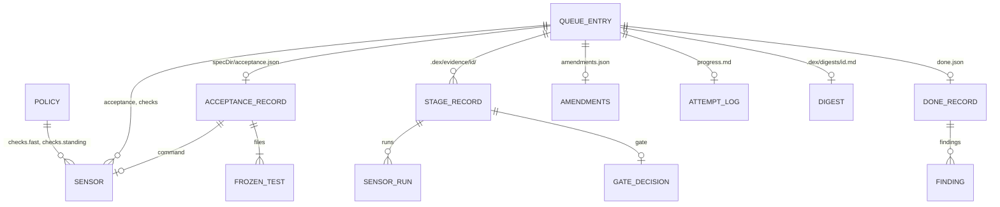

# Data Model: Grounded Loop (016)

**Feature**: [spec.md](spec.md) · **Research**: [research.md](research.md)

Every entity is a file or a value in memory. There is no database. "Tracked"
means committed in the project's git; every other file is local and ignored.

## Sensor

A command the project declares. Dex runs it (R1).

| Field | Type | Rule |
|---|---|---|
| `name` | string | non-empty; unique within its list |
| `command` | string | non-empty; run as `/bin/sh -c <command>` in the project folder |
| `timeoutSec` | integer | ≥ 1; default 600 for checks, 1800 for acceptance |

Sources, by kind:

| Kind | Declared in | Runs at |
|---|---|---|
| fast check | `policy.checks.fast`, plus the entry's queue `checks` | baseline before `implement` and `verify`; after every `implement` run |
| standing check | `policy.checks.standing` | baseline before `verify` |
| acceptance | the acceptance record's `command`, plus the entry's queue `acceptance` | red-first (record's command only); the start of `verify` |

## Sensor run

One run of one sensor. Kept inside a stage record.

| Field | Type | Rule |
|---|---|---|
| `name`, `command` | string | copied from the sensor |
| `exitCode` | integer or null | null when killed or never started |
| `signal` | string or null | set when Dex killed it |
| `durationMs` | integer | wall clock, first attempt |
| `result` | `pass` · `fail` · `timeout` · `error` · `flaky` | R2; `flaky` = `fail`, then `pass` on a re-run |
| `reruns` | integer | 0 … `checks.rerunOnFail` |
| `tail` | string[] | the last 200 output lines of the last attempt |

"Green" means `pass` or `flaky`.

## Acceptance record — `<specDir>/acceptance.json` (tracked)

Written by the `tests` agent, committed with the tests (R3). Contract:
[contracts/acceptance-json.md](contracts/acceptance-json.md).

| Field | Type | Rule |
|---|---|---|
| `version` | `1` | |
| `command` | string | non-empty; runs only this entry's acceptance tests |
| `failExitCodes` | integer[] | non-empty, no `0`; default `[1]` |
| `timeoutSec` | integer | ≥ 1; default 1800 |
| `files` | string[] | project-relative; each must exist and match `testGlobs`; at least one |
| `covers` | `{test, criterion}[]` | `criterion` is an id from `spec.md` (`SC-…`) or the brief's acceptance section |

The **frozen test set** is `files`. A content hash of this file keys the
red-first records (R4).

## Stage record — `.dex/evidence/<id>/<stage>-<n>.json` (local)

One per stage run of one entry, numbered per stage from 1 (`implement-3.json`).
Written by Dex only. Contract: [contracts/evidence.md](contracts/evidence.md).

| Field | Type | Rule |
|---|---|---|
| `version` | `1` | |
| `entryId`, `stage`, `n` | | `stage` is a queue stage, or `baseline`, or `red-first` |
| `mode` | string or null | `create` · `amend` (tests); `phase` · `restore` (implement); `diagnose` · `review` (verify) |
| `taskPhase` | integer or null | implement in `phase` mode |
| `key` | string or null | the 015 evidence key at the start |
| `tasksHash` | string or null | sha256 of `tasks.md` at the start |
| `startSha`, `endSha` | string or null | HEAD before and after |
| `treeStamp` | string | R6, after the stage |
| `runs` | Sensor run[] | in run order |
| `planDiff` | object or null | implement only: `newlyTicked`, `violations` (R8) |
| `testChanges` | object or null | implement only: `frozenChanged`, `testsDeletedOrRenamed`, `skipMarkers` |
| `fingerprint` | string or null | implement only (R11) |
| `gate` | Gate decision or null | |
| `acceptanceHash` | string or null | red-first only: sha256 of `acceptance.json` |
| `summary` | string or null | the agent's own summary, when the stage returned one; input to the attempt log, never to a gate |
| `at` | ISO-8601 | when Dex wrote it |

## Gate decision

Pure output of `gates.ts`. Stored in the stage record or the done record.

| Field | Type | Rule |
|---|---|---|
| `gate` | `red-first` · `baseline` · `progress` · `done` | |
| `outcome` | `pass` · `fail` · `pause` | `pause` stops the run with `pauseReason` |
| `pauseReason` | PauseReason or null | see § State changes |
| `reason` | string | one line for the trace and the digest |
| `next` | string or null | what the loop does next: `restore`, `retry-tests`, `fix-phase`, … |

Gate rules (FR-013, FR-018, FR-019, FR-024):

| Gate | `pass` when | otherwise |
|---|---|---|
| red-first | acceptance exit code ∈ `failExitCodes` | `0` → `pause` (`red_first_green`); crash → `fail`, `next: retry-tests` once, then `pause` (`no_progress`) |
| baseline | every fast check green (and every standing check before `verify`) | `fail`, `next: restore` |
| progress, `phase` mode | ≥ 1 newly ticked in-scope task, every fast check green, no plan or test violation | violation → `pause` (`plan_changed`, `frozen_changed` or `tests_changed`); else `fail` (no progress) |
| progress, `restore` mode | every check red at baseline is now green, no violation | as above |
| done | every acceptance run green, no `blocking` finding | `fail`, `next: fix-phase` |

## Done record — `.dex/evidence/<id>/done.json` (local)

Replaces 015's `verify.json` (R5). One per entry; the last verify replaces it.

| Field | Type | Rule |
|---|---|---|
| `version` | `2` | a `verify.json` v1 reads as absent |
| `entryId`, `key`, `tasksHash`, `checked` | | as in 015; key taken before the stage |
| `acceptance` | Sensor run[] | |
| `mode` | `diagnose` · `review` | |
| `findings` | Finding[] | empty in diagnose mode |
| `hypotheses` | string[] | diagnose mode |
| `summary` | string | the verifier's |
| `gate` | `passed` · `failed` | Dex's decision, never the agent's |

The picker counts the entry done when `gate` is `passed`, `key` equals the
entry's key now, and `tasksHash` equals the hash of `tasks.md` now.

## Finding

| Field | Type | Rule |
|---|---|---|
| `severity` | `blocking` · `minor` | |
| `summary` | string | non-empty |
| `criterion` | string or null | the success criterion it concerns |
| `where` | string or null | a file and line, or a page and step |

## Amendments — `.dex/evidence/<id>/amendments.json` (local)

| Field | Type | Rule |
|---|---|---|
| `items` | `{file, reason, status, askedAt, decidedAt}[]` | `status`: `approved` · `rejected` · `applied` |

The picker's amend row fires for the first `approved` item. The `tests` stage in
amend mode sets it to `applied`.

## Attempt log — `.dex/evidence/<id>/progress.md` (local)

Markdown, one `## <ISO> · <stage> [· phase N]` section per stage, newest last:
the agent's summary and notes, then each failing run's name and first error
line. The prompt gets the newest sections that fit in 8,000 characters (R14).
Moved to `archive/progress-<ISO>.md` when the done gate passes.

## Digest — `.dex/digests/<id>.md` (local)

One page, rewritten at every gate pause and when the entry is done (FR-037).
Sections, in order: status line (entry, stage, why it paused), diff stat per
repo, tasks done, checks and acceptance (flaky ones marked), verifier findings,
new skip markers, questions answered by default, cost. `.dex/digests/` carries
its own `.gitignore` (`*`).

## Stage scope (in memory)

Built per stage by `stageScope(policy, entry, stage, record, amendFile)` and passed
with the policy to `decideToolUse` (R9).

| Field | Type | Meaning |
|---|---|---|
| `writeOnly` | string[] or null | globs; a write tool outside them is denied |
| `protect` | string[] | project-relative paths; any edit, move or delete is denied |

## Policy — new fields (`.dex/policy.json`, tracked)

Contract: [contracts/policy-json.md](contracts/policy-json.md).

| Field | Type | Default |
|---|---|---|
| `checks.fast` | Sensor[] | `[]` |
| `checks.standing` | Sensor[] | `[]` |
| `checks.rerunOnFail` | integer ≥ 0 | `1` |
| `testGlobs` | string[] | R9's list |
| `testSupport` | string[] | R19's list |
| `verify.browser` | boolean | `false` |

## Queue entry — new fields (`.dex/queue.json`, tracked)

Contract: [contracts/queue-json.md](contracts/queue-json.md).

| Field | Type | Rule |
|---|---|---|
| `acceptance` | Sensor[] | optional; required when `skip` has `tests` |
| `checks` | Sensor[] | optional; extra fast checks for this entry |

## State changes (`.dex/state.json`)

No new field: fingerprints and flaky counts come from the stage records.
`PauseReason` gains five values:

| Value | Raised by |
|---|---|
| `red_first_green` | red-first: the tests pass before the feature exists |
| `plan_changed` | progress: a task was removed, added, reworded, renumbered or re-opened |
| `tests_changed` | progress: a file matching `testGlobs` was deleted or renamed |
| `stalled` | three equal implement fingerprints in a row |
| `flaky_check` | a check was flaky three times in one entry |

`counters[id].implementRunsWithoutProgress` now counts runs that did not pass
the progress gate.
