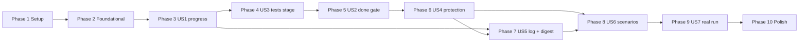

# Tasks: Grounded Loop — Tests and Checks Decide, Not the Agent

**Input**: Design documents from `specs/016-grounded-loop/` — [plan.md](plan.md), [spec.md](spec.md), [research.md](research.md) (R1–R21), [data-model.md](data-model.md), [contracts/](contracts/), [quickstart.md](quickstart.md)
**Prerequisites**: plan approved 2026-11-05 (R3, R19 and the dex-ecommerce target confirmed by the owner)

**Tests**: requested. The spec asks for table-driven gate tests (SC-001), every D-016-11 scenario under the mock (SC-002, FR-044) and a mock loop on dex-ecommerce (SC-003). Inside each story the test tasks come first and must fail before the implementation lands.

**Organization**: Setup is the brief's Phase 0 (confirm 015). Foundational holds what every story reads: the sensor runner, the tree stamp, stage records, the new policy and queue fields, the new pause reasons and events. Then one phase per user story. **US3 comes before US2**, the brief's order (tests stage, then verify): the done gate needs an acceptance sensor for every entry, and for a new project only the `tests` stage provides one. Then US4–US7 by priority, and a final Polish phase.

**Gate after every phase**: `npm test` (core, renderer, `check:size`) and `npm run typecheck` pass — never a bare `npx tsc --noEmit`. No file passes 600 lines.

## Format: `[ID] [P?] [Story] Description`

- **[P]**: can run in parallel (different files, no dependency on an unfinished task)
- **[Story]**: the user story the task serves (US1–US7, from spec.md)
- Paths are relative to the repository root. `$EX` = `$HOME/Projects/Github/lukaskellerstein/dex-ecommerce`. `dex` = `node dist/core/cli.js` after `npx tsc`.

---

## Phase 1: Setup — confirm 015 as built (brief Phase 0, FR-045)

**Purpose**: Measure before changing anything, so later findings and failures can be told apart from old ones.

- [X] T001 Run `npm install` if this worktree has no `node_modules/`, then `npm test` and `npm run typecheck` on the untouched tree; record pass or fail per suite in specs/016-grounded-loop/research.md under a new heading "Phase 0 measurements" (a failure found here is pre-existing, not 016's)
- [X] T002 [P] Record the per-tool finding counts of `nvim-tools --json --all` in specs/016-grounded-loop/research.md § Phase 0 measurements (the baseline the final check compares against)
- [X] T003 [P] Record the output of `bash scripts/loc-by-area.sh` in specs/016-grounded-loop/research.md § Phase 0 measurements (the size baseline for the PR's per-area delta)
- [X] T004 Confirm the 015 pieces 016 builds on: src/core/{queue,picker,policy,evidence,cli}.ts exist, and src/core/__tests__/{queue,picker,policy,evidence,cli,loop,existing-project,failure-policy}.test.ts pass; list them with their pass status in specs/016-grounded-loop/research.md § Phase 0 measurements (FR-045)
- [X] T005 Run the 015 mock loop on a scratch clone: `git clone --no-local "$EX" <scratch>/ex-0`, point its `origin` at a fresh `git init --bare <scratch>/ex-0.git`, `npx tsc`, `dex run <scratch>/ex-0 --agent mock`; record the stage sequence and exit code in specs/016-grounded-loop/research.md § Phase 0 measurements, plus what the clone's `main` holds (queue kind, entries, `.dex/mock-config.json` shape), so Phase 9 knows which fixture the 016 mock loop needs

**Checkpoint**: 015 confirmed green; baselines recorded.

---

## Phase 2: Foundational — sensors, stamps, records, configuration

**Purpose**: The pieces every story reads. No gate decides anything yet, and the loop behaves exactly as in 015.

**⚠️ CRITICAL**: No user-story work starts before this phase passes its gate.

### Tests first

- [X] T006 [P] Create src/core/__tests__/sensors.test.ts with real `sh` commands: `exit 0` → `pass`; `exit 3` → `fail` with `exitCode` 3; `exit 127` and a missing program → `error`; `sleep 30` with `timeoutSec: 1` → `timeout`, and a child started with `sh -c 'sleep 30 & wait'` is gone afterwards (process-group kill, R1); an aborted `AbortSignal` stops a run; 500 printed lines keep only the last 200 in `tail`; a command that fails once then passes (reading a counter file in the temp dir) with `rerunOnFail: 1` → `flaky`, `reruns: 1`; with `rerunOnFail: 0` → `fail`; every sensor in a list runs even after one fails (FR-017)
- [X] T007 [P] Create src/core/__tests__/tree-stamp.test.ts on a temp repo (src/core/__tests__/helpers/git.ts `mkTmpRepo`): the same tree gives the same `treeStamp`; editing a tracked file, adding an untracked file, or committing changes it; an ignored file does not; `diffHashSince(sha)` is equal for two runs that changed nothing and differs when a file changed (R6, R11)
- [X] T008 [P] Extend src/core/__tests__/evidence.test.ts: `writeStageRecord` numbers per stage (`implement-1.json`, `implement-2.json`, `baseline-1.json`), writes through `<file>.tmp` + rename, creates `.dex/evidence/.gitignore` (`*`) when absent; `readStageRecords(projectDir, id, stage?)` returns them oldest first and skips an unreadable file
- [X] T009 [P] Extend src/core/__tests__/policy.test.ts: defaults for `checks` (`{fast: [], standing: [], rerunOnFail: 1}`), `testGlobs`, `testSupport`, `verify` (`{browser: false}`) exactly as in specs/016-grounded-loop/contracts/policy-json.md; rejections for an unknown key under `checks` or `verify`, a duplicate check name, `timeoutSec` < 1, `rerunOnFail` > 5, an empty `testGlobs`
- [X] T010 [P] Extend src/core/__tests__/queue.test.ts: `tests` sits between `tasks` and `implement` in `STAGE_NAMES`; `skip: ["tests"]` and `gates: ["tests"]` validate; entry `acceptance` and `checks` validate per specs/016-grounded-loop/contracts/queue-json.md (shape, unique names, default `timeoutSec` 1800 and 600); a 015 queue without them is still valid
- [X] T011 [P] Create src/core/__tests__/acceptance.test.ts for the sensor merge: `fastChecksFor(policy, entry)` returns the policy's fast checks then the entry's `checks`; a name in both throws with the entry id; `acceptanceSensorsFor(entry, record)` returns the record's command (as `acceptance`) then the queue's `acceptance`; `validateEntrySensors(queue, policy)` reports every collision

### Implementation

- [X] T012 Create src/core/sensors.ts per research R1 and data-model § Sensor run: types `SensorSpec {name, command, timeoutSec}`, `SensorResult`, `SensorRun`; `runSensor(spec, {cwd, env, signal})` spawns `/bin/sh -c` with `detached: true`, kills the group with `SIGTERM` then `SIGKILL` after 5 s on timeout or abort, keeps a 200-line ring buffer, maps exit codes 126/127 and spawn errors to `error`; `runSensors(specs, {rerunOnFail, cwd, env, signal})` runs all in declared order and re-runs a `fail` up to `rerunOnFail` times (a later pass → `flaky`)
- [X] T013 [P] Create src/core/tree-stamp.ts: `treeStamp(projectDir)` = sha256 over `git rev-parse HEAD`, `git diff HEAD --binary`, and `git ls-files -o --exclude-standard -z` names with their `git hash-object` ids; `diffHashSince(projectDir, sha)` = sha256 over `git diff <sha> --binary` plus the same untracked part; `execFileSync`, no shell (R6)
- [X] T014 Extend src/core/evidence.ts with the stage record of specs/016-grounded-loop/contracts/evidence.md: `StageRecord` type, `writeStageRecord(projectDir, record)` (assigns `n`), `readStageRecords(projectDir, entryId, stage?)`; keep 015's `evidenceKey` and `tasksHash` unchanged
- [X] T015 Extend src/core/policy.ts: `Policy.checks`, `testGlobs`, `testSupport`, `verify` with the defaults and validation of specs/016-grounded-loop/contracts/policy-json.md; add them to `POLICY_FIELDS` and `DEFAULT_POLICY`; update src/core/queue-init.ts so `dex queue init` writes every new default spelled out, and its case in src/core/__tests__/queue-init.test.ts
- [X] T016 Extend src/core/queue.ts: add `"tests"` to `STAGE_NAMES` between `"tasks"` and `"implement"`; `QueueEntry` and `ResolvedEntry` gain `acceptance: SensorSpec[]` and `checks: SensorSpec[]` (resolved to `[]` when absent) with validation; add `tests` to `StepType` in src/core/types.ts and `tests: "entries"` to `PHASE_OF_STEP` in src/core/agent/MockConfig.ts
- [X] T017 Create src/core/acceptance.ts with `fastChecksFor`, `acceptanceSensorsFor(entry, record | null)` and `validateEntrySensors(queue, policy)` (T011); call `validateEntrySensors` where the queue and the policy are loaded together — `loadInput` in src/core/cli/describe.ts, the CLI's load in src/core/cli.ts (exit 2), and the run start in src/core/run-lifecycle.ts (refuse to start, naming the collision)
- [X] T018 [P] Add `red_first_green`, `plan_changed`, `tests_changed`, `stalled`, `flaky_check` to `PauseReason` in src/core/state.ts; find every exhaustive use of `PauseReason` (grep `pauseReason` and `PauseReason` in src/ and src/renderer/, for example a label map in src/renderer/components/loop/PauseCard.tsx) and add a label for each
- [X] T019 [P] Add the `sensor_run`, `gate_decided` and `digest_written` events of specs/016-grounded-loop/contracts/ipc-events.md to src/core/events.ts, and `"scope"` to the `policy_denied` event's `rule`; mirror them wherever the renderer duplicates the event union (check src/renderer/electron.d.ts)

**Checkpoint**: Foundation ready. The loop still behaves as in 015; `npm test` and `npm run typecheck` pass.

---

## Phase 3: User Story 1 — progress counts only when Dex's own checks agree (Priority: P1) 🎯 MVP

**Goal**: Dex runs the fast checks before and after every `implement` run, decides progress itself, turns a red baseline into a "restore green" run, re-runs flaky checks, and pauses a stalled entry.

**Independent Test**: Under the mock with fake checks: ticks while red → no progress and a restore run; fail-then-pass → `flaky`, not blocking; three equal fingerprints → pause `stalled` (spec US1).

### Tests for User Story 1

- [X] T020 [P] [US1] Create src/core/__tests__/gates.test.ts with table cases for `baseline` (all green → pass; one red → fail with `next: "restore"`; flaky counts as green; for `verify` the standing runs count too), `progress` in `phase` mode (new tick + green → pass; new tick + red → fail; no tick + green → fail; a violation → pause with its reason — `plan_changed`, `frozen_changed`, `tests_changed`), `progress` in `restore` mode (every check red at baseline now green → pass; one still red → fail), `fingerprint` (order of check names does not matter; a different first error line or diff hash changes it; flaky checks are left out), `stalled` (three equal → true; two → false; three with one different → false) and `flakyPause` (a check flaky 3 times in the entry's records → pause `flaky_check` naming it)
- [X] T021 [P] [US1] Create fixtures/mock/grounded/fake-check.mjs per specs/016-grounded-loop/contracts/mock-config.md § Fake sensors (reads `.dex/fake/<name>`, exits with its first line, drops it unless it is the last, a missing file means 0) and fixtures/mock/grounded/policy.json with fast checks `unit` and `lint` (`node .dex/fake/check.mjs <name>`) and `rerunOnFail: 1`
- [X] T022 [US1] Add `mkGroundedProject(scenario, opts)` to src/core/__tests__/helpers/loop.ts: `mkExistingProject` plus `.dex/fake/check.mjs` (copied from fixtures/mock/grounded/fake-check.mjs), `.dex/fake/.gitignore` (`*`), fixtures/mock/grounded/policy.json, the scenario's mock config, and initial `.dex/fake/<name>` sequences from `opts`
- [X] T023 [P] [US1] Create fixtures/mock/grounded/ticks-while-red.json, same-fingerprint.json and flaky-check.json per the table in specs/016-grounded-loop/contracts/mock-config.md (they use `implement.runs` and `implement.restore` from T030)
- [X] T024 [US1] Create src/core/__tests__/grounded-scenarios.test.ts with the three US1 scenarios: assert the `implement-<n>.json` and `baseline-<n>.json` records, the `gate_decided` events, that the restore prompt carries the failing check's name and tail, the `flaky` result, and the `stalled` pause with the evidence in its detail; also update src/core/__tests__/failure-policy.test.ts so "a run without progress" means "a run that failed the progress gate"

### Implementation for User Story 1

- [X] T025 [US1] Create src/core/gates.ts: the `GateDecision` type of data-model.md and pure `baseline`, `progress`, `fingerprint`, `stalled`, `flakyPause` — no `fs`, no git, no clock (T020 passes)
- [X] T026 [US1] Create src/core/entry-prompts.ts by moving `buildBriefPrompt`, `buildSpecifyPrompt`, `buildClarifyPrompt`, `buildPlanPrompt`, `buildTasksPrompt`, `buildImplementPrompt`, `buildVerifyPrompt`, `buildStagePrompt` and their private helpers out of src/core/prompts.ts (which keeps the project-level prompts and `stageEnv`); update the imports in src/core/stages/loop.ts, src/core/stages/cycle-stages.ts, src/core/cli/describe.ts and the tests — a pure move, all tests still green (R18)
- [X] T027 [US1] In src/core/entry-prompts.ts add `buildRestorePrompt(entry, projectDir, {failing})` ("the fast checks below are red; make them green; add no feature work; tick no task in tasks.md", then each failing check's name, command and tail) and an evidence section that `buildImplementPrompt` adds when the entry's last progress gate failed
- [X] T028 [US1] Create src/core/stages/gate-runs.ts: `baselineGate(ctx, entry, stage)` reuses the entry's last record when its `treeStamp` equals `treeStamp()` now (R6), else runs `fastChecksFor` (plus `policy.checks.standing` before `verify`) with `runSensors`, decides with `gates.baseline`, writes a `baseline` stage record, and emits `sensor_run` per run and `gate_decided`; `progressGate(ctx, entry, run)` runs the fast checks after an implement run, computes the newly ticked in-scope task ids from the `tasks.md` text before and after, the fingerprint (`diffHashSince(startSha)`), decides with `gates.progress` (violations empty until US4), writes the `implement` record and emits
- [X] T029 [US1] In src/core/stages/cycle-stages.ts give `runImplement` a `mode: "phase" | "restore"`: `restore` runs through `runStage` (step `implement`, no task phase) with `buildRestorePrompt`; both modes return `startSha`, the `tasks.md` text before and after, cost and `limitHit`; drop `checkedBefore`/`checkedAfter` from `ImplementResult` (the gate replaces them)
- [X] T030 [US1] Mock: add `implement.runs?: StepDescriptor[]` (the k-th implement run of an entry uses `runs[k-1]`, else the last; counted in memory per entry) and `implement.restore?: StepDescriptor` to src/core/agent/MockConfig.ts with validation and cases in src/core/agent/__tests__/MockConfig.test.ts; use them in src/core/agent/MockAgentRunner.ts (a restore run arrives through `runStep` with step `implement`); add both fields to specs/016-grounded-loop/contracts/mock-config.md
- [X] T031 [US1] In src/core/stages/post-stage.ts: `recordStage` takes `progressPassed: boolean | null` instead of `ImplementProgress` (a pass resets the counter); add `stallCheck(records)` (`stalled`) and `flakyCheck(records)` (`flaky_check`) guards built on src/core/gates.ts; the limit message reads "without passing the progress gate"
- [X] T032 [US1] Wire src/core/stages/loop.ts: before `implement`, `baselineGate`, and a red baseline dispatches a restore run; before `verify`, `baselineGate` with the standing checks, and a red one dispatches a restore run instead of the verifier (R7); after every implement run, `progressGate`, whose result goes to `recordStage`; in `decisionGuard`, `stallCheck` when the last stage in this process was an implement run, and `flakyCheck` after every gate (R11, R12); keep loop.ts under 600 lines by keeping the gate calls in stages/gate-runs.ts

**Checkpoint**: US1 complete. A mock run with red fake checks never counts ticked boxes as progress, and the 015 fixtures (no checks) behave as before.

---

## Phase 4: User Story 3 — acceptance tests are written first, by an agent that does not implement (Priority: P1)

**Goal**: A `tests` stage writes boundary acceptance tests and a tracked `acceptance.json` before the first `implement`, and Dex's red-first gate checks that they fail by an assertion.

**Independent Test**: Under the mock: an assertion failure passes red-first and the loop reaches `implement`; tests that already pass pause; a crash runs `tests` again once, then pauses; `skip: ["tests"]` without `acceptance` pauses (spec US3).

### Tests for User Story 3

- [X] T033 [P] [US3] Extend src/core/__tests__/acceptance.test.ts with `parseAcceptance` cases from specs/016-grounded-loop/contracts/acceptance-json.md: a valid record; each missing required field; `failExitCodes` containing 0; a listed file that is missing, or outside `testGlobs`; an unknown field; defaults for `failExitCodes` and `timeoutSec`
- [X] T034 [P] [US3] Extend src/core/__tests__/gates.test.ts with `redFirst`: exit code in `failExitCodes` → pass; exit 0 → pause `red_first_green`; another exit code, `timeout` or `error` → fail with `next: "retry-tests"`; a missing or invalid record → the same as a crash; the second crash in a row → pause `no_progress` (R20)
- [X] T035 [P] [US3] Extend src/core/__tests__/picker.test.ts with the rows of research R4: `acceptance.json` missing → `tests`; present and the last red-first record for its hash is a crash → `tests`; present and red-first passed → `implement`; `skip: ["tests"]` with queue `acceptance` → `implement`; `skip: ["tests"]` without it → pause `invalid_input`; `gates: ["tests"]` pauses after the stage; an invalid `acceptance.json` on a later read → pause `invalid_input`

### Implementation for User Story 3

- [X] T036 [US3] Add `parseAcceptance(raw, policy, projectDir)`, `AcceptanceInvalidError`, `readAcceptance(tree, entry)` (reads `<specDir>/acceptance.json` from the picker's tree) and `acceptanceHash(text)` to src/core/acceptance.ts; `acceptanceSensorsFor` now includes the record's command
- [X] T037 [US3] Add `redFirst(run, record, previousCrash)` to src/core/gates.ts (T034 passes)
- [X] T038 [US3] Add `buildTestsPrompt(entry, projectDir, {mode: "create", testGlobs, testSupport, lastCrash})` and `TESTS_SCHEMA` (`{summary}`) to src/core/entry-prompts.ts: write acceptance tests at the feature's boundary (CLI, HTTP API, the UI through Playwright, or the project's evidence tool) from the spec's success criteria, the brief's acceptance section and the plan's contracts; no unit tests of code that does not exist; set up the test runner if missing (the test-support files may be changed); write `<specDir>/acceptance.json` exactly per the contract, with a command that runs only this entry's tests and the exit codes that mean "tests ran and some failed"; commit as the project's rules say; the last crash's evidence when there is one
- [X] T039 [US3] Create src/core/stages/tests-stage.ts: `runTests(deps, entry, cycleNumber, {mode: "create"})` runs the stage through `runStage` with `TESTS_SCHEMA`, writes a `tests` stage record, then the red-first gate: `readAcceptance`, `runSensor` on its command, `gates.redFirst`, a `red-first` record with `acceptanceHash`, `gate_decided`; returns a `Guard` for a pause, else null
- [X] T040 [US3] Add the rows of research R4 to src/core/picker.ts between `tasks` and `implement` (the amend row comes in US4), reading `acceptance.json` from the entry's tree and the red-first records from the evidence
- [X] T041 [US3] Wire src/core/stages/loop.ts: dispatch `tests` to `runTests`, pause on its guard; in src/core/stages/post-stage.ts let `progressCheck` allow one `tests` → `tests` repeat after a red-first crash (the second pauses, via `gates.redFirst`)
- [X] T042 [US3] Mock: a `tests` stage descriptor runs through `runStep` in src/core/agent/MockAgentRunner.ts (its `writes` create the test files and `acceptance.json`); cases in src/core/agent/__tests__/MockConfig.test.ts
- [X] T043 [P] [US3] Create fixtures/mock/grounded/tests-already-pass.json, skip-tests-no-acceptance.json and happy-path.json per specs/016-grounded-loop/contracts/mock-config.md (happy path: `tests` writes `acceptance.json` with `node .dex/fake/check.mjs acceptance`, `.dex/fake/acceptance` starts at `1`, and the last implement run writes `0`)
- [X] T044 [US3] Bring the 015 fixtures onto the new stage, so every existing loop test still reaches done: give fixtures/mock/new-project.json, fixtures/mock/existing-project.json and fixtures/mock/verify-fails-once.json a `tests` descriptor that writes `acceptance.json` and a fake acceptance sequence (or, for an entry that starts at `implement`, `skip: ["tests"]` plus a queue `acceptance` in fixtures/existing-project/queue.json); make `mkLoopProject` and `mkExistingProject` in src/core/__tests__/helpers/loop.ts install `.dex/fake/`
- [X] T045 [US3] Add the US3 scenarios to src/core/__tests__/grounded-scenarios.test.ts: tests-already-pass → `red_first_green`; a crash → `tests` once more, then `no_progress`; skip-tests-no-acceptance → `invalid_input` before `implement`; happy path → `tests-1.json`, `red-first-1.json` with gate `pass`, then `implement`

**Checkpoint**: US1 + US3. Every entry gets an acceptance sensor before its first `implement`.

---

## Phase 5: User Story 2 — done only when Dex's acceptance run is green and no blocking issue is open (Priority: P1)

**Goal**: `verify` starts with Dex's own acceptance run; the verifier diagnoses (red) or reviews (green) and cannot pass an entry; `done.json` holds Dex's decision; a later commit re-verifies.

**Independent Test**: Under the mock: red acceptance with a scripted `passed` → not done, fix phase; green with a blocking finding → not done, fix phase; green with minor findings → done; a commit after done → `verify` again with a new acceptance run (spec US2).

### Tests for User Story 2

- [X] T046 [P] [US2] Extend src/core/__tests__/gates.test.ts with `done`: every acceptance run green and no blocking finding → pass; one red → fail with `next: "fix-phase"`; green + blocking → fail; green + minor only → pass; zero acceptance runs → fail ("no acceptance sensor"); the function takes no verdict, and a case documents that a verifier output of `passed` with red acceptance yields `fail` (SC-006, SC-007)
- [X] T047 [P] [US2] Extend src/core/__tests__/evidence.test.ts with `done.json` v2 write and read, and a 015 `verify.json` read as absent; extend src/core/__tests__/picker.test.ts: `gate: "passed"` with the same key and `tasksHash` → done; `gate: "failed"` → `verify`; a new commit or a changed `tasks.md` → `verify`; only a 015 `verify.json` → `verify`
- [X] T048 [P] [US2] Create src/core/__tests__/verify-stage.test.ts for the pure parts: `parseReview` and `parseDiagnose` accept the shapes of research R13 and return null for a malformed output; a `verdict` field in the output is ignored

### Implementation for User Story 2

- [X] T049 [US2] Add `done(acceptance, findings)` to src/core/gates.ts (T046 passes)
- [X] T050 [US2] Replace 015's verify record in src/core/evidence.ts with the done record of specs/016-grounded-loop/contracts/evidence.md (`DoneRecord`, `writeDoneRecord`, `readDoneRecord`; a `verify.json` reads as absent); remove `VERIFY_SCHEMA`, `VerifyVerdict`, `parseVerdict`, `readVerifyRecord` and `writeVerifyRecord`, and fix every caller (grep them: src/core/picker.ts, src/core/stages/cycle-stages.ts, src/core/agent/MockAgentRunner.ts, the tests)
- [X] T051 [US2] Rewrite `buildVerifyPrompt` in src/core/entry-prompts.ts for two modes (R13): `diagnose` gets Dex's acceptance tails and the diff stat, and appends `## Phase <N>: Verify fixes V<k>`; `review` checks the work against the spec and the brief and returns findings with `blocking` or `minor`, appending a fix phase for each blocking one; no verdict field; a browser instruction when `policy.verify.browser`; 015's round, next phase number and next task id stay
- [X] T052 [US2] Create src/core/stages/verify-stage.ts: move `runVerify` and `verifyFacts` from src/core/stages/cycle-stages.ts; take the 015 key before the stage; run `acceptanceSensorsFor` with `runSensors`; pick the mode; run the verifier with `REVIEW_SCHEMA` or `DIAGNOSE_SCHEMA` (defined and parsed here); write `done.json` from `gates.done` and a `verify` stage record; emit `gate_decided`; a stopped stage writes nothing
- [X] T053 [US2] Change the done row of src/core/picker.ts to read `readDoneRecord` (FR-007), with reasons that name what changed
- [X] T054 [US2] For `policy.verify.browser`, add a headless, isolated Playwright MCP server to the verify session's options in src/core/agent/claudeSession.ts (`npx -y @playwright/mcp@<exact version> --headless --isolated`, the version pinned in the code and recorded in specs/016-grounded-loop/research.md R13); a case in src/core/agent/__tests__/runner-options.test.ts that only `verify` with the flag gets it
- [X] T055 [US2] Mock: `verify` descriptors gain `findings` and `hypotheses` in src/core/agent/MockConfig.ts; src/core/agent/MockAgentRunner.ts returns the review shape or the diagnose shape by the prompt's mode, and appends `rounds[k].fixTasks` in diagnose mode or when it returns a blocking finding; `rounds[k].verdict` is still returned and ignored by the gate
- [X] T056 [P] [US2] Create fixtures/mock/grounded/verifier-passes-red.json and blocking-finding.json per specs/016-grounded-loop/contracts/mock-config.md
- [X] T057 [US2] Add the US2 scenarios to src/core/__tests__/grounded-scenarios.test.ts: verifier-passes-red → diagnose mode, fix phase, not done; blocking-finding → fix phase, not done; minor only → done with the findings in `done.json`; after done, a commit on the entry's branch → `verify` again and `verify-2.json` has a new acceptance run (SC-005); update src/core/__tests__/loop.test.ts and src/core/__tests__/existing-project.test.ts, which read `verify.json`

**Checkpoint**: US1 + US3 + US2. No entry is done on an agent's word.

---

## Phase 6: User Story 4 — the implementer cannot weaken the plan or the tests (Priority: P2)

**Goal**: Per-stage write scopes, a frozen test set per entry, a structural `tasks.md` check, test-file protection, skip-marker reporting, and test amendments that only the human approves.

**Independent Test**: Under the mock: an edit of a frozen test is denied with `policy_denied` (rule `scope`); a reworded task pauses; a deleted test file pauses; a skip marker is recorded and does not pause; an amendment question waits even in `recommended-then-review` (spec US4).

### Tests for User Story 4

- [X] T058 [P] [US4] Create src/core/__tests__/plan-diff.test.ts: `diffTasks(before, after)` allows `[ ]` → `[x]` and `[X]`, and reports a removed, added, reworded or reordered task, a re-opened task and a changed phase heading, each naming the task; prose and notes are ignored; `testFileChanges(nameStatus, testGlobs, frozen)` reports frozen files that changed and test files deleted or renamed from `git diff --name-status -M` output; `skipMarkers(addedLines)` finds `@pytest.mark.skip`, `pytest.skip(`, `@unittest.skip`, `.skip(`, `xit(`, `xdescribe(`, `it.todo(`, `test.fixme(`, `t.Skip(`
- [X] T059 [P] [US4] Extend src/core/__tests__/policy.test.ts with every row of specs/016-grounded-loop/contracts/policy-json.md § Table cases, plus `stageScope` for each stage of research R9, including amend mode
- [X] T060 [P] [US4] Extend src/core/__tests__/humanInput.test.ts: a question with header `Test amendment` gets the options `Approve amendment` and `Reject`, is never answered by default in `recommended-then-review`, and its answer is recorded in `amendments.json`; extend src/core/__tests__/evidence.test.ts for `recordAmendment`, `pendingAmendment` and `markAmendmentApplied`

### Implementation for User Story 4

- [X] T061 [US4] Create src/core/plan-diff.ts with the pure `diffTasks`, `testFileChanges` and `skipMarkers` (T058 passes)
- [X] T062 [US4] In src/core/policy.ts add `StageScope {writeOnly, protect}`, the optional `scope` argument of `decideToolUse` and its two checks (the frozen-path Bash verbs of the contract included), rule `"scope"` in `PolicyDecision`, and `stageScope(policy, entry, stage, record, amendFile)` (T059 passes)
- [X] T063 [US4] Carry the scope to the permission chain: `scope?: StageScope` on `StepContext` and `TaskPhaseContext` in src/core/agent/AgentRunner.ts; `SessionParams` and `permissionDeps` in src/core/agent/claudeSession.ts; `preToolUseDecision` and `makeCanUseTool` in src/core/agent/permissions.ts pass it to `decideToolUse`; src/core/stages/run-stage.ts forwards it; cases in src/core/agent/__tests__/claudeSession.test.ts
- [X] T064 [US4] Build and pass the scope for each stage in src/core/stages/cycle-stages.ts (implement), src/core/stages/tests-stage.ts (tests) and src/core/stages/verify-stage.ts (verify)
- [X] T065 [US4] In `progressGate` (src/core/stages/gate-runs.ts) feed `gates.progress` with `diffTasks` on the `tasks.md` text before and after, and `testFileChanges` and `skipMarkers` from `git diff --name-status -M <startSha>` and the added lines of `git diff <startSha>`; store them in the record's `planDiff` and `testChanges`; in src/core/stages/post-stage.ts, also run `frozenCheck` over the entry's frozen test set
- [X] T066 [US4] Change the implement prompt in src/core/entry-prompts.ts: drop "write the error under the task in tasks.md"; ask for failures and notes in the result's `notes`; add the amendment rule (ask with header `Test amendment`, name the test file and the reason; never edit a frozen test); add `ATTEMPT_SCHEMA` (`{summary, notes}`) and an `outputFormat`/`structuredOutput` pair to `TaskPhaseContext`/`TaskPhaseResult` in src/core/agent/AgentRunner.ts, src/core/agent/ClaudeAgentRunner.ts and src/core/agent/MockAgentRunner.ts
- [X] T067 [US4] Amendments: in src/core/humanInput.ts recognise a `Test amendment` question in `askQuestions` (fixed options, always wait, R10) so the Claude path (src/core/agent/permissions.ts) and the mock (`MockAgentRunner.ask`) share it; add `recordAmendment`, `pendingAmendment` and `markAmendmentApplied` to src/core/evidence.ts; the answer to the implementer says "approved; the test author will change it; go on with the other tasks" or the rejection
- [X] T068 [US4] Add the amend row to src/core/picker.ts (research R4: before the `tests` rows) and amend mode to src/core/stages/tests-stage.ts and `buildTestsPrompt` (only that file and the spec folder; no red-first; `markAmendmentApplied`)
- [X] T069 [US4] Mock: in src/core/agent/MockAgentRunner.ts send every write, append and the new `deletes` through `decideToolUse` with the context's scope; a denied one is skipped, logged and emitted as `policy_denied`; add `deletes` to src/core/agent/MockConfig.ts with validation and a case in src/core/agent/__tests__/MockConfig.test.ts
- [X] T070 [P] [US4] Create fixtures/mock/grounded/rewords-task.json, edits-frozen-test.json and test-amendment.json, and add test-amendment.json to the table in specs/016-grounded-loop/contracts/mock-config.md
- [X] T071 [US4] Add the US4 scenarios to src/core/__tests__/grounded-scenarios.test.ts: rewords-task → `plan_changed` naming the task; edits-frozen-test → `policy_denied` with rule `scope` and the file unchanged; a deleted test file → `tests_changed`; a new `.skip(` → in `testChanges.skipMarkers`, no pause; test-amendment → waits in `recommended-then-review`, approve → `tests` runs in amend mode, reject → the implementer gets the rejection

**Checkpoint**: US1–US4. Gates read a plan and tests the implementer could not change.

---

## Phase 7: User Story 5 — a one-page digest for the owner, an attempt log for the next agent (Priority: P2)

**Goal**: `progress.md` per entry, fed into the next prompt and archived when done; a digest at every gate pause and when done, shown in the app and printed by the CLI; gate cards in the trace.

**Independent Test**: Under the mock: a gate pause writes a digest with every section, the app shows it, and `dex run` prints its path; the second implement prompt contains the first run's attempt entry; done archives the log (spec US5).

### Tests for User Story 5

- [X] T072 [P] [US5] Create src/core/__tests__/attempt-log.test.ts: `appendAttempt` writes one section per stage in the format of specs/016-grounded-loop/contracts/evidence.md; `attemptSlice` returns the newest sections that fit in 8,000 characters, never a cut section; `archiveAttempts` moves the file to `archive/progress-<ISO>.md`
- [X] T073 [P] [US5] Create src/core/__tests__/digest.test.ts: `buildDigest` has every section of FR-037 in order, marks flaky checks, lists skip markers and default-answered questions, says "no fast checks ran" when the policy has none (FR-020), and gives a diff stat per repo for a policy with `repos`; `writeDigest` creates `.dex/digests/.gitignore` (`*`)
- [X] T074 [P] [US5] Extend src/core/__tests__/cli.test.ts for `dex digest <projectDir> <entryId>` (exists → stdout, exit 0; none yet → exit 1; unknown entry → exit 2) and the `digest: <path>` line `dex run` prints on a gate pause
- [X] T075 [P] [US5] Create src/renderer/components/agent-trace/__tests__/GateCard.test.tsx and src/renderer/components/queue/__tests__/DigestView.test.tsx; extend src/renderer/components/queue/__tests__/QueuePanel.test.tsx for the Digest button

### Implementation for User Story 5

- [X] T076 [US5] Create src/core/attempt-log.ts (`appendAttempt`, `attemptSlice`, `archiveAttempts`) (T072 passes)
- [X] T077 [US5] Create src/core/digest.ts (`buildDigest` from the stage records, `done.json`, the run state's review list and cost; the diff stat from the entry's first stage record's `startSha` to the working tree, per repo; `writeDigest`) (T073 passes)
- [X] T078 [US5] Feed the attempt log: after every per-entry stage, src/core/stages/gate-runs.ts appends the agent's summary and notes plus the failing runs' first lines; `buildImplementPrompt`, `buildRestorePrompt`, `buildTestsPrompt` and `buildVerifyPrompt` in src/core/entry-prompts.ts add an "Earlier attempts" section from `attemptSlice`; src/core/stages/verify-stage.ts archives the log when the done gate passes
- [X] T079 [US5] Write the digest in `pause()` of src/core/stages/loop.ts for every pause that has an entry, and in src/core/stages/verify-stage.ts when the done gate passes; emit `digest_written`
- [X] T080 [US5] CLI: a `digest` command in src/core/cli/args.ts and its handler in src/core/cli.ts per specs/016-grounded-loop/contracts/cli.md; src/core/cli/run.ts prints `digest: <path>` for the last `digest_written` before it exits
- [X] T081 [US5] IPC: `project:get-digest` in src/main/ipc/project.ts, `getDigest` in src/main/preload-modules/project-api.ts, and its type in src/renderer/electron.d.ts
- [X] T082 [US5] Renderer: create src/renderer/components/agent-trace/GateCard.tsx (gate, outcome, reason, each run's name, result and duration, tail folded), and render it from `sensor_run` and `gate_decided` in src/renderer/hooks/useLiveTrace.ts; create src/renderer/components/queue/DigestView.tsx; add the Digest button to src/renderer/components/queue/QueuePanel.tsx and the digest link to src/renderer/components/loop/PauseCard.tsx (CSS custom properties, Lucide icons, local state only)
- [ ] T083 [US5] Live check over CDP (quickstart § 6): start `dev-setup.sh` if it is down, open a dex-ecommerce scratch clone with the grounded mock fixture, and confirm with `mcp__electron-playwright__browser_snapshot` that the gate cards, the pause card's digest link and the digest view appear; check `browser_console_messages` for errors

**Checkpoint**: US1–US5. The owner can read what the loop made on one page.

---

## Phase 8: User Story 6 — every unhappy path can be rehearsed at zero cost (Priority: P2)

**Goal**: All of D-016-11 in one place, each ending as documented, at zero cost.

**Independent Test**: `src/core/__tests__/grounded-scenarios.test.ts` runs every fixture in fixtures/mock/grounded/ and checks the end in the table of specs/016-grounded-loop/contracts/mock-config.md (spec US6).

- [X] T084 [US6] In src/core/__tests__/grounded-scenarios.test.ts make one named test per row of the FR-044 table plus happy-path and test-amendment, driven from one table that names the fixture and the expected end; each also asserts `cumulativeCostUsd` is 0 in `.dex/state.json`
- [X] T085 [P] [US6] Create fixtures/mock/grounded/README.md: one line per fixture with its scenario and expected end (the same table as the contract), and how to copy the set into a dex-ecommerce clone (quickstart § 2)

**Checkpoint**: SC-002 met: every scenario ends as documented.

---

## Phase 9: User Story 7 — the first real grounded run, on a dex-ecommerce scratch clone (Priority: P3)

**Goal**: The dry run shows every sensor; the owner signs off; one real entry fails at red-first and passes at done.

**Independent Test**: On the clone: the dry run lists the checks and acceptance commands and runs nothing; one real entry's evidence shows the same tests red at red-first and green at done (spec US7).

- [X] T086 [US7] Add the Sensors section of specs/016-grounded-loop/contracts/cli.md to each open entry's block in src/core/cli/describe.ts (fast, entry checks, standing, acceptance from the record or the queue, or "none — the entry will pause before implement"); cases in src/core/__tests__/cli.test.ts that the dry run runs no sensor and writes no file
- [X] T087 [US7] Mock loop on dex-ecommerce (SC-003): make a scratch clone of `$EX` with `origin` on a scratch bare repo, install fixtures/mock/grounded/ into it as quickstart § 2 says (using the fixture T005 found the clone needs: a new-project run after `initial` with a `GOAL.md`, or the existing-project queue), run `dex run <clone> --agent mock`, and check every entry has `tests-1.json`, a passing `red-first-1.json`, `done.json` with `gate: "passed"`, a digest, and an empty `git status`; record the result in specs/016-grounded-loop/research.md under a new heading "Phase 9 — first real run"; fix quickstart § 2 if the commands differ
- [X] T088 [US7] Configure the real sensors in the scratch clone's `.dex/policy.json`: fast checks and the standing suite from the clone's own scripts (read its `package.json`; if the clone has no code or test scripts yet, record that and let the first entry's `tests` stage set up the runner, R19); `verify.browser: true` against the local dev server; record the policy in specs/016-grounded-loop/research.md § Phase 9
- [ ] T089 [US7] Run `dex run <clone> --dry-run`, paste its output into specs/016-grounded-loop/research.md § Phase 9, and **ask the owner to sign off** before any real stage (SC-009)
- [ ] T090 [US7] **Ask the owner first (costs money).** Set the clone's `.dex/dex-config.json` to `{"agent": "claude"}`; run the next open entry (from `003-promo-codes` on) with `dex run <clone> --once` (the `tests` stage and red-first), then `dex run <clone>` to done, with the owner watching; record cost, the red-first and done evidence (`jq` lines of quickstart § 4) and anything odd in specs/016-grounded-loop/research.md § Phase 9 (SC-004)
- [ ] T091 [US7] **Ask the owner** whether to run the rest of the clone's queue; if yes, run it and record each entry's outcome and cost in specs/016-grounded-loop/research.md § Phase 9

**Checkpoint**: SC-004 and SC-009 met on the clone.

---

## Phase 10: Polish & cross-cutting concerns

- [X] T092 SC-006 audit: run the grep of quickstart § 5 over src/core and record every hit with why it cannot pass a gate in specs/016-grounded-loop/research.md under a new heading "Final checks"
- [X] T093 [P] Update .claude/rules/06-testing.md § 4f.3: rows for `.dex/evidence/<id>/<stage>-<n>.json`, `done.json` (replacing `verify.json`), `amendments.json`, `progress.md`, `.dex/digests/<id>.md` and `<specDir>/acceptance.json`; in § 4c note the grounded mock fixtures and `.dex/fake/`
- [X] T094 [P] Bring specs/016-grounded-loop/quickstart.md and specs/016-grounded-loop/contracts/ in line with what was built (commands, field names, fixture list)
- [ ] T095 Run `nvim-tools --json --all` and compare with the T002 baseline: no new findings (or each one fixed); record the result in specs/016-grounded-loop/research.md § Final checks
- [X] T096 Run `bash scripts/loc-by-area.sh` and record the per-area delta against T003 in specs/016-grounded-loop/research.md § Final checks (for the PR description)
- [X] T097 Final gate: `npm test` and `npm run typecheck` pass; a last mock loop on a fresh dex-ecommerce scratch clone (quickstart § 2) reaches done for every entry with a clean `git status`
- [X] T098 Set the Status line of specs/016-grounded-loop/spec.md and add an "Outcomes (as built)" table, one row per success criterion with its evidence (the 015 spec's format)

---

## Dependencies & Execution Order

### Phase dependencies



- **US1 → US3**: the red-first and tests stage reuse the sensor wiring of `stages/gate-runs.ts`.
- **US3 → US2**: the done gate fails with zero acceptance sensors, and only the `tests` stage gives a new project's entries one; T044 moves the 015 fixtures onto the new stage first.
- **US2 → US4**: the verify scope (`tasks.md` only) is built in US4 over `stages/verify-stage.ts` from US2.
- **US4 → US5**: the attempt log reads the `notes` that T066 adds to the implement output.
- **US7** needs everything; T090 and T091 also need the owner.

### Within each phase

- Test tasks first; they fail before the implementation lands.
- Pure modules (`gates.ts`, `plan-diff.ts`, the scope in `policy.ts`) before the wiring (`stages/*`).
- `src/core/__tests__/grounded-scenarios.test.ts` grows in every story phase, so its tasks never run in parallel with each other.

## Parallel opportunities

- **Phase 2**: T006–T011 (six test files) together; then T013, T018, T019 next to T012.
- **US1**: T020, T021, T023 together; T026 (the prompt move) next to T025.
- **US3**: T033, T034, T035 together; T043 next to T036–T042.
- **US2**: T046, T047, T048 together; T056 next to the implementation.
- **US4**: T058, T059, T060 together; T070 next to T061–T069.
- **US5**: T072–T075 together; T081 and T082 (main and renderer) next to T076–T080.

### Example: the US4 test tasks at once

```text
Task: "Create src/core/__tests__/plan-diff.test.ts …"                    (T058)
Task: "Extend src/core/__tests__/policy.test.ts with the scope table …"  (T059)
Task: "Extend src/core/__tests__/humanInput.test.ts for amendments …"    (T060)
```

## Implementation strategy

### MVP — US1 only

Phases 1–3. Dex already stops counting ticked boxes with red checks, restores green before new work, and stops a stalled entry. That alone closes the "ticks with a broken build" hole, on any project that declares `checks.fast`.

### Incremental delivery

1. US1 → progress is grounded (MVP).
2. US3 → every entry gets an oracle written before the code.
3. US2 → done is grounded; the agent's verdict is gone.
4. US4 → the plan and the tests are protected.
5. US5 → the owner gets the digest; the next agent gets the attempt log.
6. US6 → every unhappy path is one test.
7. US7 → the first real grounded run on the dex-ecommerce clone, with the owner.

Each step ends with `npm test` and `npm run typecheck` green and the mock loop finishing.
